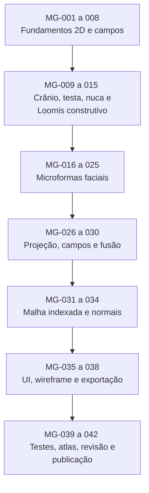

# Cabeça V3 — reconstrução por microgeometria 2D e malha anatômica 3D
**Data:** 10/11/2026 · **Estado:** motor V3 implementado experimentalmente, com regressões geométricas locais; aprovação estética/anatômica por referência ainda obrigatória.

## Objetivo e diferença para V1/V2
A V3 é um motor novo, não uma esfera deformada. Ela parte de seções 2D sagitais/transversais definidas com interpolação cúbica, aplica mais de 2 mil pequenas elipses 2D (órbitas, testa, nariz, zigomas, maxila, lábios, mandíbula, temporais, nuca etc.) como campos de relevo e funde esses campos em uma **superfície paramétrica 3D única**. As elipses são controles temporários de escultura, não sólidos visíveis no resultado. V1/V2 continuam no seletor.

## Estrutura
- `src/engine/head-v3/anatomy.js`: seções anatômicas por splines C1 (não elipsoide global).
- `src/engine/head-v3/microfields.js`: microformas 2D determinísticas, espalhamento gaussiano nos atlas (frontal, posterior e lateral), cache com parâmetros.
- `src/engine/head-v3/index.js`: fusão de atlas, pontos da cabeça, grade malhada, orelhas, rig simplificado mandibular, iso-curvas e diagnóstico.
- `src/engine/head-v3/mesh-export.js`: triangulação indexada, fechamento de polos, normais, inspeção de bordas e exportação OBJ.
- `src/engine/cabeca.js`: nova rota `v3_microgeometry`.
- `src/engine/montagem.js`: invalidação de cache dos controles V3.
- `src/engine/desenho.js`: wireframe técnico e guias V3 separados da esfera-guia V1/V2.
- `src/ui/controles.js`, `src/scene/parametros.js`: seletor e controles da densidade/intensidade.
- `src/ui/exportar.js`, `index.html`: botão para exportar a cabeça V3 em OBJ após checagem de malha.
- `testes/cabeca-v3-microgeometria.mjs`: testes integrados para dez biotipos, três LOD, simetria, anatomia básica, malha fechada, mandíbula e compatibilidade V1/V2.
- `testes/atlas-cabeca-v3.mjs`: nove ângulos reais × sexo, criados pelo rasterizador SVG do aplicativo.

## DAG executável de 42 tarefas



### Fase A — fundação (MG-001–008)
MG-001 versão nova sem modificar V1/V2; MG-002 coordenadas X/Y/Z; MG-003 landmarks paramétricos; MG-004 atlas 2D; MG-005 biblioteca de microelipses; MG-006 splines e seções cúbicas; MG-007 campos de influência; MG-008 densidade ajustável.

### Fase B — neurocrânio (MG-009–015)
MG-009 construir seções craniais explícitas; MG-010 topo parietal; MG-011 plano temporoparietal Loomis como referência construtiva; MG-012 testa de perfil tangente; MG-013 arco occipital no perfil; MG-014 transição para a nuca; MG-015 perfil e largura por seção.

### Fase C — face anatômica (MG-016–025)
MG-016 órbitas em baixo-relevo; MG-017 arcos supraorbitais; MG-018 raiz/dorso/ponta do nariz; MG-019 zigomas; MG-020 maxila; MG-021 lábios; MG-022 corpo mandibular; MG-023 mento e ângulo; MG-024 orelhas; MG-025 continuidade cervical.

### Fase D — reconciliação e malha (MG-026–034)
MG-026 coordenadas 3D dos campos 2D; MG-027 parametrização comum de seções; MG-028 composição de campos frontais/posteriores/laterais; MG-029 fusão contínua; MG-030 interpolação contínua; MG-031 malha indexada fechada; MG-032 triangulação por LOD; MG-033 organização topológica; MG-034 normais por triângulos.

### Fase E — produto (MG-035–038)
MG-035 guias de microformas no modo construção; MG-036 malha sem guias no modo manequim; MG-037 controles; MG-038 exportação SVG existente e OBJ fechado novo.

### Fase F — validação (MG-039–042)
MG-039 rodar regressões de 10 biotipos × 3 LOD e topologia; MG-040 gerar atlas em nove vistas para masculino/feminino; MG-041 comparar esteticamente com referências fornecidas e iterar; MG-042 integrar e publicar após critérios.

## Portões obrigatórios para considerar concluído
- **Verificado localmente no núcleo isolado:** 10 biotipos × 3 LOD, 30 malhas, simetria e NaN = 0. Exemplo médio LOD1: 18.354 vértices, 36.704 triângulos, zero bordas e arestas não-manifold no fechamento.
- **A confirmar no CI integrado:** importações reais, regressões V1/V2, comandos de exportação, build e renderizador SVG com 18 vistas.
- **Revisão estética ainda necessária:** correspondência com a referência frontal/perfil/3/4, anatomia detalhada, contornos da mandíbula, nuca e globo ocular. Ser manifold não prova fidelidade humana nem elimina autointerseções geométricas.
- **Limite atual:** campo facial e deformação mandibular são simplificados. Ainda não há solver de otimização contra digitalizações 3D ou controle automático de erro anatômico validado por dataset. A parametrização por malha tubular gera topologia fechada via calotas, mas não equivale a retopologia profissional de animação.

## Comandos
```bash
cd geomannequin
npm run testar:cabeca-v3
npm run construir
node testes/atlas-cabeca-v3.mjs masculino medio
node testes/atlas-cabeca-v3.mjs feminino medio
```

No aplicativo: **Geometria da cabeça → Cabeça V3 — microgeometria anatômica**; ajuste **densidade** e **intensidade** nos sliders. Exporte um OBJ pelo botão **Cabeça V3 (.obj)**.
