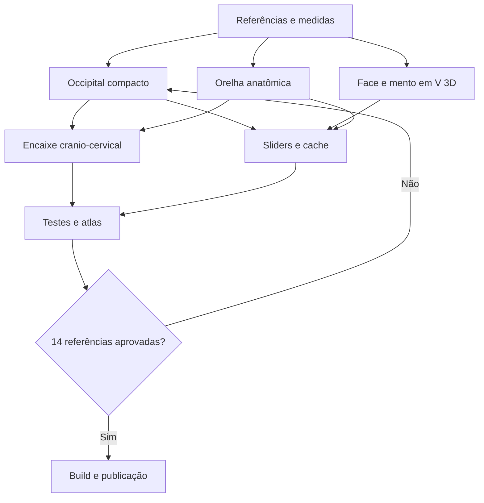

# TASK GRAPH — Cabeça V4.1: occipital compacto, face em V 3D, orelhas reconstituídas

**Data:** 10/11/2026. **Modelo:** `v4_anatomical`, exibido no seletor como **V4.1**. V1–V3 permanecem separados.

## DAG de dependências



## Tarefas, dependências e critérios

**Feito** = código escrito e parcialmente verificado; **pendente** = exige validação, ajuste ou publicação. Não equiparar integridade da malha à fidelidade das referências.


### A — Referências e medição

| ID | Estado | Dependência | Entrega | Arquivo/função |
|---|---|---|---|---|
| A01 | feito | — | Classificar as 14 referências por vistas, anatomia e estilo | `docs/head-v4-reference-analysis.md` |
| A02 | feito | A01 | Medir diferenças entre perfil posterior V4 e referências | `head-v4/anatomy.js` |
| A03 | feito | A01 | Identificar largura excessiva da mandíbula inferior | `head-v4/anatomy.js` |
| A04 | feito | A01 | Auditar forma e altura da aurícula V4 | `head-v4/index.js` |
| A05 | pendente | A02-A04 | Gerar máscaras de silhueta das 14 referências | `testes/saida/` |
| A06 | pendente | A05 | Calibrar projeção e escala dos pares de referência | `docs/head-v4-1-qa.md` |

### B — Cráneo e occipital

| ID | Estado | Dependência | Entrega | Arquivo/função |
|---|---|---|---|---|
| B01 | feito | A02 | Separar posterior do frontal no perfil sagital | `sectionV4()` |
| B02 | feito | B01 | Reduzir profundidade posterior em janela suave | `posteriorReductionV41()` |
| B03 | feito | B02 | Permitir compactação craniana independente | `v41CranialCompactness` |
| B04 | feito | B02 | Controlar curvature da nuca inferior | `v41PosteriorArcTightness` |
| B05 | feito | B02 | Preservar testa/órbita/nariz sem recuar em Z | `testes/cabeca-v4-1-anatomia.mjs` |
| B06 | feito | B02-B05 | Evitar afunilamento temporal ou orelha flutuante | `head-v4/anatomy.js` |
| B07 | pendente | B06,A05 | Comparar silhuetas frontal, perfil e traseira por imagem | `docs/head-v4-1-qa.md` |

### C — Face em V 3D e queixo

| ID | Estado | Dependência | Entrega | Arquivo/função |
|---|---|---|---|---|
| C01 | feito | A03 | Iniciar convergência após órbitas, preservando zigomas | `mandibleTaperV41()` |
| C02 | feito | C01 | Afilar gradualmente maxila, gônio e mandíbula | `sectionV4()` |
| C03 | feito | C02 | Criar cunha 3D com largura do mento positiva | `v41ChinPointedness` |
| C04 | feito | C02 | Separar afinamento mandibular da convergência facial | `v41ChinTaper` |
| C05 | feito | C02 | Recuar planos laterais em Z além da largura em X | `pointV4()` |
| C06 | feito | C05 | Criar linhas anatômicas V e mento na superfície 3D | `anatomicalCurvesV4()` |
| C07 | feito | C06 | Aplicar ao renderizador apenas na V4 | `engine/desenho.js` |
| C08 | feito | C03-C07 | Medir V e simetria para 10 biotipos | `testes/cabeca-v4-1-anatomia.mjs` |
| C09 | pendente | C08,A05 | Comparar 3/4, vista baixa e mento com referências | `docs/head-v4-1-qa.md` |

### D — Orelha anatômica

| ID | Estado | Dependência | Entrega | Arquivo/função |
|---|---|---|---|---|
| D01 | feito | A04 | Separar orelha V4.1 em módulo próprio | `head-v4/ear-anatomy.js` |
| D02 | feito | D01 | Posicionar entre brow ridge e base nasal | `earMetricsV41()` |
| D03 | feito | D02 | Aderir à seção temporal da cabeça | `earPointV41()` |
| D04 | feito | D03 | Modelar hélice, escafa e anti-hélice | `earPointV41()` |
| D05 | feito | D04 | Modelar concha, trago e antitrago | `earPointV41()` |
| D06 | feito | D05 | Modelar lóbulo e cruz superior | `earPointV41()` |
| D07 | feito | D02-D06 | Parametrizar inclinação, posição e relevo | `v41EarTilt/Setback/Relief` |
| D08 | feito | D07 | Construir aurícula radial com maior resolução | `buildEarV41()` |
| D09 | feito | D08 | Projetar seis traçados de cartilagem | `earCurvesV41()` |
| D10 | feito | D09 | Desenhar anatomia 3D ao invés de curvas genéricas | `engine/desenho.js` |
| D11 | pendente | D10,A05 | Inspecionar sobreposição e oclusão em todos os ângulos | `docs/head-v4-1-qa.md` |

### E — Pescoço e mastoide

| ID | Estado | Dependência | Entrega | Arquivo/função |
|---|---|---|---|---|
| E01 | feito | B04 | Preservar pescoço estreito V3/V4 | `engine/corpo.js` |
| E02 | feito | D03 | Reancorar ECM através da nova earPointV4 | `engine/desenho.js` |
| E03 | feito | E01-E02 | Testar topo do pescoço oculto sob occipital | `testes/cabeca-v4-1-anatomia.mjs` |
| E04 | pendente | E03,A05 | Inspecionar nuca em 3/4 traseiro e pitch | `atlas-cabeca-v4.mjs` |
| E05 | pendente | E04 | Corrigir costura se ainda houver degrau | `head-v4/neck-system.js` |
| E06 | pendente | E04 | Testar flexão/extensão cervical e rotação extrema | `testes/cabeca-v4-poses.mjs` |

### F — Interface, cache e compatibilidade

| ID | Estado | Dependência | Entrega | Arquivo/função |
|---|---|---|---|---|
| F01 | feito | B03,C03,D07 | Adicionar nove sliders V4.1 | `scene/parametros.js` |
| F02 | feito | F01 | Persistir defaults e permitir JSON | `engine/padroes.js` |
| F03 | feito | F01 | Invalidar cache de cabeça/orelha por slider | `engine/montagem.js` |
| F04 | feito | F01 | Preservar modelo e motor V1–V3 | `engine/cabeca.js` |
| F05 | feito | F02 | Atualizar seletor V4.1, sem duplicar opção | `index.html/ui/controles.js` |
| F06 | feito | F05 | Atualizar referência JS para evitar cache | `index.html` |
| F07 | pendente | F06 | Confirmar reload de cenas e editor | `scene/estado.js` |
| F08 | pendente | F07 | Recompilar HTML único e testar | `npm run construir` |

### G — Testes, atlas e aprovação

| ID | Estado | Dependência | Entrega | Arquivo/função |
|---|---|---|---|---|
| G01 | feito | B05,C08,D10 | Testar occipital, V 3D e orelhas em 10 biotipos | `cabeca-v4-1-anatomia.mjs` |
| G02 | feito | G01 | Testar três LOD, simetria e OBJ manifold | `cabeca-v4-1-anatomia.mjs` |
| G03 | feito | G02 | Registrar teste na suíte completa | `package.json` |
| G04 | feito | G03 | Criar atlas V4/V4.1 com câmeras fixas | `atlas-cabeca-v4-1-comparar.mjs` |
| G05 | pendente | G04 | Gerar e conferir folha 3x3 de V4.1 | `atlas-cabeca-v4.mjs` |
| G06 | pendente | G05,A05 | Comparar com as 14 imagens e ajustar arte | `docs/head-v4-1-qa.md` |
| G07 | pendente | G03-G06 | Passar suíte Node, V3 legada, build e CI | `GitHub Actions` |
| G08 | pendente | G07 | Confirmar renderização em GitHub Pages | `Pages` |

## Fórmulas e faixas

```text
v=(1-y)/(1-chinY)
B41(v)=B4(v)*(1 - posteriorReductionV41(v))  [somente seção posterior negativa]
W41(v)=W4(v)*mandibleTaperV41(v)
Z41(v,theta)=Z4(v,theta) - .063*convergence*faceRamp*sidePlane
                    + .022*pointedness*chinRamp*(1-sidePlane)
```

Janela posterior suave impede corte reto na nuca; três fatores independentes de convergência afinam o mento sem chegar a largura zero. A projeção V modifica tanto **X** quanto **Z**, não apenas o desenho frontal.

### Valores padrão

| Controle | Padrão | Faixa |
|---|---:|---:|
| `v41OccipitalReduction` | 0.82 | 0–1 |
| `v41CranialCompactness` | 0.28 | 0–1 |
| `v41PosteriorArcTightness` | 0.55 | 0–1 |
| `v41MandibleConvergence` | 0.85 | 0–1 |
| `v41ChinTaper` | 0.82 | 0–1 |
| `v41ChinPointedness` | 0.80 | 0–1 |
| `v41EarSetback` | 0.015 | -0.20 a 0.20 |
| `v41EarRelief` | 1 | 0.4–1.7 |
| `v41EarTilt` | -6° | -25° a 25° |

## Comandos de regressão

```bash
cd geomannequin
npm run testar:cabeca-v4-1
npm run testar:cabeca-v4
npm run testar:cabeca-v3
npm run construir
npm run comparar:cabeca-v4-1
npm run atlas:cabeca-v4-1 -- masculino medio
npm run atlas:cabeca-v4-1 -- feminino medio
```

## Portões de aprovação visual

1. Perfil: occipital visivelmente mais curto; curvatura sem degrau; orelha integrada ao temporal.
2. Frontal: V começa nos zigomas, desce pelo gônio e termina em queixo quase pontudo, sem virar triângulo plano.
3. Três quartos: a superfície mandibular recua em profundidade, com plano malar e maxila distintos.
4. Posterior: nuca e mastoide conectados; orelhas simétricas.
5. Inferior: nariz, plano submentoniano e orelhas legíveis.
6. Zoom e yaw/pitch/roll: a mesma malha deve funcionar nos ângulos extremos.
7. V1–V3, serialização, exportação OBJ, câmera e renderizador não podem regredir.

**Limite da entrega inicial:** a matemática foi testada isoladamente para 10 biotipos e 30 malhas (779.520 vértices), sem falhas geométricas detectadas. A inspeção dos SVGs contra os anexos, a execução total do GitHub Actions e a publicação continuam sendo portões separados. A aurícula continua uma malha separada sobreposta à cabeça e a união cranio-cervical não é uma fusão manifold integral.
