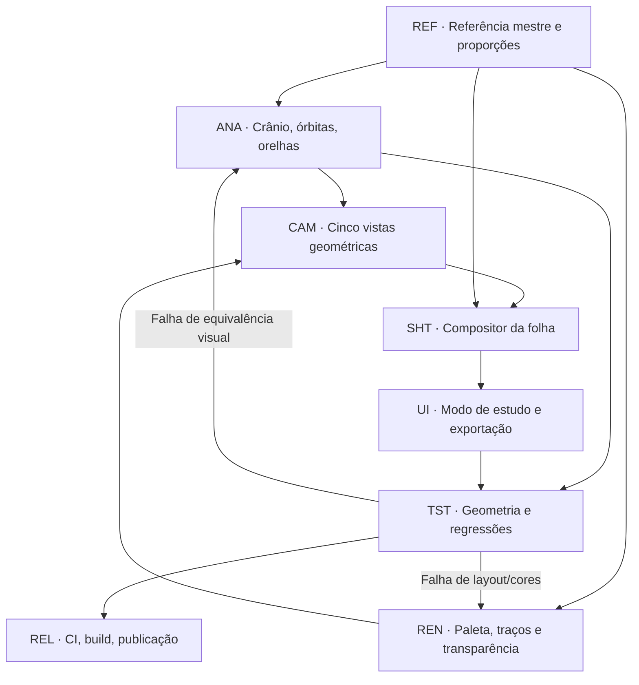

# TASK GRAPH EXECUTÁVEL — GeoMannequin Cabeça V4.2 / Refined Study Sheet

**Data:** 10/11/2026 · **Referência visual:** imagem aprovada pelo usuário nesta conversa, 1448×1086, com perfil principal rosa translúcido, vistas 3/4 e frontal, três close-ups, medições, notas e mini sequência. **Compositor implementado:** 1400×1050, 4:3.

O objetivo é abrir `?study=v42` e ver uma folha gerada pela **malha real**. Não embutir a imagem aprovada como falso resultado; qualquer aproximação estética depende de calibração geométrica e render real.

**Códigos de estado:** `feito` = implementado e/ou checado estruturalmente; `parcial` = tem código/teste, sem verificação completa; `pendente` = ainda falta execução, inspeção ou correção. Nenhum teste isolado certifica identidade pixel a pixel.

## Grafo de dependências



## Critérios anatômicos para aprovação

- Crânio posterior **compacto e suavemente arredondado** do parietal à nuca, sem degrau.
- Cavidade orbital ligeiramente côncava no volume real; sobrancelha e aro inferior presentes.
- Orelhas posicionadas entre arco superciliar e base nasal, com hélice, anti-hélice, concha e lóbulo visíveis.
- Face inferior em V **tridimensional**, mento quase pontudo com largura positiva, maxila e boca sem bico.
- Pescoço estreito conectado sob o occipital em perfil, frontal e vistas posteriores.

## Tokens visuais da imagem

```text
canvas: 1400×1050; referência aprovada: 1448×1086
paper #FAFBFD          grid #E6ECF3
main ink #81465D       face fill #F4DBE8
shade 1 #EDC8D8       shade 2 #DCA5BA
wireframe #E6A4B8     guide blue #B3C9DD
```

## Coordenadas principais (SVG)

| Bloco | x | y | largura | altura | função |
|---|---:|---:|---:|---:|---|
| Perfil principal | 100 | 83 | 590 | 718 | visual principal |
| Três quartos | 704 | 80 | 344 | 397 | volume lateral |
| Frontal | 1064 | 79 | 309 | 398 | proporções |
| Zoom occipital | 715 | 582 | 187 | 174 | nuca |
| Zoom orelha | 936 | 582 | 187 | 174 | cartilagens |
| Zoom órbita | 1156 | 582 | 187 | 174 | cavidade ocular |
| Notas | 31 | 876 | 450 | 162 | checklist |
| Sequência | 500 | 883 | 804 | 128 | progressão visual |

## Tarefas por subsistema


### REF — Imagem-mestre e especificação

| ID | Status | Dependências | Tarefa | Implementação/artefato |
|---|---|---|---|---|
| REF01 | feito | — | Catalogar imagem aprovada como referência visual mestre | `conversa / 1448×1086` |
| REF02 | feito | REF01 | Separar geometria da composição da folha | `estudo V4.2` |
| REF03 | feito | REF01 | Medir proporções relativas dos 9 blocos principais | `study-sheet.js` |
| REF04 | feito | REF01 | Extrair amostras de preenchimento, papel e contraste | `STUDY_TOKENS` |
| REF05 | feito | REF03 | Definir coordenadas da folha final em 1400×1050 (4:3) | `STUDY_SIZE` |
| REF06 | feito | REF01 | Registrar marcos de olho, orelha, nariz, nuca e mento | `docs/head-v4-2-target.md` |
| REF07 | pendente | REF01 | Gerar máscaras de segmentação da referência por painel | `teste de similaridade` |
| REF08 | pendente | REF07 | Criar dataset versionado com imagens autorizadas para a comparação | `assets/references` |

### ANA — Geometria 3D V4.2

| ID | Status | Dependências | Tarefa | Implementação/artefato |
|---|---|---|---|---|
| ANA01 | feito | REF02 | Preservar V4.1 e editar somente o ramo v4_anatomical | `head-v4/*` |
| ANA02 | feito | ANA01 | Suavizar janela de redução occipital da calota superior | `anatomy.js` |
| ANA03 | feito | ANA02 | Adicionar arredondamento contínuo na base occipital/nuca | `v42NapeRoundness` |
| ANA04 | feito | ANA01 | Preservar V da mandíbula e mento quase pontudo tridimensional | `sectionV4` |
| ANA05 | feito | ANA01 | Escavar levemente órbitas nos dois lados da face | `v42OrbitalCavity` |
| ANA06 | feito | ANA05 | Preservar rebordos supra/infraorbitais sobre a cavidade | `facial-relief.js` |
| ANA07 | parcial | ANA05 | Proteger a silhueta externa contra cortes orbitais abruptos | `facial-relief.js` |
| ANA08 | feito | ANA01 | Reprojetar hélice e concha acima da pele lateral do crânio | `v42EarProjection` |
| ANA09 | feito | ANA08 | Corrigir altura e inclinação das orelhas | `ear-anatomy.js` |
| ANA10 | feito | ANA04 | Preservar nariz e boca discretamente aberta no preset | `study-sheet.js` |
| ANA11 | pendente | ANA03 | Revisar continuidade cervical real em perfil e posterior | `neck/bust` |
| ANA12 | pendente | ANA08,ANA11 | Corrigir eventual interpenetração orelha, cabeça e pescoço | `orelha/occipital` |
| ANA13 | parcial | ANA02,ANA05,ANA08 | Validar em 10 combinações de biotipo e sexo | `cabeca-v4-2-geometria.mjs` |
| ANA14 | parcial | ANA13 | Validar três LODs e matriz de ângulos extremos | `testes anatômicos` |

### REN — Render técnico, linhas e cores

| ID | Status | Dependências | Tarefa | Implementação/artefato |
|---|---|---|---|---|
| REN01 | feito | ANA01 | Reutilizar rasterizador SVG de verdade, sem desenhar imagem estática | `engine/cena.js` |
| REN02 | feito | REF04 | Definir paleta rosa/vinho/azul desaturado | `study-sheet.js` |
| REN03 | feito | REN01 | Usar preenchimento pastel e sombreamento por campos reais | `makePalette()` |
| REN04 | feito | REN01 | Separar silhueta, linhas faciais, planos e grid de construção | `layers()` |
| REN05 | feito | REN04 | Renderizar meridianos e paralelos 3D | `ring/merid` |
| REN06 | feito | REN04 | Manter guias Loomis/Asaro sobre a superfície da malha | `anat/planes` |
| REN07 | feito | REN04 | Reduzir contornos ocultos que atravessam o crânio | `ocultas=0` |
| REN08 | feito | REF05 | Adicionar grade de papel técnico de 25/125 unidades | `sheetFrame()` |
| REN09 | parcial | REN04 | Suavizar espessura/contraste do contorno por tipo de peça | `engine/desenho.js` |
| REN10 | pendente | REN03 | Criar preset sombreado azul independente da folha rosa | `estilo planar` |

### CAM — Vistas e coerência espacial

| ID | Status | Dependências | Tarefa | Implementação/artefato |
|---|---|---|---|---|
| CAM01 | feito | REN01 | Usar o mesmo conjunto de parâmetros anatômicos em todos os quadros | `modelForView()` |
| CAM02 | feito | CAM01 | Criar câmera principal de perfil esquerdo ortográfico | `yaw −90°` |
| CAM03 | feito | CAM02 | Posicionar a face e o occipital dentro do enquadramento | `panX +.22` |
| CAM04 | feito | CAM01 | Criar câmera 3/4 frontal esquerda | `yaw −40°` |
| CAM05 | feito | CAM01 | Criar câmera frontal simétrica | `yaw 0°` |
| CAM06 | feito | CAM01 | Criar vista posterior 3/4 para a sequência | `yaw 145°` |
| CAM07 | feito | CAM01 | Criar vista inclinada para progressão inferior | `roll −12°` |
| CAM08 | feito | CAM01 | Compartilhar cache da geometria entre as cinco câmeras | `newCache() único` |
| CAM09 | feito | CAM01 | Não alterar yaw/pitch/zoom/pose da cena do editor | `modelForView()` |
| CAM10 | pendente | CAM03 | Calibrar pivôs e zoom com medida de silhueta projetada | `ajuste de composição` |
| CAM11 | pendente | CAM02-CAM07 | Validar visibilidade do pavilhão auricular em todos os ângulos | `atlas real` |

### SHT — Compositor 1400×1050

| ID | Status | Dependências | Tarefa | Implementação/artefato |
|---|---|---|---|---|
| SHT01 | feito | REF05 | Criar SVG raiz vetorial com título e metadados | `buildHeadStudySvg()` |
| SHT02 | feito | SHT01 | Criar título, subtítulo e selo versão | `sheetText()` |
| SHT03 | feito | CAM02,SHT01 | Criar painel grande do perfil à esquerda | `renderWindow()` |
| SHT04 | feito | CAM04,SHT01 | Criar painel 3/4 no topo direito | `renderWindow()` |
| SHT05 | feito | CAM05,SHT01 | Criar painel frontal | `renderWindow()` |
| SHT06 | feito | SHT03-SHT05 | Criar três ampliações com crops de renderização real | `annotationCard()` |
| SHT07 | feito | SHT03 | Criar medição BROW / EYE LEVEL, EAR HEIGHT, BASE OF NOSE | `measures()` |
| SHT08 | feito | SHT01 | Criar caixa PROPORTIONS / NOTES | `notes()` |
| SHT09 | feito | CAM02-CAM07 | Criar cinco miniaturas de evolução na faixa inferior | `timeline()` |
| SHT10 | feito | REN08 | Criar grade leve por pattern SVG repetível | `sheetFrame()` |
| SHT11 | feito | SHT03-SHT10 | Implementar alinhamento normalizado do layout | `coordenadas` |
| SHT12 | feito | SHT01 | Manter SVG editável e escalável sem rasterização | `SVG aninhado` |
| SHT13 | parcial | SHT06 | Ajustar recortes de orelha, órbita e nuca à malha renderizada | `sourceBox` |
| SHT14 | pendente | SHT13,REF07 | Provar correspondência visual real à referência | `diff multivista` |

### UI — Modo dedicado no aplicativo

| ID | Status | Dependências | Tarefa | Implementação/artefato |
|---|---|---|---|---|
| UI01 | feito | SHT01 | Expor botão Estudo V4.2 no cabeçalho | `index.html` |
| UI02 | feito | UI01 | Criar visualização modal em tela cheia | `head-study.js` |
| UI03 | feito | UI02 | Abrir diretamente por ?study=v42 | `URL` |
| UI04 | feito | UI03 | Escolher automaticamente headModel v4_anatomical | `openSheet()` |
| UI05 | feito | UI02,CAM09 | Permitir retornar ao editor sem trocar sua câmera | `closeSheet()` |
| UI06 | feito | UI02 | Regerar folha após alterar parâmetros | `updateSheet()` |
| UI07 | feito | UI06 | Permitir mostrar/ocultar grade 3D | `gm42Wire` |
| UI08 | feito | UI06 | Exportar SVG nativo com nome versionado | `saveSvg()` |
| UI09 | feito | UI02 | Suportar escape, controles de foco e feedback de erro | `head-study.js` |
| UI10 | feito | UI02 | Criar CSS responsivo e versão de impressão | `head-study.css` |
| UI11 | pendente | UI09 | Verificar toque/móvel e uso do teclado no navegador | `QA de UI` |
| UI12 | pendente | UI06,CAM08 | Verificar latência e fluidez no hardware integrado | `benchmark` |

### TST — Regressões e qualidade

| ID | Status | Dependências | Tarefa | Implementação/artefato |
|---|---|---|---|---|
| TST01 | feito | ANA03,UI06 | Validar sintaxe de módulos da V4.2 | `node --check` |
| TST02 | feito | SHT01 | Validar cinco câmeras e cache compartilhado com mock renderer | `folha-cabeca-v4-2.mjs` |
| TST03 | feito | CAM09 | Validar que a folha não altera P do editor | `folha-cabeca-v4-2.mjs` |
| TST04 | feito | REF04,SHT01 | Validar cor, padrões e textos da folha | `folha-cabeca-v4-2.mjs` |
| TST05 | parcial | ANA13 | Validar geometria da órbita, nuca e orelha em 10 biotipos | `cabeca-v4-2-geometria.mjs` |
| TST06 | parcial | ANA14 | Validar 30 malhas em três LODs | `cabeca-v4-2-geometria.mjs` |
| TST07 | pendente | TST02,TST05 | Gerar SVG real com cinco vistas via Node | `--svg` |
| TST08 | pendente | TST05 | Executar testes de V4.1, V3 e V2 | `npm run testar:*` |
| TST09 | pendente | UI10,TST07 | Executar npm run construir com novo CSS e módulo UI | `ferramentas/construir.mjs` |
| TST10 | pendente | TST09 | Verificar screenshot da aplicação aberta com ?study=v42 | `browser QA` |
| TST11 | pendente | TST10,REF07 | Comparar com a imagem aprovada por diferença de contorno/layout | `diff visual` |
| TST12 | pendente | TST07 | Registrar artefato real do GitHub Actions | `CI` |
| TST13 | pendente | UI05,TST10 | Verificar ausência de regressão de navegação/editor | `browser QA` |
| TST14 | pendente | TST11 | Aprovar a correspondência visual final com as referências | `revisão humana` |

### REL — Entrega e publicação

| ID | Status | Dependências | Tarefa | Implementação/artefato |
|---|---|---|---|---|
| REL01 | feito | ANA01 | Preservar V1/V2/V3 e continuar no ID v4_anatomical | `compatibilidade` |
| REL02 | feito | ANA03,ANA05,ANA08 | Registrar parâmetros V4.2 em defaults/slider e cache | `padroes/montagem` |
| REL03 | feito | TST02,TST05 | Criar scripts testar:cabeca-v4-2 e atlas:cabeca-v4-2 | `package.json` |
| REL04 | feito | REL03 | Criar workflow de validação e atlas SVG | `geomannequin-v42-study.yml` |
| REL05 | feito | REL01-REL04 | Documentar arquitetura, tokens e rotas | `head-v4-2-task-graph.md` |
| REL06 | pendente | REL05 | Publicar PR com alterações isoladas | `GitHub` |
| REL07 | pendente | REL06 | Verificar build e CI sem presumir sucesso | `GitHub Actions` |
| REL08 | pendente | REL06 | Integrar ao main preservando editor existente | `merge` |
| REL09 | pendente | REL08 | Confirmar acesso no GitHub Pages | `?study=v42` |

## Execução, testes e visualização

```bash
cd geomannequin
npm ci
npm run testar:cabeca-v4-2
npm run testar:cabeca-v4
npm run testar:cabeca-v3
npm run atlas:cabeca-v4-2
npm run construir
npm run servir
```

Abra `/geomannequin/?study=v42` para a folha pronta; use **Estudo V4.2** para abri-la a partir do editor. Clique em **Baixar SVG** para obter o arquivo vetorial completo.

### Limitações presentes e honestidade do QA

A folha é SVG vetorial composto por cinco **renders reais** da mesma malha, não uma cópia estática da imagem fornecida. Sua equivalência visual **não** está demonstrada apenas porque o código SVG foi gerado. Os testes de integração e screenshot precisam ser executados em navegador e no CI; se o CI falhar, informar a falha. A junção pescoço/cabeça ainda ocorre pela sobreposição de duas malhas, não por fusão integral de topologia manifold.

**Avaliação final:** as tarefas TST10, TST11 e TST14 são obrigatórias para afirmar que “ficou exatamente como a imagem”. Sem essas evidências, chamar o recurso de modo V4.2 experimental funcional.
