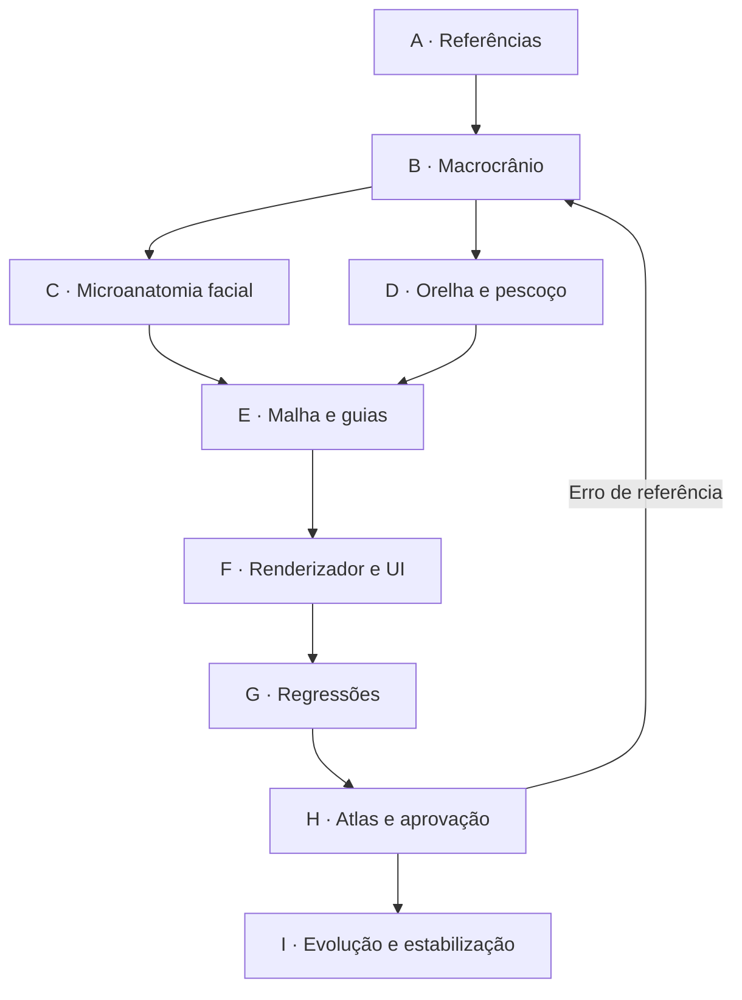

# GeoMannequin — TASK GRAPH EXECUTÁVEL Cabeça V4

**Data:** 10/11/2026 · **Meta:** aproximar-se do nível das 14 referências anatômicas fornecidas, em crânio, pequenos planos faciais, nuca, orelhas, pescoço e ângulos extremos.

**Estado:** primeira fundação experimental implementada em branch. Marcação ✓ = código adicionado e verificado isoladamente quando aplicável; ◐ = parcial; □ = pendente. Nenhuma marca ✓ representa aprovação estética final. A V1–V3 são preservadas.

## Contrato de geometria

1. A V4 é **outra malha**, não a esfera V1 nem a superfície V3 com linhas decorativas. Ela compartilha o interpolador PCHIP e o atlas microgeométrico V3, mas reconstitui seções, distribuição de relevo, detalhes, vértices e orelhas.
2. X = lado; Y = elevação; Z = anterior. `v=(1-y)/(1-chinY)`, normalizado de topo a queixo. Secções independentes `W(v), F(v), B(v)` determinam a macroforma.
3. Cada detalhe facial age em campo localizado `R(u,v)`, com `u=sin(theta)`, reduzindo a profundidade orbital, preservando rebordos e diferenciando zigoma, nariz, lábios e mento. O resultado é **uma malha 3D contínua**.
4. O pescoço da fase inicial reutiliza a versão V3 aprimorada; não afirmar união manifold cabeça-pescoço nem perfeição anatômica antes do nó D06.
5. Planos Loomis/Asaro são linhas e regiões projetadas na superfície; não discos soltos nem curvas independentes do modelo.

## DAG mestre



## Matriz de execução — 97 tarefas

### A — Análise das referências e baseline

| ID | Estado | Dependências | Tarefa | Arquivo / portão |
|---|:---:|---|---|---|
| A01 | ✓ | — | Inventariar os 14 anexos e agrupar line art / Asaro / sombreado azul / ângulos | `docs/head-v4-task-graph.md` |
| A02 | ✓ | A01 | Mapear V3: superfície, rig, seções, microcampos e renderizador | `src/engine/head-v3/*` |
| A03 | ✓ | A02 | Congelar a V3 sem alterar a geometria antiga | `src/engine/head-v4/*` |
| A04 | ✓ | A02 | Definir convenção X lateral, Y vertical, Z frontal | `head-v4/anatomy.js` |
| A05 | □ | A01 | Extrair silhuetas normais por vista e ratios craniofaciais | `testes/atlas-cabeca-v4.mjs` |
| A06 | ◐ | A01 | Catalogar landmarks observáveis nos perfis e frontais | `docs/head-v4-reference-analysis.md` |
| A07 | □ | A05 | Registrar tolerâncias projetivas e pesos da comparação | `docs/head-v4-reference-analysis.md` |
| A08 | □ | A02 | Criar atlas V3 de baseline pareado com V4 | `testes/atlas-cabeca-v3-reconstrucao.mjs` |

### B — Macrocrânio e proporções

| ID | Estado | Dependências | Tarefa | Arquivo / portão |
|---|:---:|---|---|---|
| B01 | ✓ | A04 | Criar novo espaço de seções 2D V4 e curvas PCHIP | `head-v4/anatomy.js` |
| B02 | ✓ | B01 | Remodelar largura parietal superior, sem forma de balão | `head-v4/anatomy.js` |
| B03 | ✓ | B02 | Manter volume temporal sustentado sobre a orelha | `head-v4/anatomy.js` |
| B04 | ✓ | B01 | Construir testa com trecho de perfil quase retilíneo | `head-v4/anatomy.js` |
| B05 | ✓ | B01 | Reforçar arco occipital e redução inferior contínua | `head-v4/anatomy.js` |
| B06 | ✓ | B02,B03 | Construir achatamento lateral contínuo, não disco colado | `head-v4/index.js` |
| B07 | ✓ | B01 | Limitar variações de crânio por escala, sexo, gordura e mandíbula | `head-v4/anatomy.js` |
| B08 | ✓ | B06 | Adicionar slider de plano temporal e parâmetros cranianos | `scene/parametros.js` |
| B09 | ✓ | B07 | Provar simetria bilateral no plano frontal | `testes/cabeca-v4-anatomia.mjs` |
| B10 | □ | B09,A05 | Comparar frontal, costas e perfis com traçado extraído dos anexos | `docs/head-v4-reference-analysis.md` |
| B11 | □ | B10 | Otimizar perfis em 3D minimizando erro de silhueta entre vistas | `head-v4/optimization.js` |

### C — Microanatomia da face

| ID | Estado | Dependências | Tarefa | Arquivo / portão |
|---|:---:|---|---|---|
| C01 | ✓ | B01 | Fundi-los microcampos V3 com influências V4 independentes | `head-v4/facial-relief.js` |
| C02 | ✓ | C01 | Esculpir glabela e rebordo supraorbital contínuo | `head-v4/facial-relief.js` |
| C03 | ✓ | C02 | Definir cavidade orbital sem buraco na silhueta | `head-v4/facial-relief.js` |
| C04 | ✓ | C03 | Indicar rebordo infraorbital e palpebral superior/inferior | `head-v4/facial-relief.js` |
| C05 | ✓ | C04 | Definir cantos medial/lateral com landmarks persistentes | `head-v4/index.js` |
| C06 | ✓ | C02 | Projetar raiz nasal e dorso com intensidade controlável | `head-v4/facial-relief.js` |
| C07 | ◐ | C06 | Modelar ponta/asa/base nasal no perfil e inferior | `head-v4/facial-relief.js` |
| C08 | ✓ | C03 | Formar zigoma e plano malar anterior/lateral | `head-v4/facial-relief.js` |
| C09 | ✓ | C08 | Ligar zigoma a maxila e sulco nasolabial | `head-v4/facial-relief.js` |
| C10 | ✓ | C06,C09 | Esculpir cilindro bucal, filtro e lábio superior | `head-v4/facial-relief.js` |
| C11 | ✓ | C10 | Esculpir lábio inferior e sulco mentolabial | `head-v4/facial-relief.js` |
| C12 | ✓ | C11 | Construir plano mentoniano, mento lateral e submento | `head-v4/facial-relief.js` |
| C13 | ◐ | C08,C12 | Definir gônio e ramo mandibular em corte transversal | `head-v4/anatomy.js` |
| C14 | ◐ | C08 | Controlar bochechas/masseter e anatomia feminina/masculina | `head-v4/facial-relief.js` |
| C15 | □ | C01 | Subdividir microcampos onde erro de curvatura aumentar | `head-v4/adaptive-fields.js` |
| C16 | □ | C07,C12 | Validar perfil de lábios/nariz/mento contra referências em cinco ângulos | `testes/atlas-cabeca-v4.mjs` |

### D — Orelhas, nuca e pescoço

| ID | Estado | Dependências | Tarefa | Arquivo / portão |
|---|:---:|---|---|---|
| D01 | ✓ | B03 | Criar orelhas V4 com hélice, anti-hélice, concha e trago | `head-v4/index.js` |
| D02 | ✓ | D01 | Amarrar orelha à seção V4, bilateralmente | `head-v4/index.js` |
| D03 | ✓ | D02 | Ancorar ECM em orelha/mastoide V4 | `engine/desenho.js` |
| D04 | ✓ | B07 | Reutilizar pescoço V3 estreito para não regredir frontal | `engine/corpo.js` |
| D05 | □ | B05,D04 | Verificar encaixe occipital/cervical em 9 vistas | `testes/atlas-cabeca-v4.mjs` |
| D06 | □ | D05 | Integrar pele pescoço/crânio sem junta visível na câmera baixa | `head-v4/neck-system.js` |
| D07 | □ | D03,D06 | Criar volumes SCM e fúrcula esternal em malha anatômica | `head-v4/neck-system.js` |
| D08 | □ | D07 | Refinar trapézio na parte posterior e largura dos ombros | `engine/tronco.js` |
| D09 | □ | D06,D07 | Garantir conexões com headYaw/headPitch/headRoll e flexão cervical | `head-v4/pose-adapter.js` |
| D10 | □ | D09 | Testar deformação extrema do pescoço e garganta sob mandíbula | `testes/cabeca-v4-poses.mjs` |

### E — Topologia e linhas construtivas

| ID | Estado | Dependências | Tarefa | Arquivo / portão |
|---|:---:|---|---|---|
| E01 | ✓ | B01,C01 | Criar malha paramétrica independente V4 | `head-v4/index.js` |
| E02 | ✓ | E01 | Criar três níveis de subdivisão LOD | `head-v4/index.js` |
| E03 | ✓ | C05,C11 | Criar linhas de órbita, pálpebra, lábios e nariz projetadas na malha | `head-v4/index.js` |
| E04 | ✓ | E01 | Reprojetar linhas temporais, zigoma, gônio e nuca da V3 na V4 | `head-v4/index.js` |
| E05 | ✓ | E03,E04 | Adicionar 25 landmarks V4 de cabeça e face | `head-v4/index.js` |
| E06 | ✓ | E01 | Calcular contornos de seção por ponto 3D da malha V4 | `head-v4/index.js` |
| E07 | ✓ | E01 | Gerar malha indexada com calotas e normais para OBJ | `head-v4/mesh-export.js` |
| E08 | ✓ | E07 | Medir bordas abertas, não manifold, degenerações e NaN | `head-v4/mesh-export.js` |
| E09 | □ | E07 | Criar loop de edge-flow apropriado para animação facial | `head-v4/retopology.js` |
| E10 | ◐ | E03 | Garantir linhas ocluídas por profundidade e espessura adequada | `engine/desenho.js` |

### F — Renderização e produto

| ID | Estado | Dependências | Tarefa | Arquivo / portão |
|---|:---:|---|---|---|
| F01 | ✓ | E01 | Registrar V4 em headPt, ringAt, buildHead, earSurf e buildEar | `engine/cabeca.js` |
| F02 | ✓ | E07 | Adicionar V4 no motor de exportações e namespace principal | `engine/index.js` |
| F03 | ✓ | E03 | Renderizar curvas anatômicas V4 no SVG existente | `engine/desenho.js` |
| F04 | ✓ | F03 | Evitar duplicar a antiga esfera e os círculos da V1/V2 | `engine/desenho.js` |
| F05 | ✓ | F01 | Expor V4 no seletor estático e controles dinâmicos | `index.html + ui/controles.js` |
| F06 | ✓ | F05 | Persistir headModel e sliders V4 no JSON | `scene/estado.js` |
| F07 | ✓ | F01 | Permitir o comando manequim.cabeca('v4') | `scene/comandos.js` |
| F08 | ✓ | F05 | Adicionar controle de relevo, órbita, zigoma, nariz, queixo e boca | `scene/parametros.js` |
| F09 | ✓ | F02 | Exportar Cabeça V4 como OBJ em botão separado | `ui/exportar.js` |
| F10 | □ | F03 | Criar preset clean line art das referências brancas | `head-v4/style-lineart.js` |
| F11 | □ | F03 | Criar preset planar monocromático por regiões | `head-v4/style-planes.js` |
| F12 | □ | F11 | Criar preset azul com shading discreto por plano | `head-v4/style-blue.js` |

### G — Testes geométricos e de regressão

| ID | Estado | Dependências | Tarefa | Arquivo / portão |
|---|:---:|---|---|---|
| G01 | ✓ | E08 | Testar 10 biotipos × 3 LOD com dados finitos | `testes/cabeca-v4-anatomia.mjs` |
| G02 | ✓ | G01 | Checar simetria frontal e orelhas bilaterais | `testes/cabeca-v4-anatomia.mjs` |
| G03 | ✓ | G01 | Checar continuidade de calota, occipital, mandíbula e mento | `testes/cabeca-v4-anatomia.mjs` |
| G04 | ✓ | G01 | Checar projeção nariz/boca e rebordo orbital | `testes/cabeca-v4-anatomia.mjs` |
| G05 | ✓ | G01 | Testar sliders V4 com diferença geométrica observável | `testes/cabeca-v4-anatomia.mjs` |
| G06 | ✓ | G01 | Testar mandíbula aberta sem deslocar occipital | `testes/cabeca-v4-anatomia.mjs` |
| G07 | ✓ | E08 | Verificar malha indexada e exportação OBJ | `testes/cabeca-v4-anatomia.mjs` |
| G08 | ✓ | F01 | Verificar V3→V4 com invalidação de cache | `testes/cabeca-v4-anatomia.mjs` |
| G09 | □ | G01-G08 | Executar suíte Node no ambiente real e corrigir falhas | `GitHub Actions` |
| G10 | □ | G09 | Executar build de bundle com esbuild | `npm run construir` |
| G11 | □ | G09 | Comparar regressões V1–V3 em 3 LOD | `npm run testar` |
| G12 | □ | G09 | Medir memória/latência no notebook sem GPU dedicada | `testes/desempenho.mjs` |

### H — Atlas, calibração e aprovação

| ID | Estado | Dependências | Tarefa | Arquivo / portão |
|---|:---:|---|---|---|
| H01 | ✓ | F03 | Gerar atlas 3×3 do motor V4 com pescoço e 9 ângulos | `testes/atlas-cabeca-v4.mjs` |
| H02 | ◐ | H01 | Gerar conjuntos masculino/feminino com mesmo enquadramento | `testes/atlas-cabeca-v4.mjs` |
| H03 | □ | H01 | Gerar matriz de inclinações de 15°/30°/45° e pitch ±60° | `testes/atlas-cabeca-v4-angles.mjs` |
| H04 | □ | H01 | Gerar folha com zoom orbital/nasal/mentoniano/orelha | `testes/atlas-cabeca-v4-details.mjs` |
| H05 | □ | A05 | Extrair silhuetas alvo dos anexos em 2D | `docs/head-v4-reference-analysis.md` |
| H06 | □ | H02,H05 | Comparar frontal, perfil, 3/4, posterior e inferior em pares | `docs/head-v4-comparison.md` |
| H07 | □ | H06 | Ajustar pesos geométricos por erro multivista e não só por feeling | `head-v4/optimization.js` |
| H08 | □ | H07 | Repetir comparação após refinar malhas e contornos | `docs/head-v4-comparison.md` |
| H09 | □ | H08,G10 | Aprovar com QA visual e nenhuma descontinuidade cervical | `docs/head-v4-acceptance.md` |
| H10 | □ | H09 | Publicar build e verificar V4 no GitHub Pages | `main + Pages` |

### I — Evolução pós-fundação

| ID | Estado | Dependências | Tarefa | Arquivo / portão |
|---|:---:|---|---|---|
| I01 | □ | C03 | Investigar campo de distância assinado para órbitas profundas | `head-v4/implicit-surfaces.js` |
| I02 | □ | I01 | Implementar adaptadores para múltiplas expressões faciais | `head-v4/rig-face.js` |
| I03 | □ | F11 | Conectar materiais por plano sem costura ou z-fighting | `head-v4/style-planes.js` |
| I04 | □ | F08 | Adicionar seleção de região facial no editor por nome | `scene/comandos.js` |
| I05 | □ | E09 | Criar exportação glTF e mapas de materiais | `head-v4/export-gltf.js` |
| I06 | □ | E08 | Criar testes de autointerseção de superfície (não só topologia) | `testes/cabeca-v4-topologia.mjs` |
| I07 | □ | G12 | Otimizar GPU/CPU via cache dos microcampos e normal maps | `head-v4/facial-relief.js` |
| I08 | □ | H10 | Estabilizar V4 após todas as folhas e regressões passarem | `docs/head-v4-acceptance.md` |

## Regressões e comandos

```bash
cd geomannequin
npm run testar:cabeca-v4
npm run testar:cabeca-v3
npm run testar:cabeca-v2
npm run construir
npm run atlas:cabeca-v4 -- masculino medio
npm run atlas:cabeca-v4 -- feminino medio
```

## Critérios de aceite — não negociáveis

- Silhuetas frontal, perfil bilateral e 3/4 equivalentes à referência construtiva (não apenas plausíveis em números).
- Testa sem balão, parietal estável e plano temporal lateral natural.
- Rebordos orbitais sem depressão de silhueta, olhos legíveis, nasal com base e asa, zigoma em ângulo, maxila suavemente convexa, lábios separados, gônio e mento estruturados.
- Orelha conectada corretamente à região mastoide; nuca/ECM/trapézio sem corte abrupto nas vistas posteriores.
- Manter o mesmo modelo nas vistas frontal, lateral, posterior, superior, inferior, com yaw/pitch/roll independentes.
- SVG line art e sombreado planar podem ser gerados sem linhas flutuantes; as versões azuis exigem preset próprio.
- Zero coordenadas inválidas, degeneração de triângulos, bordas não fechadas, falsos resultados de simetria; testar também autointerseções geométricas.
- Provar interação no browser, testes Node e build do HTML único. PR/commit isoladamente não completam H09/H10.

## Estado atual verificado

A implementação matemática isolada processou 10 perfis corporais × 3 LOD, totalizando 30 malhas/779.520 vértices, sem NaN, degenerações, bordas abertas ou arestas não-manifold detectadas. Foram amostradas 300 curvas anatômicas. Isso **não** garante fidelidade estética nem desempenho do renderizador completo. O atlas SVG foi escrito, mas deve ser executado e inspecionado antes da publicação definitiva.
