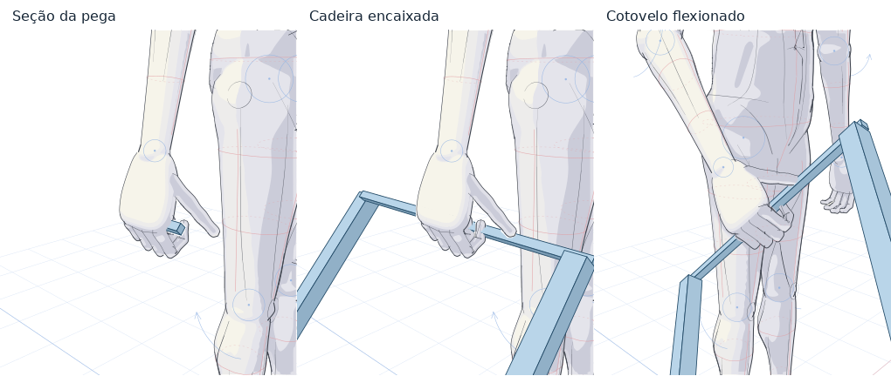

# Referências para mangá na PR 20

## Como experimentar

Na seção **Colisões e contato 3D**, escolha a mão, selecione **Cadeira com travessa** e clique em **Criar já encaixado**. **Inspecionar base / modelo inteiro** isola o segmento da travessa e mostra as dimensões em R e a área em R². A pose da cadeira continua vinculada à mão. **Desativar / reativar modelo** guarda a receita do objeto e libera a mão.



No teste padrão, o ajuste das falanges reduziu a distância da ponta do polegar à travessa de 0,500 para 0,011 R na mão direita e de 0,521 para 0,011 R na esquerda. Os valores usam os volumes simplificados das falanges. O comando `obj.medidasDaBase().contatosAoCriar` devolve a medição de cada dedo no instante da criação.

No painel **Roupa, cabelo, vento e VFX**, o paletó, a calça e o cabelo podem ser combinados no mesmo personagem. Para desenhar tecido, marque pelo menos três pontos no corpo, escolha o tipo de apoio de cada vértice e finalize. Para desenhar cabelo, escolha um penteado, marque raízes sobre a cabeça e finalize. O ângulo da câmera determina a superfície visível.

No editor de comandos, execute o exemplo em uma cena com a mão direita livre.

```js
const cadeira = cena.objetoNaMao("cadeira", { mao: "direita" });
log(cadeira.medidasDaBase());
cena.referencia("paleto", { cor: "#394760" });
cena.referencia("calca", { cor: "#30384d" });
cena.referencia("longo", { cor: "#563a30" });
cena.referencia("impacto", { inicio: 12, duracao: 8, x: .54, y: .42 });
cena.ventoChave(0, { x: 0, z: 0 });
cena.ventoChave(24, { x: 2, z: -.3, rajada: .5 });
cena.quadroSimulado(15);
```

## Evidências e limites do grafo

| Grupo | Funcionalidade exercitada | Validação ainda aberta |
| --- | --- | --- |
| Mãos e contato | Duas mãos, troca da mão principal, falha de encaixe com restauração, geração da peça, perfis reutilizáveis, seção visível, contato e soltura. A área de um perfil desenhado corresponde ao seu polígono. A colisão usa doze faixas de extrusão. | Comparação visual de cada tipo de preensão em close, folga por dedo em poses extremas e reprodução da cena exata em que o artista observou repulsão. |
| Roupa | Paletó, camisa, calça, painel por cliques, apoio, pressão e pontos livres. Os pontos novos guardam o deslocamento na base local da articulação. | Costura e espelhamento de painéis, dobras dinâmicas e ajuste manual de cada vértice de um painel já vestido. |
| Cabelo | Quatro penteados, raízes definidas por clique ou coordenadas da cabeça, comprimentos editáveis, colisores corporais e vento. | Inércia por mecha quando a cabeça muda rapidamente de pose. |
| Vento e efeitos | Direção mundial, rajada, interpolação entre quadros, linhas de movimento e impacto, chama, fumaça, explosão e rastro por amostras. A inclusão em prévia e exportação é independente. | Máscaras artísticas por câmera e definição do efeito solicitado como “TVT”. |
| Integração | Exportação SVG, reabertura do JSON, teste de regressão das referências e paridade da distribuição MCP. O HTML autocontido abriu em Chromium headless e os controles de cadeira, guia e paletó responderam. | Revisão artística das cenas finais e medição no equipamento do usuário. |

## Desempenho

O comando `node testes/desempenho-referencias.mjs` mede a geração do SVG em Node. Ele move o cotovelo a cada quadro e combina cadeira, terno, cabelo, vento e linhas de impacto. Na medição de trinta quadros após aquecimento, o p95 ficou em 87,4 ms para uma figura e 68,5 ms para três figuras, com somente a primeira mudando de pose. Os números variam entre execuções. A meta proposta de 33,3 ms por quadro continua aberta. A medição da pintura no navegador e na Intel UHD 620 depende do equipamento.

Os testes específicos são `npm run testar:referencias`, `npm run testar:autogrip`, `npm run testar:grip-v3`, `node testes/contato-v2.mjs` e `npm run verify:dist --prefix mcp`. Na comparação com o início da PR, as 26 divergências de referência visual, o teste de tangência da composição e a verificação da malha cervical já ocorriam antes destas mudanças.
