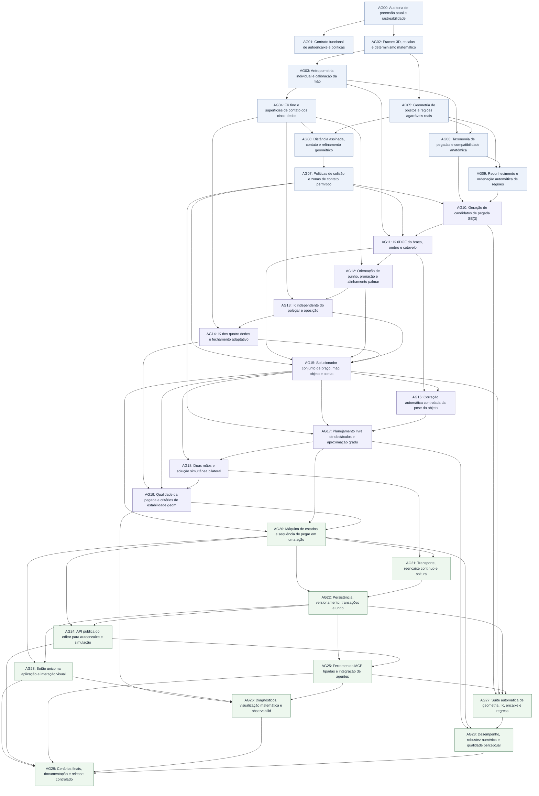

# MASTER TASK GRAPH — AutoGrip anatômico e autoencaixe sem interpenetração (GeoMannequin)

**Data:** 11/11/2026 · **Branch:** `feat/geomannequin-grip-v3-hardening-20261110` · **PR:** #20 (draft)

**Escopo:** projeto completo de uma função que, ao receber o manequim e o objeto, determina automaticamente uma pegada viável e movimenta **braço, ombro, cotovelo, punho, palma, polegar, indicador, médio, anelar e mínimo**, avalia colisões e confirma uma preensão rígida sem interpenetração proibida. Deve funcionar por **um botão**, **uma chamada de código no editor** e **uma ferramenta MCP tipada**.

**Estado: IMPLEMENTAÇÃO EXPERIMENTAL EM ANDAMENTO.** O código-fonte já cobre parcialmente vários grupos, mas **nenhum dos 30 gates está aprovado** e os 300 itens continuam sem `done` até haver testes integrados/visuais que satisfaçam seus critérios de aceite. Ver [relatório de implementação](./auto-grip-implementacao-progressiva-20261111.md). O que já existe no Grip V3 é a base; a nova geometria, busca e solução conjunta precisam ser construídas. Este grafo é adicional aos task graphs de 239 tarefas da preensão rígida V3 e de 240 tarefas da paridade MCP.

## Arquivos completos (300 tarefas verificáveis)

- [Parte A — AG00 a AG09: auditoria, mão, objeto e colisões](./task-graph-autoencaixe-maos-parte-a-20261111.md) — 100 tarefas;
- [Parte B — AG10 a AG19: candidatos, IK, cinco dedos, solver e bilateralidade](./task-graph-autoencaixe-maos-parte-b-20261111.md) — 100 tarefas;
- [Parte C — AG20 a AG29: botão, comando, MCP, persistência, testes e release](./task-graph-autoencaixe-maos-parte-c-20261111.md) — 100 tarefas;
- [Manifesto JSON integral, para agentes](./task-graph-autoencaixe-maos-manifest-20261111.json) — tarefas, estados, aceites e dependências;
- [JSON da Parte A](./task-graph-autoencaixe-maos-parte-a-20261111.json), [B](./task-graph-autoencaixe-maos-parte-b-20261111.json), [C](./task-graph-autoencaixe-maos-parte-c-20261111.json).

Os identificadores são **AG-NN.01–AG-NN.10**. Cada grupo tem 10 tarefas e um **gate AGNN**, fechado quando sua última tarefa de validação é aprovada. O DAG foi verificado automaticamente: **300 tarefas, 30 gates, 330 nós, 667 dependências, 0 links inexistentes e 0 ciclos**. Prioridades: **200 P0** e **100 P1**. Todos os estados começam como `planned`.

## 1. Ação que deve existir na aplicação

### Editor JavaScript (assinaturas PROPOSTAS, não implementadas hoje)

```js
// Executa uma única ação: decidir onde e como pegar, resolver dedos, braço e colisões.
const r = cena.autoEncaixarObjeto("Cadeira 1", {
  manequim: "Ana",
  mao: "auto",                 // direita | esquerda | ambas | auto
  pegada: "auto",              // pinca | potencia | gancho | lateral | tripode | apoio
  preservarObjeto: true,      // padrão: cadeira NÃO muda de posição
  permitirMoverObjeto: false, // somente se a pessoa autorizar
  ajustarBraco: true,
  ajustarPunho: true,
  ajustarDedos: true,
  colisao: "rigorosa",
  animar: false               // true executa aproximação animada e verifica percurso
});
log(r);

// Duas fases para previsão, inspeção e commit transacional:
const plano = cena.planejarEncaixe("Cadeira 1", { manequim:"Ana", mao:"direita" });
const resultado = cena.aplicarEncaixe(plano.id, { revisao:plano.revisao });

// Atalho no manequim / objeto, mesma engine sem duplicação:
cena.obter("Ana").autoSegurar("Cadeira 1", { pegada:"gancho" });
cena.obterObjeto("Cadeira 1").autoEncaixarPor("Ana", { mao:"ambas" });
```

`autoEncaixarObjeto` pode ser uma fachada que combina `planejarEncaixe` + `aplicarEncaixe` em uma operação atômica; não precisa obrigar o usuário a executar duas chamadas.

### MCP remoto (contrato PROPOSTO)

```json
{
  "ferramenta": "preensao",
  "acao": "auto_encaixar",
  "objeto": "Cadeira 1",
  "manequim": "Ana",
  "mao": "auto",
  "pegada": "auto",
  "preservarObjeto": true,
  "evitarColisoes": true
}
```

O nome `ferramenta` acima é explicativo do destino; a estrutura final deve respeitar o schema MCP, sem código JavaScript remoto arbitrário. Integrar também `operacoes_lote`, `roteiro_declarativo`, documentação e widget. Todos usam o MESMO solver do editor.

### Botão único

**Selecionar manequim → selecionar objeto → clicar “Autoencaixar / Segurar corretamente”.** Se mão, tipo e ponto não forem especificados, são escolhidos pelo algoritmo. O modo padrão mantém a cadeira imóvel durante o encaixe e tenta mover primeiro ombro, cotovelo, punho e dedos. Se impossível, devolve motivo e opções de correção; mover o objeto é opt-in.

## 2. Critério matemático de uma pegada correta

Uma pegada é um problema de otimização com configuração `q` de ombro, cotovelo, punho e dedos, transformação rígida opcional `T_obj`, regiões agarráveis `G` e conjunto de contatos `C`:

\[
\min_{q,T_{obj},G,C} E = w_p E_{palma} + w_o E_{orientação} + w_c E_{contatos} + w_a E_{anatomia} + w_m E_{movimento} + w_s E_{suavidade}
\]

Sujeito a **restrições duras**: limites articulares, nenhuma mão ocupada indevidamente, objeto preservado quando solicitado, ausência de colisão proibida e contato exigido pelo tipo de pegada. Penalidades **não podem compensar** violação de restrição dura.

Distâncias são medidas em **R**, unidade do motor atual (1 R ≈ 11,4 cm), e não em pixels. A calibração de precisão deve partir de testes com a geometria realmente desenhada. **Alvos iniciais de engenharia**, a calibrar por classe de objeto: erro de ponta/superfície ≤ 0,05 R, interpenetração final máxima ≤ 0,02 R nas geometrias com suporte preciso, desvio da palma ≤ 0,05 R e orientação ≤ 5° quando houver liberdade suficiente. Valores **não são garantias** para qualquer objeto e devem ser corrigidos conforme a fidelidade do colisor disponível. Testes finais e relatórios registram tolerâncias reais, por região.

**Classificação de resultados:** `aplicado` (todos os critérios passaram), `planejado` (preview), `inviavel` (nenhuma pegada atende), `cancelado` ou `erro` (estado restaurado). Nunca devolver “perfeito” se houve contato falso ou penetração ocultada.

## 3. Como o algoritmo deverá decidir a pegada

```text
Selecionar manequim + objeto
  ├─ Extrair forma/tamanho real da mão e dos 5 dedos
  ├─ Identificar superfícies, barras, bordas, alças e zonas de pega do objeto
  ├─ Gerar candidatos: pinça, potência, gancho, tripode, lateral, apoio
  ├─ Rejeitar incompatibilidade de dimensão, mão ocupada ou alcance
  ├─ Definir orientação/posição de pregrasp da palma
  ├─ Resolver ombro, cotovelo, antebraço e punho em 6DOF
  ├─ Resolver polegar e dedos independentes por contato 3D
  ├─ Detectar penetração na mão, objeto, torso e ambiente
  ├─ Otimizar conjuntamente posição, rotação e fechamento
  ├─ Se autorizado: aplicar pequeno ajuste 6DOF ao objeto
  ├─ Se duas mãos: otimizar ambas simultaneamente
  ├─ Verificar aproximação livre de obstáculos até a pega final
  ├─ Comparar candidatos e escolher o melhor viável
  ├─ Validar qualidade; só então criar vínculo Grip V3
  └─ Devolver relatório, cena atualizada e estado persistível
```

Uma pegada de **pinça** necessita polpas do polegar e indicador em superfícies opostas; **potência**, palma e vários dedos ao redor do volume; **gancho**, dedos ao redor de uma borda com espaço real; **tripode**, polegar-indicador-médio; **lateral**, contato tipo chave; **apoio**, sustentação superficial sem presumir que o objeto está rigidamente preso.

## 4. Grafo mestre de dependências (30 gates)



### Tabela das fases

| Gate | Entrega | Prioridade | Pré-requisitos | Tarefas |
|---|---|---|---|---:|
| AG00 | Auditoria de preensão atual e rastreabilidade | P0 | — | 10 |
| AG01 | Contrato funcional de autoencaixe e políticas | P0 | AG00 | 10 |
| AG02 | Frames 3D, escalas e determinismo matemático | P0 | AG00 | 10 |
| AG03 | Antropometria individual e calibração da mão | P0 | AG02 | 10 |
| AG04 | FK fino e superfícies de contato dos cinco dedos | P0 | AG03 | 10 |
| AG05 | Geometria de objetos e regiões agarráveis reais | P0 | AG02 | 10 |
| AG06 | Distância assinada, contato e refinamento geométrico | P0 | AG04, AG05 | 10 |
| AG07 | Políticas de colisão e zonas de contato permitido | P0 | AG06 | 10 |
| AG08 | Taxonomia de pegadas e compatibilidade anatômica | P1 | AG03, AG05 | 10 |
| AG09 | Reconhecimento e ordenação automática de regiões | P1 | AG05, AG08 | 10 |
| AG10 | Geração de candidatos de pegada SE(3) | P0 | AG07, AG08, AG09 | 10 |
| AG11 | IK 6DOF do braço, ombro e cotovelo | P0 | AG03, AG07, AG10 | 10 |
| AG12 | Orientação de punho, pronação e alinhamento palmar | P0 | AG04, AG11 | 10 |
| AG13 | IK independente do polegar e oposição | P0 | AG04, AG12 | 10 |
| AG14 | IK dos quatro dedos e fechamento adaptativo | P0 | AG04, AG13 | 10 |
| AG15 | Solucionador conjunto de braço, mão, objeto e contatos | P0 | AG07, AG11, AG12, AG13, AG14 | 10 |
| AG16 | Correção automática controlada da pose do objeto | P1 | AG11, AG15 | 10 |
| AG17 | Planejamento livre de obstáculos e aproximação gradual | P1 | AG07, AG15, AG16 | 10 |
| AG18 | Duas mãos e solução simultânea bilateral | P1 | AG15, AG17 | 10 |
| AG19 | Qualidade da pegada e critérios de estabilidade geométrica | P1 | AG14, AG15, AG18 | 10 |
| AG20 | Máquina de estados e sequência de pegar em uma ação | P1 | AG15, AG17, AG19 | 10 |
| AG21 | Transporte, reencaixe contínuo e soltura | P1 | AG18, AG20 | 10 |
| AG22 | Persistência, versionamento, transações e undo | P0 | AG20, AG21 | 10 |
| AG23 | Botão único na aplicação e interação visual | P1 | AG20, AG22 | 10 |
| AG24 | API pública do editor para autoencaixe e simulação | P0 | AG20, AG22 | 10 |
| AG25 | Ferramentas MCP tipadas e integração de agentes | P0 | AG22, AG24 | 10 |
| AG26 | Diagnósticos, visualização matemática e observabilidade | P1 | AG19, AG23, AG25 | 10 |
| AG27 | Suíte automática de geometria, IK, encaixe e regressão | P0 | AG10, AG15, AG22, AG25 | 10 |
| AG28 | Desempenho, robustez numérica e qualidade perceptual | P0 | AG17, AG20, AG27 | 10 |
| AG29 | Cenários finais, documentação e release controlado | P0 | AG23, AG24, AG25, AG26, AG28 | 10 |

## 5. Onde cada etapa entra no código existente

| Módulo existente | Reutilizar e evoluir |
|---|---|
| `src/engine/maos.js` | juntasDedos, dedosChave, gestos pinca/gancho/segurar; comprimentos e flexões |
| `src/engine/bracos.js` | armDims e armPose; parâmetros de tamanho, FK e orientação da mão |
| `src/engine/cadeia.js` | ikArm atual resolve sobretudo posição do punho, com 4 DOFs e penalidade de corpo |
| `src/engine/contact-v2.js` | colliderRig fino por falanges, pointSolid, capsuleSolidContact e manifoldObject |
| `src/engine/grip-sites.js` | sites pontuais: encostoTopo, encostoEsquerdo/Direito, lateral, topo, etc. |
| `src/scene/preensao-v2.js` | fecharDedos progressivo por dedo, sem solução global |
| `src/scene/grip-v3.js` | handFrameV3, beginRigidGrip, alinharPalmaV3, segunda mão IK, attachment SE3 |
| `src/scene/comandos.js` | cena.segurarObjeto com encaixar/alcance, mas ainda sem autoencaixe integral |
| `src/scene/contato-v2.js` | regras de colisão e contato permitido próximo de GripSite |
| `mcp/lib/tools-control.mjs` | ferramenta preensao, a estender com auto_encaixar/planejar |
| `mcp/lib/tools-storyboard.mjs` | roteiro_declarativo/operacoes_lote, a estender sem JS remoto |
| `mcp/widget/geomannequin.html` | widget interativo, a estender com botão e status do AutoGrip |

**Módulos novos sugeridos** (nomes propostos): `src/engine/hand-metrics.js`, `hand-contact-geometry.js`, `grip-regions.js`, `grasp-candidates.js`, `grasp-ik.js`, `finger-ik.js`, `grasp-contact.js`, `grasp-optimizer.js`, `grasp-path.js`; `src/scene/grip-auto.js`; `testes/grip-auto-*.mjs`. A arquitetura poderá consolidar módulos se evitar duplicidade e preservar API pública.

## 6. Testes de aceitação obrigatórios

| Cenário | Esperado |
|---|---|
| Cadeira, pega no encosto superior | Braço e palma chegam ao encosto; dedos curvam ao redor da geometria sem entrar na madeira; cadeira permanece imóvel no modo padrão |
| Cadeira, mão esquerda e direita | Eixos espelhados corretamente, sem dedos invertidos |
| Cadeira, duas mãos | Ambas alcançam contatos distintos; não ocorre colisão interbraços ou teleporte do objeto |
| Copo cilíndrico | Pegada de precisão ou potência compatível com o diâmetro, polegar em oposição |
| Objeto muito pequeno (pinça) | Ponta/polpa de polegar e indicador encostam em superfícies opostas e os outros dedos não são forçados |
| Caixa grande | Pegada de apoio/duas mãos quando viável; caso contrário, falha com diagnóstico dimensional |
| Objeto atrás das costas ou perto do peito | Movimento contorna obstáculo quando possível ou é rejeitado; não atravessa tórax |
| Objeto longe demais | Retorna inviável sem alongar braço, alterar tamanho ou teleportar objeto |
| Cadeira inclinada em 6DOF | Normais e contatos seguem rotação real da peça |
| Biotipos diferentes | Mesmos objetos usam abertura e comprimento calculados por mão individual |
| Variação de pose pós-pegada | Objeto segue braço sem drift; colisões continuam válidas |
| Cancelamento e falha | Estado anterior restaurado, sem vínculo órfão ou falsa pegada |
| Salvar/abrir cena | Vínculo, dedos e deslocamentos retornam iguais |
| Botão, JavaScript e MCP | Mesmo estado inicial + opções produzem mesma solução e métricas |
| Testes visualizados em 360° | Ausência de penetrações escondidas pelo ângulo da câmera |

## 7. Ondas de implementação

**Onda 0 — Base geométrica:** AG00–AG07; a taxonomia e a busca de regiões (AG08–AG09) podem começar quando seus gates diretos estiverem aprovados. Saída: métricas anatômicas e colisão de alta fidelidade.

**Onda 1 — Um braço e cinco dedos:** AG10–AG15; gerar candidatos, resolver palma 6DOF e IK de polegar e quatro dedos, confirmar contato sem interpenetração.

**Onda 2 — Ajuste e aproximação:** AG16–AG20; permitir microajuste opcional do objeto, planejar trajetória, resolver bilateralidade e selecionar a pegada geométrica mais confiável.

**Onda 3 — Persistir e operar:** AG21–AG26; transporte sem drift, JSON/undo, botão, API JavaScript e MCP tipado.

**Onda 4 — Provar e publicar:** AG27–AG29; testes, atlas e regressões, tempo/memória, demonstração final do fluxo sem intervenção manual. Gate de release impede declarar pronto prematuramente.

## 8. Definição de pronto e limites de escopo

- [ ] Autoencaixe **one-click** e uma chamada por editor/MCP, sem scripts remotos arbitrários.
- [ ] O tamanho de cada mão e suas falanges deriva dos parâmetros reais do manequim.
- [ ] Tipos pinça/potência/gancho/tripode/lateral/apoio e seleção automática cobertos por testes.
- [ ] Ombro, cotovelo, punho, palma e dedos coordenados no solver de contato.
- [ ] Nenhuma interpenetração proibida acima das tolerâncias verificadas; contato real em zonas válidas.
- [ ] Aproximação e transporte evitam colisão ao longo da trajetória, não apenas no estado final.
- [ ] Mover objeto só quando autorizado; hand/object scaling automático proibido por padrão.
- [ ] Falhas impossíveis têm diagnóstico e rollback, sem mover o modelo para posição fisicamente não alcançável.
- [ ] Duas mãos têm solver simultâneo, sem afirmar resistência ao peso sem simulação de forças.
- [ ] Snapshots, JSON, histórico, previsualização, cancelamento e testes de MCP funcionam.
- [ ] Documentos, CI e `mcp/dist` sincronizados e validado em clientes suportados.

**Limite realista:** o motor atual representa objetos com caixas/cilindros geométricos e preensão como attachment cinemático. Este projeto pretende alcançar **encaixe anatômico e visual geometricamente verificável**. Não equivale automaticamente a simular forças, distribuição de pressão, atrito e deformações de tecido. Tais modelos exigiriam uma etapa física própria; a qualidade geométrica da pegada não deve ser chamada de estabilidade mecânica garantida.

## 9. Rastreabilidade e execução por agentes

Cada tarefa concluída deve registrar: ID `AG-NN.MM`, commit, diff de arquivos, teste que prova aceitação, relatório de contato/penetração, benchmark quando relevante, screenshot/atlas quando visual e condição residual. `planned`, `in_progress`, `blocked` e `done` são estados válidos. A fase **não** fecha sem seu gate de aceitação. A implementação do AutoGrip fica separada do histórico de tarefas de MCP integral; integrar os grupos `AG24/AG25` ao trabalho de paridade MCP existente apenas depois de estabilizar o solver.
