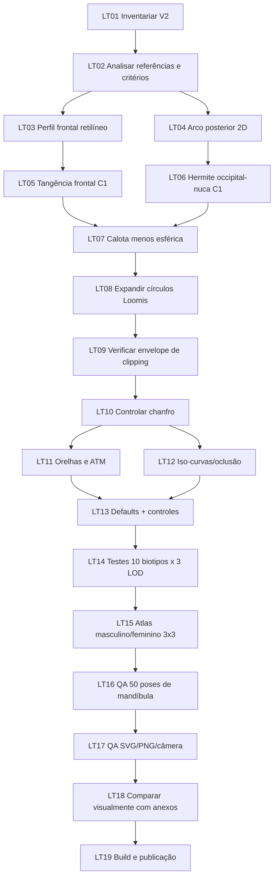

# GeoMannequin · Task graph completo — Loomis nas laterais, nuca e testa

**Data:** 10/11/2026 · **Componente:** cabeça paramétrica V2 · **Prioridade:** P0  
**Referência:** imagens da conversa com círculos/vermelho na área craniana, nuca e testa.  
**Escopo:** geometria real, curvas e controles; não substituir o volume por decoração SVG. A V1 é intocável.

## Definição visual de aceite

1. **Loomis bilateral:** dois círculos completos reais, planos e simétricos `x=±d`, com borda circular em `(y,z)`, raio ampliado (~0,73), cobertura temporal, parietal superior e início da nuca; contorno C1 por chanfro, sem tampas flutuantes.
2. **Nuca:** arco occipital circular/oval no **plano do perfil** `(y,z)`, independente do raio transversal da cabeça. Não acrescentar esfera occipital. A curva chega à base cervical por interpolação Hermite C1, sem ponta nem estreitamento brusco.
3. **Testa:** segmento quase retilíneo `y≈0,20…0,67`, ligado por tangência à abóbada acima e ao rosto abaixo, sem quinas. Superior fecha arredondado no vértice.
4. **Compatibilidade:** 5 biotipos × 2 sexos, 3 níveis de detalhe, cabeça rotacionável, boca 0–1, orelhas junto ao plano temporal, grades e exportações.

## DAG (dependências)



## Lista executável com evidências

| ID | Atividade | Dependência | Critério objetivo |
|---|---|---|---|
| LT01 | Localizar módulos V2 e renderizador | — | `src/engine/head`, `desenho.js` e defaults auditados |
| LT02 | Diagnosticar diferenças da referência | 01 | Círculo temporal pequeno, testa convexa, nuca irregular identificados |
| LT03 | Construir perfil anterior linear | 02 | Inclinação praticamente constante em `y=.25,.46,.58` |
| LT04 | Construir arco occipital sagital | 02 | Occipital posterior arredondado, sem esfera extra |
| LT05 | Garantir tangência da testa à calota | 03 | Sem salto na derivada em `y=.67` |
| LT06 | Garantir tangência da nuca | 04 | Sem salto na derivada em `y=-.28` |
| LT07 | Remodelar largura alta do crânio | 05,06 | Seção transversal não esférica; ápice fechado |
| LT08 | Ampliar planos x=±d | 07 | Raio padrão `0.73`, simetria exata |
| LT09 | Limitar profundidade pelo envelope | 08 | `safeEnvelope > distance + 0.015` |
| LT10 | Preservar transição planar/convexa | 09 | Chanfro C1 e nenhum disco desconectado |
| LT11 | Avaliar ancoragem auricular e ATM | 10 | Orelhas aderidas, occipital imóvel com boca aberta |
| LT12 | Verificar meridianos/grade/oclusão | 10 | Linhas acompanham malha e rotacionam corretamente |
| LT13 | Atualizar slider e parâmetros | 11,12 | Raio configurável de `0.37` até `0.79` |
| LT14 | Testar LOD/biotipos | 13 | 10 variantes × 3 LOD = 30 malhas finitas, planaridade medida |
| LT15 | Produzir atlas técnico 3×3 | 14 | 9 vistas × 2 sexos = 18 imagens SVG |
| LT16 | Testar articulação e expressões | 15 | 50 estados mandibulares, sem mover abóbada |
| LT17 | Verificar render/câmera/exportações | 16 | Sem linhas ilegíveis, falhas ou regressões |
| LT18 | Aprovação estética da referência | 17 | Perfil, 3/4, frontal, costas e superior comparados lado a lado |
| LT19 | Validar build e publicar | 18 | commit em `main`, site renderizado e aceito |

## Arquivos e comandos

- `src/engine/head/profile.js` — perfil linear + transições C1.
- `src/engine/head/sections.js` — calota transversal menos esférica.
- `src/engine/head/side-planes.js` — círculos reais ampliados.
- `src/engine/head/mesh-clipping.js` — mantém corte na malha UV, sem tampa.
- `src/engine/padroes.js` e `src/scene/parametros.js` — padrão e slider.
- `testes/cabeca-v2-perfil-loomis.mjs` — prova geométrica nova.
- `testes/cabeca-v2-planos.mjs` — planaridade, simetria, biotipos e ATM existentes.
- `testes/atlas-planos-loomis.mjs` — geração de referências reais.

```bash
cd geomannequin
npm run testar:planos-loomis
npm run testar:cabeca-v2
npm run atlas:planos-loomis -- masculino medio
npm run atlas:planos-loomis -- feminino medio
npm run construir
```

**Portões de qualidade:** os testes numéricos e uma prévia geométrica não bastam para certificar semelhança estética. LT15–LT19 exigem rodar renderizador/build, examinar SVGs e aprovar a referência. Não declarar concluídos sem evidência.
