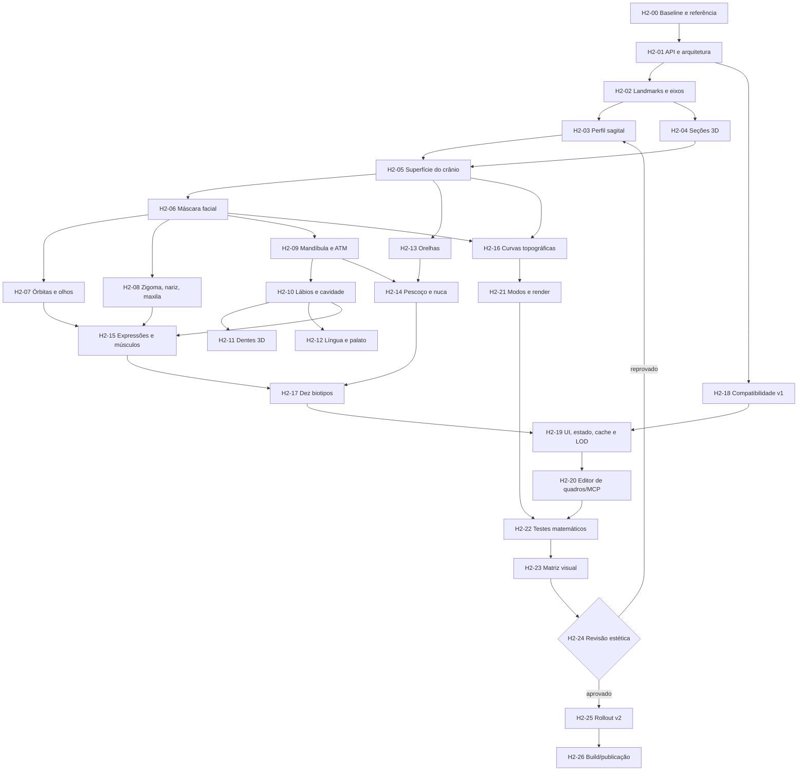

# GeoMannequin — Task Graph de implementação da Cabeça V2

**Estado:** especificação técnica original; **já existe um protótipo experimental de Cabeça V2, mas a qualidade estética e a topologia Loomis ainda não foram aprovadas**. Consulte [registro real da V2](head-v2-implementacao.md) e [task graph obrigatório dos planos circulares laterais](task-graph-cabeca-v2-planos-laterais-loomis.md).  
**Referência visual primária:** imagem anexada pelo usuário em 10/11/2026, intitulada *MATHEMATICAL MANEQUIN HEAD: 3x3 GEOGEBRA-STYLE CURVATURE & TOPOGRAPHY REFERENCE*.  
**Abrangência:** crânio, face, órbitas, olhos, sobrancelhas, nariz, zigoma, maxila, mandíbula/ATM, lábios, cavidade oral, dentes, língua, orelhas, nuca e pescoço, em **10 biotipos** e vistas múltiplas.  
**Repositório:** `4lexandre33/4lexandre33.github.io` → `geomannequin/`.  
**Princípio de execução:** construir um motor anatômico **paramétrico paralelo**, testar e só depois habilitar. Não substituir o sistema v1 com ajustes superficiais sucessivos.

> Este é um **plano executável**, não um relatório de tarefas já concluídas. Todos os estados listados abaixo são **PENDENTE** até que existam código, testes e revisão visual correspondentes. A ilustração é uma referência de desenho técnico e topologia aparente, não uma malha 3D calibrada ou uma fonte de medidas clínicas.

---

## Extensão estrutural prioritária — LP-00 a LP-28

**Obrigatório antes da aprovação estética e antes do rollout definitivo da Cabeça V2:** implementar dois planos circulares laterais **geometricamente planos**, integrados à abóbada craniana conforme Loomis. O achatamento leve atual em `cranial-surface.js` **não satisfaz esse requisito**.

**[Abrir Task Graph completo da construção Loomis (29 tarefas, fórmulas, testes e sete ondas)](task-graph-cabeca-v2-planos-laterais-loomis.md).**

Os estados da tabela H2 abaixo continuam sendo **itens do plano original**, não certificados de implementação. Consulte o relatório de implementação para os estados reais e pendências.

---

## 0. O problema a resolver

A cabeça atual usa `src/engine/cabeca.js` com `shape(p)`, `ringAt(y,p,S)`, `headPt(y,th,p,S)`, `mandibula(v,p,S)`, `buildHead(p,S)` e `earSurf`. Os traços faciais e a boca são parcialmente projetados sobre a superfície em `desenho.js`; `boca.js` gera curvas de lábios e arcadas; `montagem.js` gere malhas e cache. Isso permite desenhar, porém não garante:

1. neurocrânio lateral convincente, incluindo frontal, temporal, parietal e occipital;
2. face construída como planos e volumes conectados ao crânio;
3. topologia orbital e perioral robusta;
4. mandíbula com malha própria, rotação temporomandibular e pele deformável;
5. boca interna volumétrica coerente em frente, 3/4 e perfil;
6. linhas topográficas matemáticas sobre a superfície real, com oclusão correta;
7. consistência nas dez morfologias e nas poses de cabeça/pescoço.

**Resultado alvo:** uma cabeça de desenho anatômico de alta qualidade: silhueta correta, volumes em três dimensões, isolinhas construtivas úteis e expressões que deformam a geometria de forma natural. Não prometer fotorealismo, correspondência exata à imagem ou precisão médica sem calibração e avaliação humana.

## 1. Restrições inegociáveis

- **Compatibilidade:** preservar a API pública v1 de `cabeca.js` e o formato dos parâmetros já salvos. Cenas antigas, editor de quadros, exportação SVG/OpenPose/ControlNet e MCP não podem falhar por falta de importação ou mudança de nomes.
- **Ativação progressiva:** usar `headModel: "v1" | "v2"` (ou configuração equivalente explícita); a v1 permanece padrão até aprovação visual e funcional. A opção textual deve ser serializada em `src/scene/estado.js`, pois `SL` representa controles numéricos.
- **Transformações:** coordenadas locais da cabeça com `x` lateral (esquerda/direita), `y` vertical e `z` anterior/posterior; adaptação final à cadeia cervical existente em `montagem.js`. Uma convenção única deve ser escrita em testes e documentação.
- **Fonte única de verdade:** superfícies, sulcos, linhas de construção, oclusão e landmarks devem derivar dos mesmos dados anatômicos. Proibido corrigir “por cima” com riscos 2D que divergem da malha.
- **Expressões:** maxila superior fixa; mandíbula com transformação rígida de ATM + pesos de deformação facial locais; occipital e nuca não se movem ao abrir a boca.
- **Dez biotipos:** masculino/feminino × magro/médio/atlético/musculoso/cheio; preservar a interpolação contínua de sexo e ajustes manuais de `biotipos.js`.
- **Renderizador:** manter suporte aos modos manequim, construção e écorché, perspectiva/ortográfica, z-buffer, máscaras, SVG e exportações dos quadros.
- **Desempenho:** parametrizar LOD e cache; a malha não deve ser reconstruída quando apenas a câmera muda. Medir tempos atuais e novos antes de estabelecer limites finais.
- **Segurança da integração:** não sobrescrever `testes/referencia.json` automaticamente e não apagar `dist/` sem reconstrução e verificação.

## 2. Arquitetura proposta e contrato de módulos

Criar o diretório **`src/engine/head/`**. A v1 permanece em `cabeca.js` e `boca.js` como implementação de compatibilidade.

```text
geomannequin/
  src/engine/
    cabeca.js                   # fachada compatível + seletor v1/v2
    boca.js                     # fachada da API oral legada
    montagem.js                 # cache e seleção de malhas v2
    desenho.js                  # renderiza a partir de geometria e atlas reais
    esqueleto.js                # mandíbula/ATM, pescoço
    index.js                    # exports públicos sem colisões de nomes
    head/
      constants.js              # unidades, eixos, limites e LOD
      landmarks.js              # landmarks e curvas mestras 3D
      profile.js                # Bézier/B-spline: silhueta sagital
      sections.js               # seções coronais/axiais e interpolação
      cranial-surface.js        # abóbada crâniana em 3D
      face-fields.js            # RBF/campos de relevo faciais
      facial-mask.js            # malha facial de transição
      orbit.js                  # bordos orbitais, globos e pálpebras
      nose.js                   # glabela, radix, dorso, ponta, asas
      jaw-rig.js                # ATM, maxila e mandíbula independentes
      mouth-cavity.js           # lábios, comissuras, cavidade
      dentition.js              # arcadas e dentes 3D
      tongue.js                 # língua, palato e assoalho oral
      ears.js                   # pavilhão auricular e implantação
      neck.js                   # nuca, ECM e transição cervical
      expressions.js            # expressão → controles/weights morfológicos
      biotypes.js               # adaptação morfológica do sistema existente
      iso-curves.js             # linhas topográficas da superfície verdadeira
      mesh.js                   # triangulação, normais, UV, fronteiras e LOD
      compatibility.js          # adaptador shape/ringAt/headPt/earSurf
      diagnostics.js            # landmarks, normais, curvatura, cortes
      index.js                  # API interna da cabeça v2
  testes/
    cabeca-v2-geometria.mjs
    cabeca-v2-mandibula.mjs
    cabeca-v2-expressao.mjs
    cabeca-v2-biotypes.mjs
    cabeca-v2-compatibilidade.mjs
    cabeca-v2-perfil.mjs
    matriz-cabeca-v2.mjs
    saida/cabeca-v2/             # artefatos gerados; não comitar milhares de arquivos
  docs/
    task-graph-cabeca-v2-topologia-matematica.md
```

**Regra de dependências:** `head/` só importa `engine/matematica.js` e seus próprios módulos; não deve importar `desenho.js`, `montagem.js` ou `scene/`. O fluxo é **parâmetros → geometria → malhas/curvas → renderer → UI/MCP**. Evitar imports circulares e manter cada import/export ES em uma linha para compatibilidade com o carregador headless existente.

### Contrato interno proposto (pseudocódigo, NÃO implementado)

```js
buildHeadV2(params, options) => {
  skullMesh, faceMesh, jawMesh, earMeshes,
  eyeMeshes, mouthMeshes, neckTransition,
  landmarks, surfaceSampler, isoCurves,
  bounds, normals, diagnostics
}
sampleHeadSurfaceV2(region, u, v, params) => [x, y, z]
solveJawPoseV2(jawOpen, jawSide, params) => transform3D
makeHeadIsoCurvesV2(surface, { spacing, direction, density, hiddenLines }) => paths3D
```

O adaptador de `cabeca.js` deve conservar a assinatura antiga enquanto a v2 está atrás da feature flag. **Não reexportar símbolos duplicados** por `engine/index.js`. A seleção deve ser explícita e determinística, inclusive no MCP.

## 3. Grafo principal das tarefas (DAG)



**Portões obrigatórios:** G0 (baseline), G1 (crânio/face estáticos), G2 (mandíbula e interior oral), G3 (pescoço/biotipos), G4 (compatibilidade/exportações), G5 (aprovação visual), G6 (publicação).

## 4. Backlog técnico com ordem, arquivos e critérios de aceite

Todos os itens abaixo começam **PENDENTES**.

| ID | Prioridade / dependência | Trabalho técnico e arquivos | Entrega verificável |
| --- | --- | --- | --- |
| **H2-00** | P0 / início | Congelar baseline v1, capturar parâmetros/poses dos 10 biotipos, arquivar resultados dos testes atuais, relacionar as duas referências anexadas e os dois prints defeituosos; `docs/`, `testes/` | Manifesto baseline com vistas, poses e versão Git; sem alterar hashes |
| **H2-01** | P0 / 00 | Definir eixos, escala local, formato das malhas, contrato da API v2 e flag; `head/constants.js`, `head/index.js` | Contratos tipados/documentados; nenhum import circular |
| **H2-02** | P0 / 01 | Identificar vértice, glabela, nasion, orbitais, zigoma, tragus, mastoide, gonion, gnathion, menton, occipital, C7; `head/landmarks.js` | Landmarks 3D finitos, simétricos na pose neutra e modificáveis por biotipo |
| **H2-03** | P0 / 02 | Construir perfil sagital mestre com splines, curvatura de frontal/occipital/nuca e landmarks fixos; `head/profile.js` | Silhueta coerente vista de perfil, sem degraus nos segmentos |
| **H2-04** | P0 / 02 | Criar seções horizontais/coronais elípticas deformadas, controlando largura, profundidade e centro sagital; `head/sections.js` | Seções suaves, não esféricas e sem raios negativos |
| **H2-05** | P0 / 03+04 | Gerar neurocrânio 3D, UV e normals, com frontal/parietal/temporal/occipital; `cranial-surface.js`, `mesh.js` | Mesh fechado onde aplicável, winding consistente e perfil/lateral da referência |
| **H2-06** | P0 / 05 | Máscara facial contínua com campos de relevo paramétricos e transição sem fendas; `face-fields.js`, `facial-mask.js` | Zigoma, maxila, sulcos e face média volumétricos, sem face “colada” |
| **H2-07** | P0 / 06 | Escavar órbitas, modelar bordo orbital, globo ocular, pálpebras e sobrancelhas 3D; `orbit.js` | Íris e pálpebras acompanham o olho sem flutuar nem atravessar a órbita |
| **H2-08** | P0 / 06 | Unificar glabela, radix, nariz, zigoma, maxila fixa e sulcos; `nose.js`, `face-fields.js` | Perfil nariz–testa–maxila sem quebra e com oclusão lateral correta |
| **H2-09** | P0 / 06 | Criar mandíbula independente: côndilos, ramo, ângulo, corpo, mento; ATM com rotação e translação pequena opcional; `jaw-rig.js` | Boca abre sem arrastar occipital; queixo acompanha movimento com trajetória física plausível |
| **H2-10** | P0 / 09 | Malhas labiais superior/inferior, comissuras, cavidade e interior escuro; `mouth-cavity.js` | Boca em 0/25/50/75/100% com lábios fechando nos cantos e sem recorte retangular |
| **H2-11** | P1 / 10 | Arcos dentários 3D superior fixo/inferior mandibular, dentes simplificados mas volumétricos; `dentition.js` | Arcadas acompanham mandíbula em perfil/3/4; não parecem grade |
| **H2-12** | P1 / 10 | Língua 3D, assoalho e palato, limites de colisão; `tongue.js` | Língua visível quando apropriado, contida dentro da boca |
| **H2-13** | P0 / 05 | Remodelar orelha com hélice, anti-hélice, concha, trago, antítrago e lóbulo; `ears.js` | Implantação bilateral coerente com ATM, mastoide e linha dos olhos |
| **H2-14** | P0 / 09+13 | Nuca/occipital/base cervical, ECM, trapézio e ligação com clavículas; `neck.js`, `corpo.js` | Pescoço sempre visível em frente, perfil e 3/4, inclusive mandíbula aberta |
| **H2-15** | P1 / 07+08+10 | Sistema de expressões por pesos de deformação: orbicular dos olhos, frontal, corrugador, zigomático, risório, masseter, orbicular da boca etc.; `expressions.js` e `atlas/rosto.js` | Sorriso/surpresa/olhos fechados/franzir sem fendas ou “rugas impressas” permanentes |
| **H2-16** | P1 / 05+06 | Isolinhas meridianas/latitudinais e de curvatura sobre a malha real, com ocultação; `iso-curves.js`, `diagnostics.js` | Aparência de construção topográfica semelhante à referência, sem linhas atravessando vazios |
| **H2-17** | P0 / 14+15 | Mapear `BIOTIPOS` existentes para cabeça v2, preservando 10 presets, `headScale`, `cranialDepth` e deltas manuais; `head/biotypes.js`, `scene/biotipos.js` | Dez variações distintas, proporcionais e simétricas sem caricatura |
| **H2-18** | P0 / 01 | Fachada v1/v2 preservando `shape`, `ringAt`, `headPt`, `mandibula`, `earSurf`, `buildHead` e `buildEar`; `cabeca.js` | Testes existentes executam com a flag v1 sem alteração |
| **H2-19** | P0 / 17+18 | Configuração/serialização `headModel`, sliders novos, mesh cache por geometria, LOD; `parametros.js`, `estado.js`, `montagem.js`, `ui/controles.js` | JSON antigo carrega; troca de v1/v2 não deixa cache stale; câmera não reconstrói malha |
| **H2-20** | P0 / 19 | Integrar seleção em `scene/comandos.js`, roteiro de quadros, headless MCP; `scene/quadros.js`, `mcp/lib/core.mjs` (apenas se necessário) | Mesmo frame v2 em navegador e MCP; cena original restaurada |
| **H2-21** | P0 / 16+19 | Pipeline de malhas, topografia e atlas com z-buffer, ortográfica/perspectiva, três modos e exports; `desenho.js`, `index.js` | Nenhum recurso quebra; contornos e profundidade coerentes |
| **H2-22** | P0 / 20+21 | Testes de geometria/ATM/manifold/simetria/interpolação/cache; `testes/cabeca-v2-*.mjs` | Todos testes automáticos passam, sem NaN e sem regressão da v1 |
| **H2-23** | P0 / 22 | Gerar 3×3 padrão e 10 biotipos × vistas × expressões × modos; `testes/matriz-cabeca-v2.mjs` | Manifesto de SVGs, imagens comparativas e métricas |
| **H2-24** | P0 / 23 | Revisão estética contra anexos (silhueta, planos, órbitas, boca, pescoço e linhas matemáticas) | Aprovação explícita; registrar correções ainda pendentes |
| **H2-25** | P0 / 24 | Feature flag ativada seletivamente; preservar rollback; migrar exemplos e documentação | v2 opcional e v1 íntegra; nenhuma cena antiga perdida |
| **H2-26** | P0 / 25 | `npm run testar`, `npm run construir`, build MCP, verificar GitHub Pages, revisar snapshots | Publicação só após testes + inspeção; arquivos `dist/` atualizados |

### H2-00 — Base e evidências (primeiro commit)

Capturar casos que já falharam: frontal com boca aberta, perfil com maxilar e occipital, orelha lateral, pescoço “engolido”, masculino musculoso e feminino cheio. Reutilizar as folhas existentes em `testes/visuais-cranio-3x3/`, registrando que são **baseline**, não padrão aprovado. Referenciar a imagem matemática de 10/11/2026 e a folha anatômica anterior; como os anexos não estão embutidos neste repositório, criar, com autorização adequada, um arquivo de referência em `docs/referencias/` para que agentes e revisores disponham das mesmas imagens. Não usar substituto gerado por IA sem identificar como tal.

**DoD:** manifesto contendo commit-base, conjunto de parâmetros, câmeras, valores de `jawOpen` e links das referências.

### H2-02 a H2-06 — Matemática geométrica

Convenção de superfície craniana (equação orientadora; ajustar sinais à API atual):

```text
P(y,θ) = (
  a(y)·sin(θ),
  y,
  c_z(y) + b(y)·cos(θ)
) + D_face(y,θ) + D_cranium(y,θ)
```

- `a(y)`: largura semilateral por seção; `b(y)`: profundidade semissagital; `c_z(y)`: deslocamento anterior/posterior.
- `a,b,c_z` devem derivar de splines cúbicas/Quintic Hermite, NURBS/B-splines ou PCHIP conforme o problema. **C²** é objetivo de superfície regular; **C¹** é mínimo nas interfaces de volumes; mudanças anatômicas intencionais podem produzir relevos definidos.
- As curvas-guia do crânio devem passar por vértice, fronte, glabela, têmporas, mastoides, occipital e nuca sem forçar a mesma seção elíptica na face.
- Campos locais `D_face`: RBF anisotrópica suave para zigoma, bordos orbitais, masseter, nariz, sulcos e queixo. Controlar amplitude e suporte para não criar pinças/rugosidade.
- A amostragem em UV deve ter densidade adicional perto de olhos, boca, nariz e mandíbula, preservando inversibilidade local. Evitar triângulos degenerados, normais invertidas e autointerseções.
- Derivar **curvas de superfície** e linhas da construção a partir de `P` e seus gradientes, não de caminhos SVG desconectados.

**DoD:** crânio neutro visualmente plausível em frente, perfil, 3/4 e traseira, antes de modelar expressões. Primeira aprovação estética no **G1**, sem prosseguir até resolver os volumes principais.

### H2-07 a H2-08 — Face média e órbitas

- Dois volumes orbitais com parede, borda supra/infraorbital, canto medial e lateral, globos oculares e pálpebras com espessura.
- Separação explícita entre arco da sobrancelha e pálpebra (sem sobrancelhas coladas ao globo).
- Glabela/nasion e dorso/ponta/asa nasal em função de parâmetros de projeção/altura/largura.
- Maçãs do rosto com arco zigomático, plano da bochecha e transição nasolabial que respondem à expressão.
- Em perfil, borda orbital e nariz devem preservar oclusão correta, inclusive com olho totalmente fechado.

### H2-09 a H2-12 — Sistema mandibular e oral

Transformação da mandíbula em coordenadas locais:

```text
p_mandíbula_novo = T(pivôATM) · R_x(α) · T(-pivôATM) · p_mandíbula
                    + deslocamentoATM(α)
```

Em que o pivô direito e esquerdo são landmarks paramétricos próximos aos côndilos. O ângulo `α` cresce continuamente com `jawOpen`. Para pele, lábios e músculos, utilizar pesos de deformação por região com borda contínua, sem girar crânio/nuca. Considerar deslocamento anterior moderado na abertura pronunciada; calibrar visualmente.

**Malhas mínimas distintas:** maxila (estrutura imóvel), mandíbula, interior oral, lábios, arco dentário superior, arco dentário inferior, língua. A pele externa não deve ser atravessada pelos dentes; as comissuras laterais devem permanecer conectadas.

**DoD:** em `jawOpen` = 0, 0.25, 0.50, 0.75, 1.00, a boca deve manter volume, dentes individualizados, região interna escura, queixo deslocado e pescoço intacto. Em perfil a abertura deve ser um volume, não um adesivo ou um corte vertical.

### H2-13 a H2-16 — Orelhas, nuca, atlas muscular e topografia

- Pavilhões independentes com inserção no temporal/mastoide; canal auricular esquemático e relevo da concha.
- Pescoço como seção elíptica deformável, com âncora no crânio e transição cervical para o tronco. O ECM segue mastoide → esterno/clavícula; trapézio respeita o movimento de cabeça e ombros.
- Expressões deformam a malha, não somente linhas: músculo orbicular dos olhos, zigomáticos e orbicular da boca recebem pesos morfológicos. O atlas visível é sobreposto **às superfícies reais já deformadas**.
- Isolinhas `u = constante` e `v = constante` e, opcionalmente, isolinhas de curvatura principal; aplicar profundidade, projeção e z-buffer existentes. Densidade ajustável para simular a folha GeoGebra sem poluir o modo manequim.
- Curvas de construção em modo écorché/topologia devem evidenciar frontal, temporal, zigoma, órbita, mandíbula e occipital. Não reproduzir literalmente números ou anotações visuais da referência como geometria.

### H2-17 — Dez perfis morfológicos

Construir os perfis v2 **a partir da configuração existente** de `scene/biotipos.js`, sem criar uma segunda tabela conflitante. Cada perfil modifica as mesmas bases, preservando identidade e ajustes manuais.

| Perfil | Adaptação prevista (tendência, não regra universal) |
| --- | --- |
| Masculino magro | Menor tecido mole, linha mandibular seca, cervical fina |
| Masculino médio | Base de proporções adultas neutras e landmarks canônicos |
| Masculino atlético | Masseter, cervical e região zigomática moderadamente mais definidos |
| Masculino musculoso | Pescoço e inserções musculares mais expressivos; evitar cabeça inflada |
| Masculino cheio | Subcutâneo maior em bochechas/submento; landmarks ósseos preservados |
| Feminino magro | Mandíbula de menor ângulo aparente, cervical mais fina e transições suaves |
| Feminino médio | Órbitas, maçãs e mandíbula calibradas sem extrapolação de dimorfismo |
| Feminino atlético | Face suave com musculatura cervical mais visível; compatível com corpo atlético |
| Feminino musculoso | Pescoço/trapézio robustos sem trocar automaticamente as proporções cranianas por masculinas |
| Feminino cheio | Preenchimento de bochecha, mandíbula e submento com curva suave e cervical consistente |

**Critérios:** nenhuma alteração de biotipo pode inverter normais, romper articulações ou provocar saltos faciais. `headScale` e `cranialDepth` continuam controles independentes; interpolar o sexo preserva os desvios ajustados manualmente.

## 5. Integração com o sistema existente

### Motor e rendering

- `src/engine/cabeca.js`: a fachada decide v1/v2; não remover as funções legadas na primeira fase.
- `src/engine/boca.js`: adaptar a API antiga enquanto a cabeça v2 usa `mouth-cavity.js`; exportações sem conflito.
- `src/engine/montagem.js`: manter cache de cabeça por versão, morphologia e expressão; separar chaves geométricas de chaves de câmera e linhas de overlay.
- `src/engine/desenho.js`: converter o desenho atual de olhos/boca/orelhas para dados do modelo v2; evitar renderizar simultaneamente a feição antiga e a nova.
- `src/engine/esqueleto.js`: substituir apenas o ramo mandibular da v2, preservar demais ossos e OpenPose.
- `src/engine/index.js`: incluir apenas a API pública requerida; prevenir colisões no `export *`.

### Cenas, editor e MCP

- `src/scene/parametros.js`: sliders numéricos novos; validar limites. `headModel` é enum, não deve ser confundido com slider `SL`.
- `src/scene/estado.js`: guardar `headModel`, parâmetros v2 e versão do schema; arquivos sem esse campo abrem em v1. Ao selecionar v2, parâmetros não definidos usam padrões.
- `src/scene/comandos.js`: expor uma escolha explícita e documentada do motor de cabeça no script; evitar criar comandos fictícios.
- `src/scene/quadros.js`: o storyboard deve salvar motor selecionado em cada frame, processar frames incrementais e restaurar a cena aberta ao final.
- `mcp/lib/core.mjs`: compartilha o engine e concatena os módulos de cena em `src/scene/ordem.json`; se forem adicionados módulos de cena, atualize a ordem. Os novos módulos **do motor** devem permanecer imports ES normais.
- `ferramentas/construir.mjs`: versão standalone do HTML e worker usam esbuild; testar após adicionar módulos.

**Rollback:** trocar `headModel` para `v1` deve produzir o desenho de referência anterior sem regravação de presets ou alterações em arquivos salvos. v2 não vira padrão antes de aprovação.

## 6. Protocolo de validação e métricas

### Testes determinísticos

| Família | O que medir | Critério de aceite inicial proposto |
| --- | --- | --- |
| Geometria | Vértices/normais/triângulos | 0 NaN, 0 Infinity, 0 triângulo degenerado acima da tolerância |
| Topologia | Não manifold, buracos indevidos, normais invertidas | 0 falhas nas partes previstas como fechadas; fronteiras abertas apenas onde o design permite |
| Continuidade | Posição e normais nas junções crânio/face, lábio, nuca | Posição sem gaps visíveis; ângulo entre normais adjacentes de regiões suaves preferencialmente < 5° no LOD alto |
| Simetria | Landmarks e silhueta na pose neutra | Coordenadas espelhadas dentro de tolerância numérica definida para escala canônica |
| ATM | Mandíbula em cinco aberturas | Maxila/occipital invariantes; ângulo e deslocamento suaves, sem inversão de malha |
| Cavidade oral | Língua/dentes/lábios | Sem z-fighting ou penetração grosseira em frente, perfil e 3/4 |
| Expressões | Sorriso, surpresa, franzir, piscar | Deformações contínuas e sem alteração indevida de outras regiões |
| Biotipos | 10 presets e transição de sexo | 10/10 geometrias válidas, alterações manuais preservadas |
| Performance | Tempos, memória, renderização, cache | Medir baseline v1, estabelecer orçamento v2 antes de aceitar e evitar rebuild ao orbitar câmera |
| Compatibilidade | JSON, quadros, MCP, SVG/OpenPose, dist | Nenhuma exceção; frames anteriores equivalentes sob v1 |

Os limites numéricos são **propostas de engenharia**, a calibrar com escalas reais do motor; não são valores antropométricos nem atestados de qualidade já obtidos.

### Matriz visual obrigatória

**Matriz principal proposta:** 10 biotipos × 9 vistas × 5 expressões × 3 modos = **1.350 renderizações**. Como verificações menores, rodar 10 × 3 vistas × 2 expressões × 1 modo = 60 SVGs antes da matriz completa.

As **9 vistas** da folha padrão:
1. frontal neutra;
2. perfil esquerdo;
3. três quartos esquerdo;
4. costas;
5. perfil direito;
6. três quartos direito;
7. vista por baixo;
8. vista por cima;
9. frontal ou três quartos com boca totalmente aberta.

As **5 expressões**: neutra, sorriso fechado, sorriso aberto, surpresa com mandíbula aberta e olhos fechados/franzidos. **3 modos**: manequim, construção/topografia e écorché.

Capturar adicionalmente: rotação de cabeça ±45°; flexão/extensão cervical; câmera com projeção ortográfica e perspectiva; orelha semioculta; dentição em perfil aberto; close da órbita e maxilar. Conferir oclusão, simetria e profundidade de linhas.

**Saída dos testes:** `testes/saida/cabeca-v2/manifesto.json`, folhas SVG/PNG, relatório de falhas e comparativos v1/v2. A referência fornecida deve ser usada em revisão humana para aprovar silhuetas e topografia, não só por comparação de hash pixel a pixel.

### Portões de qualidade

- **G0:** baseline gravado e reproduzível.
- **G1:** crânio/face neutros aprovados em perfil, frontal e 3/4, sem parecer esfera.
- **G2:** ATM/cavidade/lábios/dentes/língua aprovados em todos os ângulos; pescoço visível.
- **G3:** dez biotipos e expressões, sem malha rompida nem proporção incoerente.
- **G4:** MCP, storyboard, exportações e versão v1 sem regressões.
- **G5:** referência estética revisada e aprovada, incluindo isolinhas tipo GeoGebra.
- **G6:** build HTML e MCP executados, site publicado e rollback testado.

## 7. Ordem de execução por ondas e estratégia de commits

| Onda | Tarefas | Saída / proibição de avanço |
| --- | --- | --- |
| 0 | H2-00–H2-02 | Baseline, contrato e landmarks. Nada de substituir renderizador |
| 1 | H2-03–H2-05 | Cabeça neutra (sem boca/expressões); **parar em G1** |
| 2 | H2-06–H2-08 | Máscara facial, órbita, nariz, zigoma |
| 3 | H2-09–H2-12 | ATM, boca volumétrica, arcadas, língua; **parar em G2** |
| 4 | H2-13–H2-15 | Orelhas, pescoço, musculatura e expressões |
| 5 | H2-16–H2-17 | Isolinhas topográficas e dez biotipos; **parar em G3** |
| 6 | H2-18–H2-21 | Fachada v1/v2, interface, cenas, MCP, render/export; **parar em G4** |
| 7 | H2-22–H2-24 | Testes numéricos, 1.350 renders e revisão estética; **parar em G5** |
| 8 | H2-25–H2-26 | Rollout v2, rebuild, verificação do Pages e rollback; **G6** |

**Trabalho paralelo permitido:** a partir do contrato/landmarks, órbitas e rig mandibular podem avançar em branches distintas, mas duas pessoas/agentes **não devem editar simultaneamente** `cabeca.js`, `desenho.js`, `montagem.js`, `parametros.js` ou `estado.js`. Para cada onda, integrar primeiro a geometria e só então seus adaptadores.

### Padrão de Definition of Done por tarefa

Cada entrega deve conter:

1. funções novas com documentação de unidades, entradas, saídas e dependências;
2. um teste matemático que falha no erro original e passa após a correção;
3. uma referência SVG em pelo menos frente, 3/4 e perfil;
4. amostra da versão feminina e masculina (e dez perfis nos gates correspondentes);
5. registro de métricas/performance quando alterar malhas e rasterização;
6. nenhuma mudança não relacionada em ombros, pelve, pernas, frames ou exportações;
7. link de commit/PR e marcação explícita do estado no task graph.

## 8. Comandos de execução e validação

Comandos **existentes** no repositório:

```bash
cd geomannequin
npm ci
npm ci --prefix mcp
npm run testar:anatomia
npm run testar:cranio
npm run testar:face:rapida
npm run testar:matriz:rapida
npm run testar
npm run construir
npm run build --prefix mcp
```

**Novos comandos previstos** (somente depois que os arquivos de teste da v2 forem implementados e registrados em `package.json`):

```bash
npm run testar:cabeca-v2
npm run matriz:cabeca-v2:rapida
npm run matriz:cabeca-v2
```

Não afirmar que os três scripts novos já existem. O teste completo também deve validar a execução headless por `mcp/lib/core.mjs`, a serialização das cenas e o editor de quadros. Regravar `testes/referencia.json` **apenas após revisão e aprovação humana**.

## 9. Checklist final de aceite

- [ ] Caixa craniana ovalada não esférica e occipital profundo no perfil.
- [ ] Frontal, parietal, temporal e face média coerentes em 3D.
- [ ] Órbitas verdadeiras, globos e pálpebras com espessura, sobrancelhas assentadas.
- [ ] Nariz, zigoma, maxila e máscara facial integrados, sem degraus.
- [ ] Mandíbula como peça separada, com ATM e sulcos de pele sincronizados.
- [ ] Boca fechada e aberta com cavidade, dentes e língua volumétricos sem grade.
- [ ] Orelhas ancoradas simetricamente nas laterais do crânio.
- [ ] Pescoço visível, nuca fixa ao abrir a boca, transição cervical suave.
- [ ] Atlas muscular e linhas topográficas derivados das mesmas superfícies deformadas.
- [ ] Dez biotipos coerentes e deltas manuais preservados.
- [ ] Modo v1 e cenas antigas compatíveis; rollback funcional.
- [ ] Editor de quadros, MCP, SVG, OpenPose, máscaras e z-buffer íntegros.
- [ ] Matriz de 1.350 renderizações e revisão estética aprovadas.
- [ ] Versão standalone, MCP e GitHub Pages verificados após release.

---

## 10. Regra operacional para agentes de programação

**Instrução para executar este documento:** implementar **uma onda por vez** na ordem do DAG. Ao terminar uma tarefa, registrar no PR o ID, arquivos alterados, testes executados, SVGs produzidos, desvios da referência e estado real (feito, parcial, bloqueado). Não pular os portões G1–G6. Não marcar como "concluído" um item sem execução e evidência. Se a referência estética for insuficiente para fixar um parâmetro, manter o controle editável e documentar a decisão, em vez de inventar uma medida anatômica.

**Primeiro trabalho de implementação:** H2-00 + H2-01 + H2-02; depois H2-03/H2-04 com um renderizador isolado da abóbada crâniana. **Não começar por dentes, rugas ou sombreamento enquanto o perfil craniano v2 não tiver sido aprovado.**
