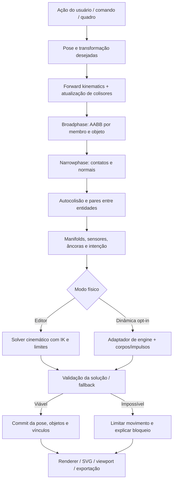
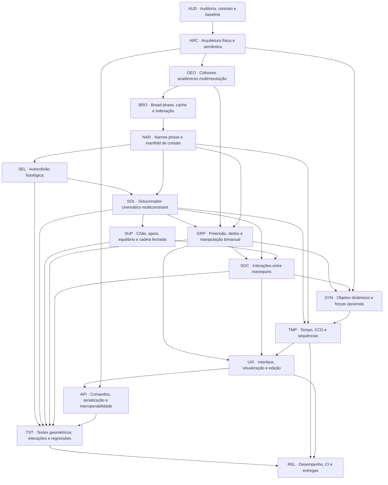

# GeoMannequin · Task Graph de Colisão, Autocolisão e Interações 3D (V2)

**Elaborado em:** 10/11/2026  
**Natureza:** especificação e grafo de tarefas; **não representa implementação**.  
**Escopo:** 177 tarefas de engenharia, 16 fases, com dependências e critérios verificáveis.  
**Escala:** unidade `R` existente (aproximadamente 11,4 cm). `1 R ≈ 11,4 cm` é uma aproximação do modelo atual, não uma métrica física universal.

## 1. Auditoria estática do código existente

Foram inspecionados os arquivos e interfaces de controle do GeoMannequin (branch principal), especialmente:

- `src/engine/colisao.js`: aproximações elipsoidais de cabeça/tórax/abdômen; detecção por amostras do braço e de pernas, correções heurísticas isoladas.
- `src/engine/colisao-cena.js`: ~20 cápsulas por manequim, algoritmo de menor distância entre segmentos, testes por AABB de manequim e contatos entre manequins.
- `src/engine/autocolisao.js`: verificação de partes não adjacentes com tolerância padrão **0,5 R**, sem resolver autocolisões continuamente.
- `src/engine/objetos.js`: objetos compostos por caixas/cilindros, aproximação por cápsulas para interação com manequins e teste orientado ao chão mais preciso para objeto×objeto.
- `src/scene/colisoes.js`: `avisar`, `corrigir`, `bloquear`, correções `distancia/giro/pose/auto`, apoio especial e exclusão por contato permitido.
- `src/engine/apoio.js`: cálculo de apoio por IK para mãos/pés/joelhos, com ajustes de corpo e aproximação do equilíbrio.
- `src/ui/colisoes.js`, `src/ui/arrastar.js`, `src/scene/comandos.js`: comandos e painel integrados às correções atuais; `validarPose()` verifica autocolisão a pedido.
- `src/scene/estado.js`: serialização de permissões de contato por **par inteiro de manequins**, não por região anatômica.
- `testes/colisoes.mjs`: regressões de afastamento, pose, contato permitido, undo e desempenho básico.

### Lacunas estruturais

1. `permitirContato` ignora o **par de manequins**, embora o objetivo seja permitir **contatos locais** e continuar impedindo atravessamento do restante do corpo. Em abraço, os dois tórax podem se penetrar sem aviso.
2. A autocolisão usa uma tolerância grosseira (0,5 R ≈ **5,7 cm**); isso não serve para toque milimétrico ou dedos sobre superfícies.
3. Colisores de cabeça e tronco ainda são formas aproximadas, podendo gerar falso positivo mesmo sem cruzar a malha visual.
4. Mãos atualmente têm cápsulas grossas; dedos, palma e polegar não são usados como colisores detalhados na checagem entre pessoas/objetos.
5. A cinemática inversa e o filtro de colisão não operam como **um solucionador conjunto**; uma alteração posterior de pose pode desfazer a correção.
6. Arrastar a extremidade com `bloquearAlvo` impede que o *alvo* entre em colisores, mas não garante que **toda a cadeia articulada** fique livre.
7. O chão é tratado por sistemas de altura/apoio separados. É necessário integrá-lo semanticamente ao catálogo de contatos.
8. Não foi observado sistema completo de **preensão, vínculo com objeto, rigidez/fricção, transferência e soltura**.
9. O código atual diferencia componentes de desenho e de geometria, mas precisa de IDs estáveis e invalidação incremental do novo motor.
10. **Esta auditoria é leitura do código, não teste integral da aplicação**. Os benchmarks e as validações multivista devem ser executados na implementação.

## 2. Modelo funcional obrigatório

Cada interação deve distinguir claramente:

| Conceito | Semântica | Regra |
|---|---|---|
| `contact` | superfícies encostam | permitido |
| `penetration` | volumes ocupam o mesmo espaço | proibido além de tolerância |
| `sensor` | região detecta presença | não substitui o bloqueio sólido |
| `grip` | mão sustenta objeto | vínculo com âncoras |
| `support` | corpo se apoia em chão/objeto | contato, reação/estabilidade |
| `push` | contato transfere deslocamento/impulso | depende do modo físico |
| `intentional-contact` | usuário escolhe onde encostar | apenas os colisores selecionados ganham essa intenção |

**Invariante principal:** habilitar toque **nunca** implica desabilitar colisões sólidas do par inteiro.

### Modelo matemático

Para uma pose articulada \(q\) e um contato de partes \(i,j\):

\[
g_{ij}(q)=d_{ij}(q)-m_{ij} \geq -\varepsilon_{ij}
\]

onde \(d\) é a distância assinada entre superfícies, \(m\) é a folga desejada, e \(\varepsilon\) é a tolerância de penetração (dependente do LOD). Pontos de toque voluntário usam simultaneamente a restrição \(d\approx m\) **e** a não-interpenetração.

Solucionador (cinemático padrão) busca:

\[
\min_q\ w_p\|q-q_{desejado}\|^2+
\sum_k w_k\|a_k(q)-b_k(q)\|^2+
\lambda\,\mathrm{custo}_{restricoes}(q)
\]

sujeito a limites articulares, âncoras de apoio e não-interpenetração.

**Importante:** se não houver solução fisicamente/articularmente viável, limitar o movimento e apresentar erro de alcançabilidade. Não deformar membros, não ignorar colisões e não teleportar personagens para forçar o resultado.

## 3. Arquitetura proposta



### Política de implementação

- **Fase obrigatória:** motor próprio de restrições geométricas/IK, determinístico e compatível com o app sem engine física instalada.
- **Fase opcional:** adaptador para <https://rapier.rs> visando forças, atrito, dinâmica, quedas e articulações físicas. A integração de Rapier só deve acontecer se a medição justificar seus custos de WASM, bundle e compatibilidade. Rigid bodies cinemáticos não evitam obstáculos automaticamente; esse controle ainda precisa integrar as consultas/solução de movimento do editor.
- **Precisão por níveis:** `coarse` para busca, `medium` para contato anatômico geral e `fine` apenas perto de mãos, rostos, pés, objetos agarrados e pares efetivamente próximos.
- **Mesh BVH opcional:** se for necessário refinar contatos em malha deformada. Uma BVH da pose neutra não é automaticamente válida após movimentar membros.

## 4. Grafo principal das fases



## 5. Task Graph detalhado (177 tarefas)

Estados iniciais: **AUDITADO** para os achados de código já verificados; **PENDENTE** para os demais itens. O grafo é uma fila de trabalho; uma tarefa não está concluída apenas porque possui código similar no projeto.


### AUD — Auditoria, contrato e baseline

**Dependências de fase:** nenhuma.  
**Entrega:** auditoria, contrato e baseline concluída sem quebrar a aplicação existente.

| Tarefa | Dependência imediata | Ação | Evidência/aceitação |
|---|---|---|---|
| **AUD-01** | — | Mapear rotinas atuais de colisão entre manequins | Inventário de capsulas(), detectarColisoes() e contatosEntre() |
| **AUD-02** | AUD-01 | Mapear autocolisão e tolerâncias existentes | Inventário de autoColisoes() e VIZINHOS |
| **AUD-03** | AUD-02 | Mapear colisão com objetos e chão | Inventário de capsulasObjeto(), apoio e restGround() |
| **AUD-04** | AUD-03 | Mapear todos os acionadores de drag, IK e comandos | Fluxograma pointermove → IK → colisão → render |
| **AUD-05** | AUD-04 | Mapear hierarquia completa do esqueleto e transformações | Tabela de juntas, pais, offsets e limites |
| **AUD-06** | AUD-05 | Mapear mãos e dedos em todos os LODs | Tabela de falanges, polegar e superfície atual |
| **AUD-07** | AUD-06 | Mapear persistência, undo e worker/camadas | Contrato de dados e invalidação de cache |
| **AUD-08** | AUD-07 | Executar testes existentes antes de qualquer mudança | Baseline reproduzível com logs e hash do commit |
| **AUD-09** | AUD-08 | Criar cenas de referência de toque e abraço | Fixtures versionados de contato intencional |
| **AUD-10** | AUD-09 | Registrar riscos numéricos e regressões visuais | Relatório de falhas com severidade e reprodução |

### ARC — Arquitetura física e semântica

**Dependências de fase:** `AUD`.  
**Entrega:** arquitetura física e semântica concluída sem quebrar a aplicação existente.

| Tarefa | Dependência imediata | Ação | Evidência/aceitação |
|---|---|---|---|
| **ARC-01** | AUD-10 | Especificar camadas Edit/Kinematic e Dynamic opt-in | Decisão documentada: cinemática padrão, dinâmica opcional |
| **ARC-02** | ARC-01 | Definir pipeline proposta → colisão → solução → commit | API transacional imutável e rollback |
| **ARC-03** | ARC-02 | Definir corpos, colisores, formas e juntas por IDs estáveis | Schema versionado CollisionBody/Collider/Joint |
| **ARC-04** | ARC-03 | Definir contato físico distinto de aviso e vínculo | Contrato Contact/InteractionConstraint/CollisionPolicy |
| **ARC-05** | ARC-04 | Definir unidades R, metros, tempo e tolerâncias | Conversões centralizadas sem duplo escalonamento |
| **ARC-06** | ARC-05 | Definir espaços local, osso, manequim, mundo, câmera | Invariantes de coordenadas e transformações |
| **ARC-07** | ARC-06 | Definir grupos e filtros de colisão por parte e relação | Matriz de 3 estados: testar/ignorar sensor/permitir toque |
| **ARC-08** | ARC-07 | Definir estado impossível e resultado não-convergente | Resultado blocked/limited/unsatisfied sem deformação |
| **ARC-09** | ARC-08 | Definir API de logs determinísticos e snapshots | IDs, normal, penetração, âncora, motivo e timestamp |
| **ARC-10** | ARC-09 | Decidir dependências WASM opcionais após benchmark | ADR Rapier para dinâmica, BVH somente se preciso |

### GEO — Colisores anatômicos multirresolução

**Dependências de fase:** `ARC`.  
**Entrega:** colisores anatômicos multirresolução concluída sem quebrar a aplicação existente.

| Tarefa | Dependência imediata | Ação | Evidência/aceitação |
|---|---|---|---|
| **GEO-01** | ARC-10 | Preservar cápsulas grossas existentes como nível 0 | Mesmas entidades e desempenho de fallback |
| **GEO-02** | GEO-01 | Implementar colisor de cabeça elipsoide/convexo | Crânio/facial com volume separado, sem cabeça esférica excessiva |
| **GEO-03** | GEO-02 | Implementar tórax, dorso, abdômen e pelve compostos | Volumes alinhados à superfície do tronco |
| **GEO-04** | GEO-03 | Implementar pescoço, ombros, clavícula e escápulas | Transições anatômicas por partes |
| **GEO-05** | GEO-04 | Implementar braços e antebraços com raios variáveis | Cápsulas elípticas/cones truncados orientados |
| **GEO-06** | GEO-05 | Implementar coxas, joelhos, canelas e tornozelos | Múltiplos volumes que preservam silhueta |
| **GEO-07** | GEO-06 | Implementar pés completos: calcanhar, sola, dedos | Contatos planos com chão e bordas |
| **GEO-08** | GEO-07 | Implementar palma/dorso/metacarpos com volume próprio | Distinguir face palmar e dorso |
| **GEO-09** | GEO-08 | Implementar cinco dedos e segmentos do polegar | Colisores independentes por falange/junta |
| **GEO-10** | GEO-09 | Ajustar colisores aos biotipos, sexo e escala anatômica | Consistência paramétrica em corpo magro/cheio |
| **GEO-11** | GEO-10 | Definir LOD grosso, médio e detalhado com histerese | LOD adaptativo preserva contatos sem popping |
| **GEO-12** | GEO-11 | Criar visualização de colisor versus malha real | Overlay de raio, erro assinado e perfil |

### BRO — Broad phase, cache e indexação

**Dependências de fase:** `GEO`.  
**Entrega:** broad phase, cache e indexação concluída sem quebrar a aplicação existente.

| Tarefa | Dependência imediata | Ação | Evidência/aceitação |
|---|---|---|---|
| **BRO-01** | GEO-12 | Construir AABB incremental por colisor | Boxes atualizadas apenas para ossos alterados |
| **BRO-02** | BRO-01 | Construir AABB por manequim/objeto/cluster | Culling hierárquico antes dos pares finos |
| **BRO-03** | BRO-02 | Escolher sweep-and-prune ou grade espacial por benchmark | Comparativo com brute force documentado |
| **BRO-04** | BRO-03 | Implementar índice dinâmico para cenas de 12 manequins/40 objetos | Consultas por proximidade em mundo 3D |
| **BRO-05** | BRO-04 | Excluir pares naturalmente adjacentes sem mascarar partes distantes | Tabela de adjacência e filtros estritos |
| **BRO-06** | BRO-05 | Excluir contatos presos por vínculo somente do par necessário | Filtro granular por colisor, jamais por pessoa inteira |
| **BRO-07** | BRO-06 | Priorizar colisores em movimento e próximos | Active set do drag e dos membros alcançando |
| **BRO-08** | BRO-07 | Criar registro de pares candidato estável e determinístico | Sort por IDs e ausência de duplicados |
| **BRO-09** | BRO-08 | Aplicar invalidação por pose, geometria, posição e escala | Cache consistente entre editor e worker |
| **BRO-10** | BRO-09 | Medir número de pares gerados/descartados | Telemetria de broadphase e testes de desempenho |

### NAR — Narrow phase e manifold de contato

**Dependências de fase:** `BRO`.  
**Entrega:** narrow phase e manifold de contato concluída sem quebrar a aplicação existente.

| Tarefa | Dependência imediata | Ação | Evidência/aceitação |
|---|---|---|---|
| **NAR-01** | BRO-10 | Reutilizar segSeg robusto para cápsulas e esferas | Casos degenerados e segmentos paralelos cobertos |
| **NAR-02** | NAR-01 | Implementar esfera/cápsula/caixa orientada/cilindro | Testes cruzados por todas as formas suportadas |
| **NAR-03** | NAR-02 | Implementar convexos com GJK e EPA ou motor equivalente | Profundidade e normal para convexos arbitrários |
| **NAR-04** | NAR-03 | Implementar caixa/cilindro exatos em contato com palma/dedos | Remover falso positivo de aproximação por cápsulas grossas |
| **NAR-05** | NAR-04 | Implementar distância ponto-triângulo e regiões do corpo | Apoio a precisão de superfície seletiva |
| **NAR-06** | NAR-05 | Avaliar BVH por triângulos apenas como refinamento opcional | Detector fino não aplicado indiscriminadamente |
| **NAR-07** | NAR-06 | Calcular testemunhas A/B, normal e penetração assinada | ContactPoint imutável com world/local anchors |
| **NAR-08** | NAR-07 | Criar manifold com contatos múltiplos por par | Agrupar e deduplicar face-a-face e apoio |
| **NAR-09** | NAR-08 | Distinguir toque (d≈0) de penetração (d<0) | Histerese enter/stay/exit para impedir flicker |
| **NAR-10** | NAR-09 | Tratar superfícies tangentes, curvas finas e degeneradas | Epsilon escalonado e fallback normal |
| **NAR-11** | NAR-10 | Implementar normal suave nas junções de volumes | Sem saltos ao mover a mão em torno do tronco |
| **NAR-12** | NAR-11 | Garantir que os dados não dependam da câmera | Teste com yaw/pitch/roll arbitrários |

### SEL — Autocolisão fisiológica

**Dependências de fase:** `NAR`.  
**Entrega:** autocolisão fisiológica concluída sem quebrar a aplicação existente.

| Tarefa | Dependência imediata | Ação | Evidência/aceitação |
|---|---|---|---|
| **SEL-01** | NAR-12 | Substituir inspeção opcional por detector a cada proposta de pose | Todas as alterações de pose passam por self collision |
| **SEL-02** | SEL-01 | Criar grafo de adjacência anatômica variável por articulação | Pais/filhos e volumes próximos não geram falsos conflitos |
| **SEL-03** | SEL-02 | Checar mão versus tórax, abdômen, rosto e cabeça | Toque palmar válido sem atravessar esterno/face |
| **SEL-04** | SEL-03 | Checar antebraço versus coxa, tronco e pescoço | Braço cruzado e repouso sobre perna permitidos |
| **SEL-05** | SEL-04 | Checar mão direita versus mão esquerda e dedos | Entrelace e palmas em contato sem fusão |
| **SEL-06** | SEL-05 | Checar pernas/canelas/pés cruzados, sentado e agachado | Poses comprimidas resolvidas sem explosão |
| **SEL-07** | SEL-06 | Checar cabeça inclinada versus ombro/peito | Restrições cervicais respeitadas |
| **SEL-08** | SEL-07 | Checar dedos versus própria palma e polegar | Fechamento até contato, sem ultrapassar mão |
| **SEL-09** | SEL-08 | Permitir contato local autoinduzido com âncoras e folga | Autotoque controlado e persistente |
| **SEL-10** | SEL-09 | Criar solver específico para autocorreção de poses | Ajuste mínimo de juntas, sem afastar corpo da cena |

### SOL — Solucionador cinemático multiconstraint

**Dependências de fase:** `SEL`, `NAR`.  
**Entrega:** solucionador cinemático multiconstraint concluída sem quebrar a aplicação existente.

| Tarefa | Dependência imediata | Ação | Evidência/aceitação |
|---|---|---|---|
| **SOL-01** | SEL-10, NAR-12 | Definir vetor de graus de liberdade ativos q | DOFs articulares + raiz com limites explícitos |
| **SOL-02** | SOL-01 | Definir custo de desvio de pose e prioridade de âncoras | Ponderações por grupo, alvo e intenção |
| **SOL-03** | SOL-02 | Definir restrições de não-penetração e tolerância | g(q)≥−epsilon e mínimo afastamento |
| **SOL-04** | SOL-03 | Adicionar Jacobianos analíticos ou diferenças finitas estáveis | Derivadas de contatos em relação às juntas |
| **SOL-05** | SOL-04 | Implementar solver iterativo de posição PGS/XPBD adaptado | Subpassos estáveis e convergência limitada |
| **SOL-06** | SOL-05 | Integrar IK de braços e pernas em uma única solução | Não sobrescrever colisões depois do IK |
| **SOL-07** | SOL-06 | Aplicar limite articular e acoplamento de ombro/escápula | Prioridades mecânicas e limites sem clipping tardio |
| **SOL-08** | SOL-07 | Tratar múltiplos membros e corpos interagindo simultaneamente | Contatos combinados e evitar deslocamento oscilante |
| **SOL-09** | SOL-08 | Respeitar elementos fixos e graus de liberdade bloqueados | Manequim ancorado permanece ancorado |
| **SOL-10** | SOL-09 | Implementar backtracking/line-search e rollback | Nunca aplicar piora da solução ou NaN |
| **SOL-11** | SOL-10 | Definir fallback: aproximar até contato factível | Pose inviável fica limitada com feedback explícito |
| **SOL-12** | SOL-11 | Registrar energia de correção/erro residual e iterações | Métricas por solver/parte e tolerância |

### SUP — Chão, apoio, equilíbrio e cadeia fechada

**Dependências de fase:** `SOL`.  
**Entrega:** chão, apoio, equilíbrio e cadeia fechada concluída sem quebrar a aplicação existente.

| Tarefa | Dependência imediata | Ação | Evidência/aceitação |
|---|---|---|---|
| **SUP-01** | SOL-12 | Integrar colisão do chão ao mesmo catálogo de contato | Chão como colisor fixo com altura e normal |
| **SUP-02** | SUP-01 | Criar patch de sola com múltiplos pontos de contato | Calcanhar, metatarso e dedos |
| **SUP-03** | SUP-02 | Suportar palmas, cotovelos, joelhos e cabeça apoiados | Pontos de apoio variados sem perfuração |
| **SUP-04** | SUP-03 | Integrar apoioEm e sobre sem dispensar colisão real | Apoio autorizado não atravessa tampo/assento |
| **SUP-05** | SUP-04 | Criar rigidez/ancoragem configurável dos apoios | Bloquear pé plantado durante ajuste do tronco |
| **SUP-06** | SUP-05 | Verificar centro de massa e polígono de sustentação | Alerta ou correção de desequilíbrio |
| **SUP-07** | SUP-06 | Resolver dois pés no chão e mãos em superfície ao mesmo tempo | Cadeia fechada multiapoio sem briga entre solvers |
| **SUP-08** | SUP-07 | Permitir arraste do corpo com apoio escorregável controlado | Fricção/capacidade de deslizar independente de interpenetração |
| **SUP-09** | SUP-08 | Criar casos sentado, ajoelhado, quatro apoios e deitado | Contato estável em superfícies horizontais/verticais |
| **SUP-10** | SUP-09 | Proteger câmeras e objetos do recálculo de suporte | Simulação independente da projeção SVG |

### GRP — Preensão, dedos e manipulação bimanual

**Dependências de fase:** `SOL`, `GEO`, `NAR`.  
**Entrega:** preensão, dedos e manipulação bimanual concluída sem quebrar a aplicação existente.

| Tarefa | Dependência imediata | Ação | Evidência/aceitação |
|---|---|---|---|
| **GRP-01** | SOL-12, GEO-12, NAR-12 | Definir sockets palmares e contatos anatômicos por dedo | Âncoras locais palma/polegar/falanges |
| **GRP-02** | GRP-01 | Criar modo aproximação pré-preensão | IK de mão orientada ao objeto antes do toque |
| **GRP-03** | GRP-02 | Identificar contatos discretos em pinça e palma | Mínimo de pontos independentes ao redor da forma |
| **GRP-04** | GRP-03 | Definir algoritmo de fechamento incremental de dedos | Cada falange para no primeiro contato |
| **GRP-05** | GRP-04 | Criar preensão cilíndrica, esférica, pinça e gancho | Presets por morfologia e diâmetro do objeto |
| **GRP-06** | GRP-05 | Criar sistema de holding com transformação relativa estável | Mão/objeto movem juntos sem oscilação |
| **GRP-07** | GRP-06 | Permitir girar objeto na mão com punho e dedos ajustados | Regrasp limitado e âncoras recalculadas |
| **GRP-08** | GRP-07 | Implementar segurar com duas mãos | Dois alvos resolvidos conjuntamente |
| **GRP-09** | GRP-08 | Implementar transferência de uma mão para outra | Handover atômico sem teletransporte |
| **GRP-10** | GRP-09 | Implementar soltar e recolocar sem manter contato fantasma | Release remove vínculo e devolve colisão normal |
| **GRP-11** | GRP-10 | Detectar preensão impossível e objeto grande demais | Status failed/partial, sem atravessar dedos |
| **GRP-12** | GRP-11 | Manter colisão do objeto segurado com corpo e cenário | Exceção somente nas áreas de apoio intencionais |

### SOC — Interações entre manequins

**Dependências de fase:** `GRP`, `SOL`, `SUP`.  
**Entrega:** interações entre manequins concluída sem quebrar a aplicação existente.

| Tarefa | Dependência imediata | Ação | Evidência/aceitação |
|---|---|---|---|
| **SOC-01** | GRP-12, SOL-12, SUP-10 | Definir contatos alvo entre pessoas por região corporal | Âncoras mão→mão, mão→ombro, braço→torso |
| **SOC-02** | SOC-01 | Implementar toque local com dedo, palma ou pé | Mover até superfície e manter folga não negativa |
| **SOC-03** | SOC-02 | Implementar aperto de mão bilateral | Duas mãos com orientação e fechamento coordenados |
| **SOC-04** | SOC-03 | Implementar braço no ombro e mão nas costas | IK intercorporal sem perfurar trapézio/torso |
| **SOC-05** | SOC-04 | Implementar abraço frontal com dois braços | Múltiplos contatos e espaço para tórax/cabeças |
| **SOC-06** | SOC-05 | Implementar abraço lateral e por trás | Contato guiado por orientação, não atravessamento |
| **SOC-07** | SOC-06 | Implementar tocar o rosto sem afundar malha | Colisão detalhada em crânio facial V4.2 |
| **SOC-08** | SOC-07 | Implementar apoiar/manter peso entre manequins | Apoio cinemático e limites de equilíbrio |
| **SOC-09** | SOC-08 | Implementar empurrão com deslocamento de alvo | Prioridade a cinemática; dinâmica apenas quando opt-in |
| **SOC-10** | SOC-09 | Implementar puxar e conduzir pela mão | Constraint de distância/orientação com colisão ativa |
| **SOC-11** | SOC-10 | Definir transições e cancelamento seguro de interação | Máquina de estados idle→approach→contact→hold→release |
| **SOC-12** | SOC-11 | Gerar presets narrativos e comandos para pares/grupos | Testes de frontal, lateral, trás, alturas diferentes |

### DYN — Objetos dinâmicos e forças opcionais

**Dependências de fase:** `GRP`, `SOC`, `ARC`.  
**Entrega:** objetos dinâmicos e forças opcionais concluída sem quebrar a aplicação existente.

| Tarefa | Dependência imediata | Ação | Evidência/aceitação |
|---|---|---|---|
| **DYN-01** | GRP-12, SOC-12, ARC-10 | Avaliar integração de Rapier WASM isolada em adapter | Sem introduzir dependência obrigatória no desenho |
| **DYN-02** | DYN-01 | Definir modos static/kinematic/dynamic/sensor de objetos | Mapeamento consistente entre mundos |
| **DYN-03** | DYN-02 | Definir massa, centro de massa e inércia | Material com densidade por objeto |
| **DYN-04** | DYN-03 | Definir coeficientes de atrito, restituição e amortecimento | Queda e arrasto controláveis |
| **DYN-05** | DYN-04 | Implementar push impulses em corpos dinâmicos | Contato produz deslocamento sem teleporte |
| **DYN-06** | DYN-05 | Implementar objeto lançado/solto e colisão no chão | Gravidade opt-in e CCD nos casos rápidos |
| **DYN-07** | DYN-06 | Sincronizar rigid bodies e pontos de encaixe da mão | Transferência cinemático↔dinâmico sem salto |
| **DYN-08** | DYN-07 | Implementar colisão caixa × caixa / cilindro × caixa dinâmica | Contato robusto nas orientações suportadas |
| **DYN-09** | DYN-08 | Implementar bloqueio de penetração nas cenas estáticas | Mesma geometria mesmo sem física |
| **DYN-10** | DYN-09 | Garantir que o SVG não dependa do passo de física | Render determinístico de snapshot |

### TMP — Tempo, CCD e sequências

**Dependências de fase:** `SOL`, `NAR`, `DYN`.  
**Entrega:** tempo, ccd e sequências concluída sem quebrar a aplicação existente.

| Tarefa | Dependência imediata | Ação | Evidência/aceitação |
|---|---|---|---|
| **TMP-01** | SOL-12, NAR-12, DYN-10 | Definir prevPose, desiredPose, solvedPose por entidade | Estados independentes sem sobrescrever origem |
| **TMP-02** | TMP-01 | Fixar timestep de resolução e interpolação visual | Subpassos previsíveis na edição contínua |
| **TMP-03** | TMP-02 | Adicionar sweep ou shape-casting para membros rápidos | Não atravessar entre dois frames |
| **TMP-04** | TMP-03 | Aplicar CCD seletivo a mão, cabeça e objetos rápidos | Prioridade por velocidade e tamanho |
| **TMP-05** | TMP-04 | Evitar tunneling em movimentos de articulação rotacional | Subdivisão angular ou cast não linear onde disponível |
| **TMP-06** | TMP-05 | Persistir âncoras durante timelines/quadros | Sem escorregar durante transições |
| **TMP-07** | TMP-06 | Calcular contatos ao interpolar quadros do editor | Animação sem atravessamento intermediário |
| **TMP-08** | TMP-07 | Separar detectar início/manter/fim de contato | Eventos estáveis e debounced |
| **TMP-09** | TMP-08 | Cancelar vínculos quando objeto/manequim desaparece | Sem referências pendentes nem erros de replay |

### UIX — Interface, visualização e edição

**Dependências de fase:** `GRP`, `SOC`, `TMP`.  
**Entrega:** interface, visualização e edição concluída sem quebrar a aplicação existente.

| Tarefa | Dependência imediata | Ação | Evidência/aceitação |
|---|---|---|---|
| **UIX-01** | GRP-12, SOC-12, TMP-09 | Criar modo Colisão 2.0 no painel existente | Seleção avisar/bloquear/corrigir e filtros |
| **UIX-02** | UIX-01 | Mostrar colisores anatômicos e AABBs como overlay opcional | Cores por corpo/parte e status |
| **UIX-03** | UIX-02 | Mostrar pontos, normais e profundidades em 3D projetado | Gizmos sem alteração de malha final |
| **UIX-04** | UIX-03 | Criar seleção de colisor e alvo de toque por clique | Picker parte→parte de dois manequins |
| **UIX-05** | UIX-04 | Criar gizmos de preensão/soltura para objetos | Mão, objeto e âncora visíveis durante edição |
| **UIX-06** | UIX-05 | Adicionar ajuste de prioridades IK/contato/pose | Sliders avançados com padrões seguros |
| **UIX-07** | UIX-06 | Exibir falha de alcance e contatos impossíveis | Mensagem contextual e sugestão sem correção surpresa |
| **UIX-08** | UIX-07 | Integrar desfazer/refazer transacional de interações | Undo com estados da pose/objetos/vínculos |
| **UIX-09** | UIX-08 | Criar visualização em câmeras orbitais e foco regional | A inspeção não depende do ângulo de câmera |
| **UIX-10** | UIX-09 | Adicionar modo performance baixo/médio/alto | Alternar precisão sem quebrar vínculos existentes |

### API — Comandos, serialização e interoperabilidade

**Dependências de fase:** `UIX`, `ARC`.  
**Entrega:** comandos, serialização e interoperabilidade concluída sem quebrar a aplicação existente.

| Tarefa | Dependência imediata | Ação | Evidência/aceitação |
|---|---|---|---|
| **API-01** | UIX-10, ARC-10 | Criar cena.colisoesDetalhadas() com contatos físicos | Consulta estável normal/profundidade/IDs/partes |
| **API-02** | API-01 | Criar cena.modoColisao() e politicas granulares | Configuração independente por par/parte |
| **API-03** | API-02 | Criar m.tocar(alvo,{parte,regiao,forca}) | Comando reproduzível por ID |
| **API-04** | API-03 | Criar m.segurar(objeto,{mao,tipo}) | Preensão retorna handle/estado |
| **API-05** | API-04 | Criar m.soltar({mao}) | Liberação consistente com física opcional |
| **API-06** | API-05 | Criar cena.interagir(tipo,a,b,opts) | Abraçar, apertar mão, empurrar, puxar |
| **API-07** | API-06 | Adicionar schema versionado de contatos/âncoras | JSON compatível com projetos antigos |
| **API-08** | API-07 | Restaurar vínculos por IDs reatribuídos e referências válidas | LoadScene sem perder alvo nem duplicar vínculo |
| **API-09** | API-08 | Registrar código em roteiros de quadros e MCP | Mesmo resultado em UI e comandos headless |
| **API-10** | API-09 | Fornecer documentação e exemplos editáveis no editor | Exemplos e mensagens de erro em português |

### TST — Testes geométricos, interações e regressões

**Dependências de fase:** `SEL`, `SOL`, `SUP`, `GRP`, `SOC`, `API`.  
**Entrega:** testes geométricos, interações e regressões concluída sem quebrar a aplicação existente.

| Tarefa | Dependência imediata | Ação | Evidência/aceitação |
|---|---|---|---|
| **TST-01** | SEL-10, SOL-12, SUP-10, GRP-12, SOC-12, API-10 | Criar fixtures de cada classe de contato geométrico | Unitários esfera/cápsula/OBB/convexo |
| **TST-02** | TST-01 | Cobrir zero comprimento, normal zero e eixos paralelos | Sem NaN/Infinity |
| **TST-03** | TST-02 | Cobrir todos os pares de corpo/corpo vizinhos e distantes | Sem falsos negativos fatais |
| **TST-04** | TST-03 | Cobrir todos os biotipos, V1–V4.2 e poses extremas | Malha vs collider com erros reportados |
| **TST-05** | TST-04 | Validar contato da palma com caixa e esfera | Distância e normal corretas |
| **TST-06** | TST-05 | Validar dedos segurando copo com polegar oposto | Sem penetração fora da folga |
| **TST-07** | TST-06 | Validar mão no próprio rosto e tronco | Autocontato sem deslocar raiz |
| **TST-08** | TST-07 | Validar aperto de mão e abraço entre dois manequins | Sem penetração do tórax nem dos braços |
| **TST-09** | TST-08 | Validar três ou mais manequins em contato coordenado | Convergência estável e estados persistentes |
| **TST-10** | TST-09 | Validar queda, soltura e empurrão em física opt-in | Sem tunneling e sem divisão por zero |
| **TST-11** | TST-10 | Validar pés e palmas apoiados no chão | Âncoras preservadas durante mudanças de pose |
| **TST-12** | TST-11 | Validar drag rápido e oscilante em todas as câmeras | Movimento contínuo sem atravessamento |
| **TST-13** | TST-12 | Validar reabertura JSON, undo/redo e links de cena | Identidade das âncoras preservada |
| **TST-14** | TST-13 | Executar regressões existentes de colisão, rig, pose e renderer | Sem perda de recursos anteriores |
| **TST-15** | TST-14 | Criar matriz visual de 3×3 por interação e biotipo | Inspeção frontal/3-4/perfil/topo |
| **TST-16** | TST-15 | Criar fuzz/property testing com sementes reproduzíveis | Dezenas de milhares de poses sem NaN ou crash |

### REL — Desempenho, CI e entregas

**Dependências de fase:** `TST`, `TMP`, `UIX`.  
**Entrega:** desempenho, ci e entregas concluída sem quebrar a aplicação existente.

| Tarefa | Dependência imediata | Ação | Evidência/aceitação |
|---|---|---|---|
| **REL-01** | TST-16, TMP-09, UIX-10 | Criar benchmarks com 1, 2, 6 e 12 manequins | Latência por fase e contagem de pares |
| **REL-02** | REL-01 | Criar benchmarks com 10, 20 e 40 objetos | Cenários estáticos e manipuláveis |
| **REL-03** | REL-02 | Medir device low-end com GPU integrada e CPU comum | Resultados de p50/p95 e memória |
| **REL-04** | REL-03 | Implementar atualização incremental por membros alterados | Não recalcular a cena inteira a cada dedo |
| **REL-05** | REL-04 | Usar Web Worker só onde resultado assíncrono é seguro | Sem race entre pose editada e contato aplicado |
| **REL-06** | REL-05 | Definir orçamento de tempo e fallback de LOD | Meta de editor responsivo com correção parcial confiável |
| **REL-07** | REL-06 | Criar pipeline CI de física e matemática | Tests/headless/build/documentação por PR |
| **REL-08** | REL-07 | Criar gate de revisão visual e interação humana | Nenhuma promessa de contato perfeito sem atlas real |
| **REL-09** | REL-08 | Incluir tracing de causas de não convergência | Reprodução/diagnóstico em issue |
| **REL-10** | REL-09 | Publicar documentação de limites e modo experimental | Configurações e limitações acessíveis |
| **REL-11** | REL-10 | Criar migração dos modos antigos para o novo motor | Padrões preservam cenas e scripts |
| **REL-12** | REL-11 | Liberar gradualmente atrás de feature flag | Ativação progressiva e rollback sem alterar poses |

## 6. Entregas verificáveis por marco

| Marco | Etapas mínimas | Deve demonstrar |
|---|---|---|
| M0 · Baseline | AUD, ARC | Testes antigos reproduzíveis e APIs definidas |
| M1 · Sem atravessar | GEO, BRO, NAR, SEL, SOL | Braços, pernas, mãos e cabeça não penetram os próprios sólidos e os dos outros |
| M2 · Apoiar | SUP | Pés e mãos apoiam em chão e objetos sem invadir volumes |
| M3 · Segurar | GRP | Copo/caixa mantêm transform relativa à mão e os dedos param na superfície |
| M4 · Interagir | SOC | Aperto de mão/abraço/empurrão solucionados com múltiplos contatos |
| M5 · Animar | TMP, DYN se necessário | Drag e quadros interpolados sem tunneling, física opcional |
| M6 · Entregar | UIX, API, TST, REL | Editor, comandos, JSON, testes, documentação e build integrados |

### Critérios quantitativos iniciais (metas de projeto, NÃO medições)

- Em testes `fine`, profundidade residual desejada \(\le 0.01R\) (≈ 1,1 mm) por par crítico em contato. A tolerância deve ser calibrada contra o erro real entre proxy e malha visual; nunca declarar exatidão milimétrica antes disso.
- No nível `medium`, alvo inicial \(\le 0.04R\) (≈ 4,6 mm) de penetração tolerada no **colisor**, com ressalva sobre correspondência visual da pele.
- Nenhuma pose, contato ou estado salvo pode conter NaN/Infinity, ponteiro inválido ou mudança silenciosa de escala.
- Após 100 ciclos consecutivos de manter um objeto, a transformação relativa da mão/objeto deve permanecer no limiar escolhido e não apresentar oscilação perceptível.
- Os benchmarks devem considerar 1, 2, 6, 12 manequins e 10, 20, 40 objetos; meta inicial de solver interativo p95 ≤16 ms em cena de referência, com degradação previsível de LOD e fallback quando inviável.
- Passagem visual obrigatória nos ângulos frontal, perfil bilateral, três quartos, traseira, superior e inferior para cada tipo de interação.
- Salvar → recarregar → desfazer/refazer deve manter âncoras, relações de contato e corpos segurados sem falha.

## 7. Matriz mínima de cenários

| Interação | Atores | Deve ocorrer | Erro impeditivo |
|---|---|---|---|
| Mão no próprio rosto | 1 manequim | Palma ou dedo repousa na pele facial | Dedo atravessa crânio ou punho penetra pescoço |
| Braços cruzados | 1 manequim | Antebraços encostam no tórax/bíceps | Volumes se fundem |
| Pernas cruzadas sentado | 1 manequim | Coxa/perna encostam sem interpenetração | Joelho atravessa outra coxa |
| Mãos entrelaçadas | 1 manequim | Falanges se aproximam e passam nos espaços livres | Dedos cortam dedos/palmas |
| Aperto de mão | 2 manequins | Alinhamento palmar e dedos com contato | Uma mão atravessa outra |
| Abraço frontal | 2 manequins | Tórax aproxima, braços envolvem superfícies | Tórax/cabeça atravessados |
| Abraço lateral/por trás | 2 manequins | Braços aderem aos alvos de contato | Braços penetram tronco |
| Mão nas costas | 2 manequins | Palma toca região dorsal | Ombro/punho atravessa corpo |
| Segurar copo | 1 manequim + objeto | Dedos fecham em torno de cilindro | Copo atravessa palma, dedos ou tronco |
| Segurar caixa | 1/2 manequins + objeto | Preensão mono/bimanual mantida | Caixa atravessa pernas/peito |
| Empurrar outro manequim | 2 manequins | Contato bilateral e deslocamento controlado | Teletransporte ou penetração |
| Apoiar-se na mesa | manequim + objeto | Palmas no tampo, pés no chão | Mãos atravessam tampo |
| Quatro apoios | 1 manequim + chão | Mãos e pés/joelhos simultaneamente apoiados | Flutuação ou atravessamento |
| Descer degrau | 1 manequim + objeto | Planta apoia no topo sem tunneling | Pé afunda no degrau |
| Cena cheia | 12 manequins + 40 objetos | Consulta, edição e render responsivos | Travamento, corrupção, IDs repetidos |

## 8. APIs públicas propostas (ainda não implementadas)

```js
// Consulta
cena.colisoesDetalhadas({ nivel: "fine", incluirAuto: true });
cena.modoColisao({ modo: "bloquear", precision: "adaptive" });

// Contato anatômico local: continua sólido
cena.obter("A").tocar("B", {
  parte: "maoD", alvoParte: "ombroE", tipo: "palma"
});

// Preensão e soltura
const grip = cena.obter("A").segurar("Copo 1", {
  mao: "direita", tipo: "cilindrica"
});
cena.obter("A").soltar({ mao: "direita" });

// Entre pessoas
cena.interagir("abracar", "A", "B", { tipo: "frontal" });
cena.interagir("apertarMao", "A", "B", { lados: ["direita", "direita"] });
cena.interagir("empurrar", "A", "B", {
  mao: "esquerda", modo: "cinematico"
});
```

A nomenclatura é **proposta para implementação futura**. Nenhuma dessas assinaturas novas deve ser considerada disponível até implementação e aprovação dos testes.

## 9. Arquivos sugeridos (compatibilidade)

**Evoluir os existentes (evitar reescrever tudo):**

```text
src/engine/colisao.js             # proxies locais e colisões com o corpo
src/engine/colisao-cena.js        # primitivas, pares e contatos
src/engine/autocolisao.js         # filtro de vizinhos e self-collision
src/engine/objetos.js             # objetos simples e colisores
src/engine/apoio.js               # chão e apoio multicontato
src/engine/cadeia.js              # FK/IK, transformações do rig
src/scene/colisoes.js            # políticas e resolução da cena
src/scene/estado.js              # JSON, undo e vínculos
src/scene/comandos.js            # API do editor/roteiros
src/ui/colisoes.js               # painel e avisos
src/ui/arrastar.js               # drags transacionais
```

**Novos módulos a considerar:**

```text
src/engine/contact/shape.js
src/engine/contact/proxy-registry.js
src/engine/contact/finger-colliders.js
src/engine/contact/broadphase.js
src/engine/contact/narrowphase.js
src/engine/contact/manifold.js
src/engine/contact/self-filter.js
src/engine/contact/solver-kinematic.js
src/engine/contact/ccd.js
src/engine/contact/constraints.js
src/engine/contact/grip.js
src/engine/contact/support.js
src/engine/contact/interaction.js
src/engine/contact/physics-adapter.js
src/scene/interaction-state.js
src/ui/contact-overlay.js
testes/contato-*.mjs
```

## 10. Riscos que NÃO devem virar atalhos

1. Desligar colisão de todo o manequim para permitir abraço.
2. Aplicar uma nova pose a cada frame que sobrescreve o resultado de colisão.
3. Usar só a projeção 2D para medir contato de corpos 3D.
4. Considerar cápsula larga equivalente à pele real (especialmente cabeça, orelhas, mãos e tórax).
5. Mover a mão ao destino sem testar o resto do braço e a trajetória.
6. Tratar agarrar como posicionar objeto apenas perto da palma, sem vínculos.
7. Exigir resposta física realista no modo de edição estática.
8. Resolver colisão com deformação ou mudança silenciosa de proporção anatômica.
9. Recompilar todos os objetos/corpos ao mover um dedo.
10. Marcar task como concluída sem testes em cenas e vistas reais.

## 11. Fontes técnicas para decisões futuras

- Rapier JS — Rigid bodies e limitação de kinematic: <https://rapier.rs/docs/user_guides/javascript/rigid_bodies/>
- Rapier JS — Collision groups, sensores e contact skin: <https://rapier.rs/docs/user_guides/javascript/colliders/>
- Rapier JS — Joints, âncoras e motores: <https://rapier.rs/docs/user_guides/javascript/joints/>
- Rapier JS — Character controller: <https://rapier.rs/docs/user_guides/javascript/character_controller/>
- BVH para precisão triangular (opcional): <https://github.com/gkjohnson/three-mesh-bvh/blob/master/API.md>
- XPBD/contact constraints como referência de arquitetura de solver: <https://developer.blender.org/docs/features/nodes/xpbd_solver/>

## 12. Conclusão

**Implementar na ordem AUD → ARC → GEO → BRO → NAR → SEL → SOL → SUP → GRP → SOC, com DYN/TMP conforme necessidade, depois UIX/API/TST/REL.** O primeiro marco útil não é um abraço: é uma mão apoiada no próprio tronco sem penetrá-lo, preservando pose, IK e câmera. A segunda prova é uma mão segurando um copo com cinco dedos reconhecidos como colisores. A terceira é um abraço com contatos múltiplos e sem mascarar a colisão dos tórax.

O código existente é uma fundação aproveitável. O trabalho principal é substituir a correção **depois** do conflito por solução **durante** a pose, com contato intencional e não interpenetração como restrições simultâneas.
