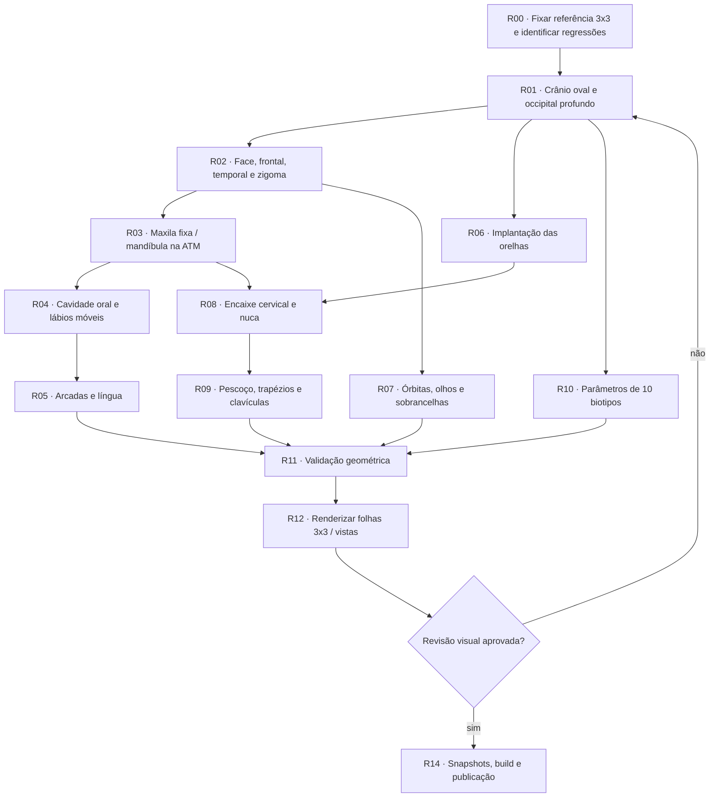

# GeoMannequin — reconstrução craniana pela referência 3×3

## Escopo

A referência visual fornecida na conversa mostra a caixa craniana como uma **abóbada ovalada e profunda na lateral**, não uma esfera. O arco frontal, região parietal, têmpora, occipital, maxila, mandíbula, pavilhões auriculares e pescoço devem manter relações plausíveis em **frente, perfil, 3/4, costas, ângulos verticais e com a boca aberta**.

O desenho da referência é uma diretriz artística/anatômica, não uma superfície 3D fotogramétrica calibrada. As proporções finais devem ser avaliadas visualmente e por simetria antes de serem aprovadas como definitivas.

## Grafo de execução



## Task graph e estado técnico

| ID | Ajuste | Arquivos | Estado |
| --- | --- | --- | --- |
| R00 | Inspeção dos dois prints com boca aberta e da nova folha de referência 3×3 | Imagens fornecidas | Concluído |
| R01 | Lateral da caixa craniana em disco oval, parietal amplo, occipital profundo, frontal mais plano; transições C1 | `engine/cabeca.js` | Implementado |
| R02 | Ajuste dos planos frontal/temporal e posterior da máscara facial | `engine/cabeca.js` | Implementado na superfície parametrizada; **máscara não é uma malha separada** |
| R03 | Giro da mandíbula com pivô na ATM, maxila superior estática e preservação da nuca; esqueleto sincronizado | `cabeca.js`, `esqueleto.js` | Implementado com deformação paramétrica |
| R04 | Remover abertura tipo grade; rima oral curva, lábios superior/inferior, pequena depressão volumétrica da boca | `engine/boca.js`, `desenho.js`, `cabeca.js` | Implementado |
| R05 | Arcadas anteriores, dentes curtos e língua associados à abertura | `engine/boca.js`, `desenho.js` | Representação projetada, **não malhas internas 3D completas** |
| R06 | Reposicionar orelhas nas laterais e ligá-las à região mastoide/ATM | `engine/cabeca.js` | Implementado |
| R07 | Integrar órbitas, linhas faciais e sobrancelhas à nova curvatura | `engine/cabeca.js`, `desenho.js` | Integrado com o sistema facial anterior |
| R08 | Corrigir movimento indevido do occipital durante a abertura e união da mandíbula com a nuca | `engine/cabeca.js` | Implementado |
| R09 | Prolongar região cervical aparente e só então abrir para a cintura escapular | `engine/corpo.js` | Implementado |
| R10 | Parâmetro `cranialDepth` e perfis por sexo/biotipo, junto de `headScale`, `skull`, `face` e `jaw` | `scene/biotipos.js`, `parametros.js`, `engine/padroes.js`, `montagem.js` | Implementado |
| R11 | Geometria de crânio, ATM, orelhas, pescoço, 10 biotipos, 50 aberturas, cache | `testes/cabeca-referencia.mjs`, `anatomia-integral.mjs` | Teste de referência passou em V8; suíte Node completa pendente |
| R12 | 3×3 de masculino médio e feminino médio, mais frente/perfil/3/4 para cinco biotipos de cada sexo | `testes/atlas-cranio.mjs`, `testes/visuais-cranio-3x3/` | **48 SVGs renderizados**, sem erros numéricos |
| R13 | Revisão estética comparando renderizações com a referência, especialmente boca, perfil e região mastoide | Arquivos SVG e aplicação | **Pendente de avaliação visual** |
| R14 | Regravar hashes antigos, recompilar `dist/` e pacote MCP se houver aprovação visual | `testes/referencia.json`, builds | **Pendente** |

## Evidências objetivas

- **48 renderizações originais do motor:** 2 folhas de 9 vistas (18) + 10 biotipos × 3 vistas (30). As cenas geraram SVGs válidos, sem `NaN`, `Infinity` ou `undefined`.
- **Teste geométrico:** 10 biotipos × 5 estados mandibulares = 50 aberturas testadas; perfil occipital, simetria das orelhas, comprimento do pescoço, maxila fixa e nuca sem rotação involuntária.
- **Interface e MCP:** `boca.js` foi exportado por `engine/index.js`; `cranialDepth` foi registrado na interface de parâmetros e na chave de cache do crânio.
- **Continuidade dos ajustes anteriores:** ombros, tronco, glúteos, pelve e pernas permanecem nos módulos do projeto. A reconstrução atual não altera a divisão dos dez biotipos.

## Folhas de revisão

- [Masculino médio — 3×3](../testes/visuais-cranio-3x3/masculino-medio.svg)
- [Feminino médio — 3×3](../testes/visuais-cranio-3x3/feminino-medio.svg)

## Como reproduzir e verificar

```bash
cd geomannequin
npm ci
npm ci --prefix mcp
npm run testar:cranio
npm run testar:anatomia
npm run atlas:cranio -- masculino medio
npm run atlas:cranio -- feminino medio
npm run testar:face
npm run testar:matriz
# Após inspecionar visualmente, regravar hashes apenas com aprovação:
# node testes/cenas.mjs --gravar
npm run testar
npm run construir
npm run build --prefix mcp
```

## Limites que não devem ser ocultados

1. O motor usa uma **única superfície de cabeça com deformação mandibular**, não crânio, maxila e mandíbula como três malhas físicas independentes.
2. Dentes, língua e parte interna da boca têm geometria curvilínea e projeção, mas **não são cavidades 3D completas com arcadas volumétricas, molares e palato**. A depressão bucal dá uma leitura de profundidade sem substituir malha oral separada.
3. Mesmo 48 SVGs numéricos válidos **não provam fidelidade anatômica ou aprovação estética**.
4. A matriz anterior de 900 cenas corporais e 300 cenas faciais ainda precisa de execução integral e de comparação visual. Workflow manual disponível para quando houver runner.
5. Não reconstruir automaticamente o HTML standalone nem regravar a referência histórica sem inspeção humana. O GitHub Pages utiliza diretamente os módulos `src/`.

Consulte também [task graph geral](task-graph-reconstrucao-anatomica.md) e [harmonia dos 10 biotipos](task-graph-harmonia-10-biotipos.md).
