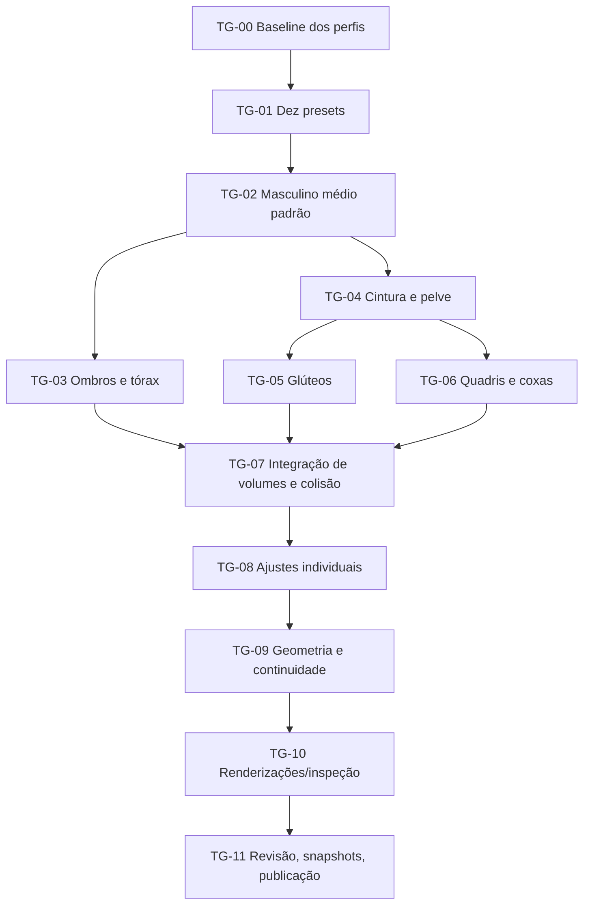

# Task graph — harmonia anatômica de 10 biotipos

**Alvo:** ombros → tórax → cintura → crista ilíaca/pelve → glúteos → coxas → joelhos → panturrilhas.
Referência-base: **masculino médio**; derivações para masculino/feminino × magro/médio/atlético/musculoso/cheio.

## Dependências



## Entregas implementadas

| Etapa | Alteração | Arquivos | Estado |
| --- | --- | --- | --- |
| TG-00 | Mapa das proporções e gargalos do motor antigo | `src/engine/`, `src/scene/` | Concluído |
| TG-01 | Dez presets com parâmetros próprios e interpolação do sexo sem perder ajustes manuais | `src/scene/biotipos.js`, `poses.js`, `comandos.js`, `ui/controles.js` | Concluído |
| TG-02 | `DEF` agora corresponde ao masculino médio canônico | `src/engine/padroes.js` | Concluído |
| TG-03 | Recalibração da largura/queda dos ombros, pescoço e massa muscular nos presets; preservação do deltoide e da articulação existentes | `biotipos.js`, `bracos.js` (auditado) | Concluído no escopo paramétrico |
| TG-04 | Fórmulas efetivas de cintura/pelve por sexo; interpolação Hermite monotônica C1 de alturas não uniformes | `src/engine/corpo.js` | Concluído |
| TG-05 | Relevo glúteo alinhado à largura da pelve, com invalidação adequada de cache | `src/engine/tronco.js`, `montagem.js` | Concluído |
| TG-06 | Centro das articulações coxofemorais compensado por espessura superior das coxas sem deslocar o esqueleto do restante do motor | `src/engine/pernas.js` | Concluído |
| TG-07 | Proxy abdominal acompanha largura real da pele; pelve mantém cápsula de colisão parametrizada | `src/engine/colisao.js`, `colisao-cena.js` | Concluído |
| TG-08 | Ajustes específicos por sexo e cinco perfis; seleção coerente por código/interface | `biotipos.js`, `comandos.js`, `ui/controles.js` | Concluído |
| TG-09 | Regressões de proporção, simetria, curvatura, encaixe das coxas, alterações manuais e cache; persistência JSON/editor de quadros | `testes/biotipos.mjs`, `testes/biotipos-cenas.mjs`, `src/scene/estado.js`, `ordem.json` | Aprovado nas verificações JS realizadas |
| TG-10 | Matriz automatizada de 900 cenas, exportação de 20 SVG e recortes PNG; revisão visual | `testes/matriz-anatomica.mjs`, `.github/workflows/geomannequin-anatomia.yml` | Ferramentas criadas; execução completa e revisão humana pendentes |
| TG-11 | PR de integração e atualização da referência visual | `testes/referencia.json`, `dist/` | Integração de código realizada; snapshots e build standalone exigem ambiente de execução |

## Proporções resultantes (raio pélvico / raio de cintura, vista frontal neutra)

| Perfil | Masculino | Feminino |
| --- | ---: | ---: |
| Magro | 1,117 | 1,387 |
| Médio | 1,112 | 1,365 |
| Atlético | 1,053 | 1,369 |
| Musculoso | 1,038 | 1,372 |
| Cheio | 1,090 | 1,285 |

Não são proporções antropométricas clínicas: são raios paramétricos locais do motor.
A variação é intencional; não há uma razão universal obrigatória para todos os corpos.

## Evidência de execução na revisão

- `testes/biotipos.mjs`: executado em JavaScript V8 com as funções reais; **10 biotipos passaram**, maior desvio de tangente de aproximadamente **0,000506**. A etapa de malhas usou construtores simplificados para avaliar a invalidação de cache sem o rasterizador.
- `testes/cintura.mjs` e `testes/pelve.mjs`: executados com funções geométricas reais; ambos **passaram**.
- **10 biotipos**: renderização efetiva do motor em SVG da pose neutra frontal (camadas reduzidas); todos válidos sem `NaN`/`Infinity`/`undefined`.
- **6 cenas adicionais**: masculino médio com braços levantados em três quartos e feminino atlético agachado com torção em três quartos, cada qual nos modos manequim, construção e écorché. Todos os seis SVGs válidos.
- **MCP/headless**: seleção por código, troca de sexo, guarda e recuperação de biotipo no JSON, continuidade de três quadros e restauração da cena original **passaram** numa fábrica de cenas V8 reproduzindo a montagem do `mcp/lib/core.mjs`.
- GitHub Actions iniciou um registro, mas o job **não recebeu runner (0 ms de execução)**. Por isso, os 900 renders e os PNGs não foram executados lá; o workflow foi mantido manual para evitar falhas a cada push.
- O conjunto antigo de hashes de `testes/referencia.json` já estava desatualizado no estado anterior do repositório. **Não regravamos os hashes sem inspeção visual** para não aprovar automaticamente mudanças indesejadas.
- `dist/geomannequin.html` não foi reconstruído; **GitHub Pages usa `src/main.js` e recebe diretamente os módulos atualizados**.

## Critérios de aceite final

- [x] Modelo inicial = masculino médio
- [x] Cinco submodelos masculinos e cinco femininos diferenciados
- [x] Seleção por código e UI convergentes e comportamento contínuo do slider `fem`
- [x] Simetria na pose neutra, com paridade entre articulações esquerda/direita
- [x] Curvatura C1 em cintura, crista ilíaca e pelve para os dez biotipos
- [x] Volume de glúteo invalida a malha e acompanha a pelve
- [x] Encaixe da coxa não cria descontinuidade lateral grosseira na geometria-base
- [x] JSON e editor de frames preservam o biotipo selecionado
- [x] Renderizações SVG amostrais do motor sem erros numéricos
- [ ] Matriz de 900 SVGs concluída, sem falhas
- [ ] Comparação visual humana das imagens em todas as vistas/poses
- [ ] Regravação dos hashes `testes/referencia.json` após aprovação visual
- [ ] Execução da suíte `npm run testar` completa
- [ ] Reconstrução do arquivo único `dist/geomannequin.html` e do pacote MCP distribuível

## Execução local

```bash
cd geomannequin
npm ci
npm ci --prefix mcp
npm run testar:anatomia
npm run testar:matriz:rapida
npm run testar:matriz
node testes/corpo.mjs 'bacia-|pelve-|cintura-'
# Inspecionar testes/saida/biotipos/*.svg e testes/saida/corpo-*.png.
# Somente após comparar as cenas, regenerar os hashes:
node testes/cenas.mjs --gravar
npm run testar
npm run construir
cd mcp && npm run build
```

O task graph e as métricas protegem a geometria, mas **a aprovação estética permanece uma avaliação visual**: não inferir dela apenas pela existência de SVG válido.
