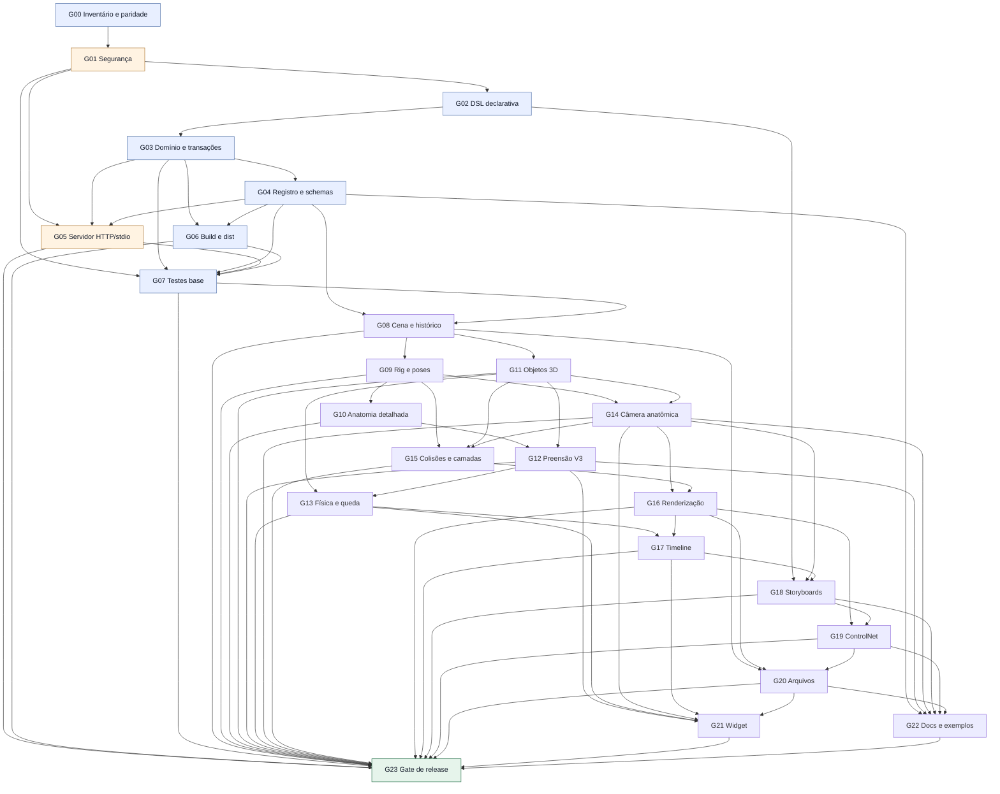

# GeoMannequin — MASTER TASK GRAPH: controle integral via MCP

**Data:** 11/11/2026 · **Situação:** PLANEJAMENTO — nenhum dos 240 itens deste novo plano está marcado como concluído.
**Origem:** auditoria estática do repositório e PR #20. **Não confundir com as 239 tarefas do task graph físico da preensão V3.**

Este documento é o índice mestre de **24 subgrafos, 240 tarefas executáveis por um agente, 24 gates de aceite e 264 nós no DAG**, com dependências verificadas automaticamente: nenhum ID inexistente e nenhum ciclo.

## Documentos de execução

- [Parte A — G00 a G11: fundamentos, segurança, motor, cena e anatomia](./task-graph-mcp-integral-parte-a-20261111.md) — 120 tarefas, cada uma com ID, pré-requisitos e evidência de aceite;
- [Parte B — G12 a G23: preensão, física, câmera, animação, render e release](./task-graph-mcp-integral-parte-b-20261111.md) — 120 tarefas;
- [Manifesto JSON completo, para automações e agentes](./task-graph-mcp-integral-manifest-20261111.json) — 240 tarefas + 24 gates, prioridades, status e dependências;
- [Manifesto JSON da Parte A](./task-graph-mcp-integral-parte-a-20261111.json) e [Parte B](./task-graph-mcp-integral-parte-b-20261111.json);
- [Auditoria técnica que motivou o plano](./auditoria-mcp-capacidades-20261111.md).

## Critério formal de “tudo controlável via MCP”

Definir o conjunto **E** de operações elegíveis como a união versionada de:

1. todos os métodos públicos retornados por `cena.comandos()`, incluindo cena, câmera, manequim e objeto;
2. todas as ações dos controles visuais da aplicação que alteram estado, cena ou dados;
3. todas as funcionalidades do MCP existente e as APIs headless de render, exportação e leitura;
4. todas as operações de V2/V3, câmera anatômica, quadros, objetos, física, camadas e IA presentes no motor.

Definir **C** como as operações de **E** com operação MCP tipada ou mapeada a uma ferramenta MCP segura, teste reproduzível, permissão explícita, diagnóstico de erro e paridade semântica. A meta final é **cobertura = |C| / |E| = 100%**. Ações intrinsecamente do navegador (abrir painel, baixar arquivo no dispositivo, focar elemento) recebem **equivalente de resultado** no MCP (artefato, comando ou estado) ou uma exclusão formal justificada que não esconda capacidade real.

**Não conta** como cobertura remota: usar `new Function`, `eval`, `vm` no processo HTTP, permitir script arbitrário em `roteiro_quadros`, dizer que uma API existe sem contrato/testes, ou fingir que física aproximada é solução dinâmica exata.

## Grafo mestre das 24 fases



Os grupos `G00`–`G23` são gates. Cada grupo tem exatamente 10 tarefas identificadas por `MCP-XX.01` a `MCP-XX.10`. A primeira define o contrato/fundação da fase, as tarefas 02–09 executam em paralelo após a primeira, e a tarefa 10 valida os resultados. Um gate só conclui quando a tarefa 10 está aprovada. Um grupo dependente aguarda os gates anteriores.

### Matriz de grupos, bloqueios e prioridade

| Gate | Entrega | Prioridade | Depende de | Tarefas |
|---|---|---|---|---:|
| G00 | Inventário executável e definição de paridade | P0 | — | 10 |
| G01 | Segurança: ameaça, isolamento e políticas | P0 | G00 | 10 |
| G02 | Linguagem declarativa de operações e roteiros | P0 | G01 | 10 |
| G03 | Camada de domínio única, estado e transações | P0 | G02 | 10 |
| G04 | Registro de comandos, contratos MCP e descoberta | P0 | G03 | 10 |
| G05 | Servidor MCP, sessões e autorização | P0 | G01, G03, G04 | 10 |
| G06 | Empacotamento, compilação e paridade do dist | P0 | G03, G04 | 10 |
| G07 | Harness automatizado e contratos mínimos | P0 | G01, G03, G04, G05, G06 | 10 |
| G08 | Cena, entidades, referências e histórico | P1 | G04, G07 | 10 |
| G09 | Corpos, poses, cinemática e limites | P1 | G08 | 10 |
| G10 | Anatomia fina, cabeça Loomis e expressão | P1 | G09 | 10 |
| G11 | Objetos 3D, hierarquias, apoio e geometria | P1 | G08 | 10 |
| G12 | Preensão V2/V3, GripSites e transporte bilateral | P1 | G10, G11 | 10 |
| G13 | Física discreta, queda, contatos e tempo | P1 | G11, G12 | 10 |
| G14 | Câmera anatômica, ótica e orientação contextual | P1 | G09, G11 | 10 |
| G15 | Composição espacial, camadas, contato e blocking | P1 | G09, G11, G14 | 10 |
| G16 | Aparência, iluminação e renderização | P1 | G14, G15 | 10 |
| G17 | Linha do tempo, poses animadas e gravação de quadros | P1 | G13, G16 | 10 |
| G18 | Roteiros, storyboards, quadrinhos e automação declarativa | P1 | G02, G14, G17 | 10 |
| G19 | Passes de IA e referências estruturadas | P1 | G16, G18 | 10 |
| G20 | Importação, exportação e artefatos de produção | P1 | G08, G16, G19 | 10 |
| G21 | Widget interativo e paridade com UI | P2 | G12, G13, G14, G17, G20 | 10 |
| G22 | Documentação, exemplos, busca e onboarding de agentes | P2 | G04, G12, G14, G18, G19, G20 | 10 |
| G23 | Gate final: segurança, paridade 100%, release e rollback | P0/P2 | G05, G06, G07, G08, G09, G10, G11, G12, G13, G14, G15, G16, G17, G18, G19, G20, G21, G22 | 10 |

**Distribuição:** 80 tarefas P0, 130 P1, 20 P2 e 10 tarefas mistas P0/P2 do gate de publicação. Todas começam com `status:"planned"` e devem mudar individualmente apenas mediante evidência de execução e testes.

## Ferramentas MCP novas propostas (nomes ainda NÃO implementados)

Preferir **ferramentas tipadas por domínio** e ações enumeradas, em vez de uma ferramenta por botão ou de abrir um terminal JavaScript remoto. Preservar as 25 ferramentas antigas e migrar gradualmente os contratos sem quebrar clientes.

| Ferramenta proposta | Ações exemplificativas | Garantia |
|---|---|---|
| `capacidades` | `descobrir, listar, consultar_status` | Inventário dinamicamente extraído de cena.comandos() e do registro de schemas |
| `cena_operacoes` | `criar, limpar, selecionar, duplicar, remover, snapshot, diff` | Mutação transacional + IDs estáveis |
| `historico` | `marcar, desfazer, refazer, consultar` | Reversão também de Grip, física e câmera |
| `manequim_rig` | `parametro, pose, pose_rapida, articulacao, validar, espelhar` | Faixas anatômicas validadas |
| `anatomia_fina` | `cabeca, face, olhar, dedos, mao, pe, biotipo, landmarks` | Só parâmetros suportados pelo motor |
| `ik` | `mao_para, pe_para, ponto_apoio, consultar_residual` | Resposta inclui alcance e erro |
| `objeto_3d` | `criar, editar, apagar, transformar, orientar, copiar, inspecionar` | Transformação tridimensional e hierarquia |
| `objeto_ancoras` | `listar, consultar, definir, remover` | GripSites e superfícies de apoio |
| `preensao` | `segurar, segunda_mao, transferir, soltar, inspecionar, listar` | Mesmo vínculo 6DOF da API de cena |
| `fisica` | `cair, avancar, simular, pousar, parar, consultar` | Dinâmica por etapas, com limites explícitos |
| `camera_anatomica` | `frente, costas, perfil, orientar, foco, seguir, parar, capturar` | Frames locais de corpo, cabeça e objeto |
| `contato_fisico` | `detectar, bloquear, resolver, permitir, verificar_trajeto` | Colisão por proxies e limitações declaradas |
| `timeline` | `keyframe, listar, interpolar, seek, step, play, pause, render` | Estado determinístico por tempo |
| `roteiro_declarativo` | `validar, executar, gerar_quadros, orbita, ficha, pagina` | Nenhum script remoto arbitrário |
| `passes_ia` | `openpose, profundidade, normal, mascara, partes, contorno, canny` | MIME, dimensões, landmarks e metadados |
| `artefatos` | `exportar, importar, verificar, baixar, listar` | JSON, SVG, PNG, OBJ/ZIP quando suportados |
| `lote_operacoes` | `validar, prever, executar, desfazer` | Lote tipado e atômico, com revisão |

Exemplo de contrato conceitual de `preensao` (proposta, não ferramenta disponível hoje):

```json
{
  "acao": "segurar",
  "objeto": "Cadeira 1",
  "manequim": "Ana",
  "mao": "direita",
  "ponto": "encostoTopo",
  "modo": "encaixar",
  "exigirContato": true
}
```

Exemplo de sequência posterior:

```json
[
  {"ferramenta": "manequim_rig", "acao": "parametro", "manequim": "Ana", "chave": "armFlexR", "valor": 45},
  {"ferramenta": "preensao", "acao": "inspecionar", "objeto": "Cadeira 1"},
  {"ferramenta": "preensao", "acao": "soltar", "objeto": "Cadeira 1", "modo": "queda"},
  {"ferramenta": "fisica", "acao": "simular", "duracao": 3, "passo": 0.0166666667}
]
```

O formato acima é **ilustrativo**. O schema final precisa ser compatível com MCP/Gemini/ChatGPT e com o controlador do motor; não é uma garantia de chamadas disponíveis neste momento.

## Gates de segurança obrigatórios antes de produção

1. Nenhum roteiro HTTP chama `new Function` com dados não confiáveis. Migrar para AST/IR declarativa ou execução externa confinada, com fronteira operacional explícita.
2. `executar_codigo` local confiável e operações HTTP públicas não compartilham o mesmo caminho irrestrito. `node:vm` sozinho não é fronteira de segurança.
3. Autenticação obrigatória; credenciais nunca aparecem em links, relatórios ou artefatos. Reduzir permissões de CORS e revisar SSE legado.
4. Limites de CPU, memória, requisições, duração, quadro, pixels e importação.
5. Isolamento entre sessões, revisão de estado, rollback e logs sem vazamento.
6. `dist` reconstruído e validado: o pacote verificado anteriormente continha **18** módulos de cena, enquanto o código atual possui **25**.

## Cenários de aceitação de ponta a ponta

**SC-01 — Cena por MCP remoto:** criar sessão, incluir dois manequins, adicionar cadeira, ajustar poses, câmera e luz, renderizar PNG e obter JSON; reabrir JSON em outra sessão produz o mesmo estado normalizado.

**SC-02 — Cadeira presa ao braço:** criar cadeira ao alcance; consultar GripSites; agarrar com a mão direita por `encostoTopo`; mover cotovelo e ombro; a cadeira acompanha em posição e rotação; o status do vínculo identifica proprietário, site e tolerância.

**SC-03 — Duas mãos e transferência:** adicionar mão esquerda, consultar residual da IK, transferir condutor, deslocar a cadeira sem teleporte, liberar a mão direita e depois esquerda; não ocorre posse duplicada nem vínculo órfão.

**SC-04 — Gravidade:** soltar uma cadeira em `modo:"queda"`, avançar em passos fixos, detectar piso/mesa/manequim com as aproximações atuais e verificar determinismo após salvar e carregar JSON.

**SC-05 — Câmera anatômica:** orientar câmera exatamente para as costas de um manequim pelo frame do tronco, depois pelas costas da cabeça girada; perfis direito/esquerdo não invertem; seguir o alvo e capturar vistas regionais.

**SC-06 — Roteiro sem execução arbitrária:** gerar storyboard com três quadros, usar câmera por alvo, transportar cadeira e soltá-la no quadro seguinte, exportar páginas e passes. Entrada de script hostil é rejeitada antes da execução.

**SC-07 — Arquivos e IA:** renderizar SVG/PNG, OpenPose de corpo/mãos/rosto, profundidade, normais e máscaras, exportar ZIP/OBJ quando suportados, validar MIME/checksums e reimportar o estado.

**SC-08 — Paridade real entre clientes:** repetir operação representativa em stdio, HTTP, `dist`, Claude, ChatGPT e Gemini. Resultados são semanticamente equivalentes, respeitando permissões e representação de arquivos.

**SC-09 — Falha e recuperação:** operação inválida no meio de um lote reverte todas as alterações; cancelamento de render grande libera recursos; sessão expirada não reutiliza dados de outro usuário.

**SC-10 — Publicação:** testes do motor, MCP source/dist, validação de schemas, regressores visuais, segurança e consumo de recursos passam antes de liberar `main` ou servidor público.

## Ordem de execução recomendada

**Onda 0, inegociável:** G00 → G01 → G02 → G03 → G04; em paralelo, G05 e G06 onde o DAG permitir; depois G07. Nenhuma ferramenta nova remota depende de executar scripts sem validação.

**Onda 1, estado e movimento:** G08 → G09/G11 em paralelo; G10; G12/G14; G13/G15. Priorizar cenas, posicionamento, objetos e a pegada da cadeira.

**Onda 2, imagem e tempo:** G16, G17, G18, G19 e G20, conforme as arestas do grafo.

**Onda 3, apresentação e documentação:** G21 e G22. Desbloquear G23 apenas após todos os gates predecessores.

## Definition of Done global

- [ ] 100% das operações elegíveis identificadas, tipadas, testadas e descobríveis via MCP seguro.
- [ ] Zero código remoto arbitrário acessível por rotas não confiáveis.
- [ ] Nenhuma divergência entre source, `mcp/dist`, schemas publicados e manifestos de capacidades.
- [ ] Todos os cenários SC-01 a SC-10 aprovados com evidências de saída.
- [ ] Testes de regressão nativos e MCP (stdio, HTTP, dist) aprovados.
- [ ] Paridade confirmada nos clientes alvo, com casos de segurança e reconexão.
- [ ] Limites reais do motor (IK, física, colisão, malha) relatados corretamente.
- [ ] Release tem versão, changelog, monitoramento e rollback comprovado.

## Evidência e execução por agente

Uma tarefa só muda para `done` quando o agente salva: **commit**, arquivos alterados, comando de teste, saída PASS/FAIL, artefatos gerados (se aplicável) e avaliação de riscos/regressão. `blocked` exige causa e tarefa desbloqueadora. Os arquivos JSON podem ser usados por orquestradores de tarefas para resolver nós prontos a executar pelo DAG, sempre sem eliminar os gates de segurança.

### Comandos finais de validação em um checkout

```sh
cd geomannequin
npm ci
npm ci --prefix mcp
npm run testar
npm run construir
cd mcp
npm test
npm run build
npm run test:dist
```

**Estado atual:** apenas o planejamento de 240 tarefas e a auditoria foram produzidos neste conjunto de arquivos. Não há execução confirmada da suíte nativa/HTTP/dist: a PR #20 continua em rascunho e o GitHub Actions reportou falhas prematuras anteriormente. **Não mesclar nem publicar por conta deste documento.**
