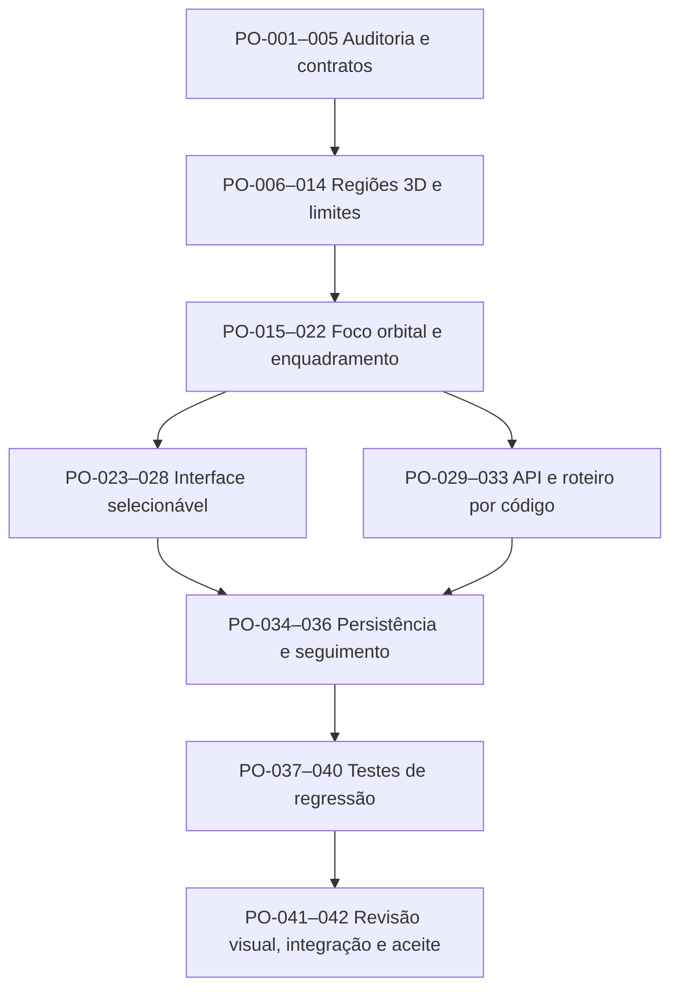

# GeoMannequin — Task graph de órbita focal por região do alvo

**Data:** 10/11/2026 · **Escopo:** câmera de cena, pivô anatômico/objeto, enquadramento próximo, editor, storyboard e persistência.  
**Repositório:** `4lexandre33/4lexandre33.github.io`, pasta `geomannequin`.  
**Prioridade:** P0 (geometria, API, editor, UI), P1 (QA, testes de múltiplos alvos), P2 (criaturas com rig próprio).

## Objetivo funcional

A câmera continua orbitando **cena inteira, grupo, manequim, objeto ou ponto 3D**. Adicionalmente, pode fixar seu pivô em uma **região específica do alvo**, calculada em coordenadas do mundo, sem fixar o azimute, a elevação ou o enquadramento.

- **Manequins:** cabeça, rosto, pescoço, torso, tórax, abdômen, quadril, ombros, braços, antebraços, mãos, pernas, coxas, canelas e pés; opções bilaterais e unilateral esquerda/direita.
- **Objetos:** inteiro, parte superior, central, inferior, topo e base. O corte é relativo ao **limite real do objeto** (inclui peças, rotação e altura de apoio). A parte superior de uma cadeira inclui o encosto se ele for mais alto.
- **Grupos:** mantém o modo preexistente. Pela API, é possível aplicar a mesma região a múltiplos manequins. Misturas incompatíveis de alvos geram mensagem de erro.
- **Criaturas:** o motor atual contém manequins humanos e objetos paramétricos, não uma categoria de criatura com rig próprio. O task graph inclui interface de extensão por landmarks/cápsulas para criaturas futuras; **não declarar suporte implementado antes de existir a categoria de criatura**.

### Três dimensões independentes

`alvo` → manequim, objeto, grupo ou cena.

`area` → sub-região 3D, atualizada quando a pose/posição do alvo mudar.

`vista` → azimute, elevação (−70° a +70°), rolagem e folga/zoom. Alterar a vista não altera a área escolhida.

## DAG macro



## 42 tarefas executáveis

| ID | Prioridade | Dependência | Entrega / critério |
|---|---|---|---|
| PO-001 | P0 | — | Auditar `scene/orbita.js` e esquema atual do pivô |
| PO-002 | P0 | 001 | Conferir cápsulas anatômicas no mundo e articulações |
| PO-003 | P0 | 001 | Conferir peças reais de objetos e rotações |
| PO-004 | P0 | 001 | Documentar câmera mundial X/Y/Z, ângulo e distância |
| PO-005 | P0 | 002–004 | Preservar contratos da órbita antiga (cena/grupo/ponto) |
| PO-006 | P0 | 005 | Criar catálogo de regiões anatômicas com nomes e sinônimos |
| PO-007 | P0 | 006 | Seleção bilateral/esquerda/direita de braços/mãos/pernas/pés |
| PO-008 | P0 | 006 | Construir bounding box por cápsulas 3D filtradas |
| PO-009 | P0 | 008 | Construir região do rosto orientada pela pose do crânio |
| PO-010 | P0 | 008 | Calcular pivô durante braço levantado, cabeça rodada, pose deitada |
| PO-011 | P0 | 003 | Bounding box real das peças de objetos, inclusive rotação |
| PO-012 | P0 | 011 | Recorte superior, central e inferior da caixa espacial |
| PO-013 | P0 | 011 | Recorte topo/base inclusive sobre apoios |
| PO-014 | P0 | 007–013 | Validar aliases, tipo de alvo e regiões incompatíveis |
| PO-015 | P0 | 014 | Estender `resolverAlvo(alvo,{area})` |
| PO-016 | P0 | 015 | Manter azimute relativo à frente do alvo (legado) |
| PO-017 | P0 | 015 | Elevação independente, fixada pelo usuário ou preservada |
| PO-018 | P0 | 015 | Centrar pivô em coordenadas mundiais e retornar metadados |
| PO-019 | P0 | 018 | Enquadramento ortográfico próximo (zoom maior para mãos/pés) |
| PO-020 | P0 | 018 | Enquadramento em perspectiva (distância/lente) |
| PO-021 | P0 | 019,020 | Folga configurável 0,80–2,5; preservar zoom manual quando desejado |
| PO-022 | P0 | 016–021 | Passos orbitais, arraste e ângulo sem perder a região |
| PO-023 | P0 | 014 | Adicionar seletor `orbArea` dependente do alvo |
| PO-024 | P0 | 023 | Mostrar partes humanas distintas, com lado E/D |
| PO-025 | P0 | 023 | Mostrar superior/central/inferior para objetos |
| PO-026 | P0 | 017 | Adicionar entrada numérica de elevação `orbElev` |
| PO-027 | P0 | 021 | Adicionar seletor próximo/normal/com folga `orbFolga` |
| PO-028 | P0 | 023–027 | Atualizar UI/informações sem duplicar controles |
| PO-029 | P0 | 015 | `camera.orbitar(alvo,{area,azimute,elevacao,folga})` |
| PO-030 | P0 | 029 | `camera.pivo(alvo,{area,enquadrar})` |
| PO-031 | P0 | 029 | `camera.area(regiao)` e `camera.focar(alvo,regiao,opts)` |
| PO-032 | P0 | 029 | `camera.vista()` também informa a região atual |
| PO-033 | P0 | 029 | `#orbita` e `#ficha` aceitam `area ...` no storyboard |
| PO-034 | P0 | 018 | Acompanhar automaticamente alvo ao mover/alterar pose antes do render |
| PO-035 | P0 | 034 | Se o alvo desaparecer, limpar pivô inválido sem interromper o render |
| PO-036 | P0 | 028,033–035 | Salvar/restaurar região, alvo e IDs de objetos via JSON |
| PO-037 | P0 | 036 | Testar regiões humanas, lados, alias e incompatibilidade |
| PO-038 | P0 | 036 | Testar objeto girado, superior/inferior, zoom e elevação |
| PO-039 | P1 | 037,038 | Testar movimento, pose, cena, grupo, exportação e roteiro |
| PO-040 | P1 | 039 | Regressão do motor: scripts Node, render SVG e build |
| PO-041 | P1 | 040 | Atlas visual com diferentes azimutes/elevações e regiões |
| PO-042 | P1 | 041 | Revisão visual, desempenho, acessibilidade e aceite no site publicado |

**Critérios de pronto:** PO-001–038 incluem implementação no código da branch, mas a execução final de testes integrados e inspeção visual ainda precisa de evidências. Não confundir commit ou sintaxe válida com aprovação do sistema inteiro. PO-039–042 são os portões de QA e publicação.

## Arquivos envolvidos

| Arquivo | Responsabilidade |
|---|---|
| `src/scene/regioes-orbita.js` | Tabela de áreas, filtros por cápsula e bounds de objetos |
| `src/scene/orbita.js` | Resolver alvo/área, pivô, ângulo, zoom, atualização |
| `src/scene/modelo.js` | Seguir pivô antes de desenhar, inclusive após alteração de pose |
| `src/ui/orbita.js` | Listas de região, elevação, aproximação, identificação |
| `index.html` | Controles selecionáveis |
| `src/scene/comandos.js` | API do editor e da câmera |
| `src/scene/quadros.js` | Sequências `#orbita` e `#ficha` |
| `src/scene/estado.js` | Persistência e restauração |
| `src/scene/parametros.js`, `src/scene/enquadrar.js`, `src/ui/arrastar.js` | Zoom próximo com/sem perspectiva |
| `src/scene/ordem.json` | Inclusão de módulo no MCP headless |
| `src/scene/ajuda.js` | Exemplos no editor |
| `testes/camera-foco-regional.mjs` | Regressão de pivô, áreas e comandos |

## Exemplos de uso

```js
camera.orbitar("Ana", {area:"cabeca", azimute:"3/4 esquerda", elevacao:25, enquadrar:true});
camera.orbitar("Ana", {area:"mao direita", azimute:-90, elevacao:10, folga:0.9});
camera.pivo("Ana", {area:"torso", enquadrar:true});
camera.area("pe esquerdo"); // preserva o ângulo atual
camera.focar("Mesa", "superior", {azimute:45, elevacao:50});
camera.focar("Caixa", "inferior", {azimute:-30, elevacao:-20});
camera.orbitar(["Ana","Leo"], {area:"cabeca", azimute:135, elevacao:15});
```

```text
#orbita "Ana" 8 area cabeca elevacao 25 — Volta da cabeça
#ficha "Ana" completa orto area "mao esquerda" — Referência das mãos
```

## Métricas de qualidade

- AABB do subalvo contém todos os pontos das cápsulas filtradas, com tolerância de arredondamento.
- A seleção esquerda/direita não incorpora cápsulas do lado oposto.
- O pivô segue a pose e translação do alvo; azimute e elevação não mudam por consequência.
- Vistas de objetos girados mantêm bounds corretos no mundo.
- Foco próximo aumenta a escala em tela relativa ao enquadramento do corpo inteiro.
- Undo/reload mantém a escolha, sem referências de objeto inválidas.
- Cenas/grupos e rotações antigas continuam funcionando.
- O funcionamento precisa ser comprovado no Node, na interface web, no gerador de quadros e na publicação.

## Limite para criaturas

Não existe hoje coleção `SCN.criaturas`, rig/ossos ou cápsulas de criaturas separado no projeto. A extensão futura deve oferecer `getRegions(entity)`, `getWorldBounds(entity,region)` e `getFacing(entity)`, permitindo selecionar partes como cabeça/patas/cauda/asas. **Esse adaptador é planejado, não implementado nem falsamente simulado.**
