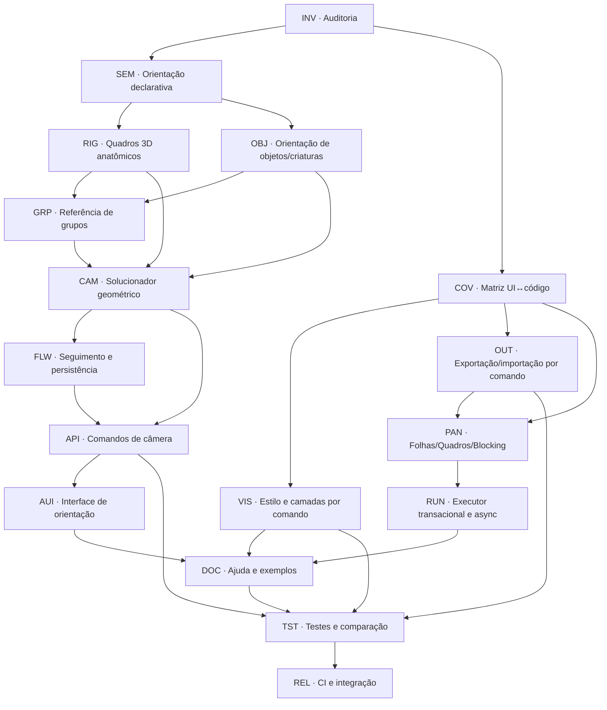

# GeoMannequin — Task Graph: orientação da câmera + comando para toda função da aplicação

**Data:** 10/11/2026 · **Escopo:** auditoria estática do repositório e especificação de implementação.  
**Total:** **196 tarefas detalhadas em 17 frentes**. **Planejamento inicial com execução incremental em 10/11/2026**: as entregas listadas no anexo de progresso ao final estão implementadas em código. Muitas tarefas permanecem pendentes ou sem validação integral.

## Resposta resumida da auditoria

A aplicação **JÁ OFERECE** a vista pelas costas de um manequim quando seu eixo corporal local +Z é considerado frente:

```javascript
// EXISTENTE — funciona no editor atual
camera.orbitar("Manequim 1",{azimute:"costas",elevacao:0,enquadrar:true});
camera.orbitar("Manequim 1",{area:"cabeca",azimute:"costas",elevacao:10,enquadrar:true});
camera.focar("Manequim 1","torso",{azimute:180,elevacao:0});
log(camera.vista());
```

O código em `src/scene/orbita.js` reconhece `costas` como 180° e calcula a direção frontal pelos eixos `[sin(wRot),cos(wRot)]` informados por `src/scene/regioes-orbita.js`. Portanto a orientação não depende de olhos. A **limitação objetiva** é que este vetor é horizontal, deriva de `wRot` (ou `giro` de objetos) e é o mesmo para qualquer sub-região. A cabeça que gira no pescoço e um ator deitado exigem a matriz de orientação daquela parte — não basta escolher apenas o centro da região.

**Importante:** `m.frente()` e `m.tras()` já existem, mas controlam a **ordem das camadas do desenho**, não a direção anatômica do corpo. Não usar esses nomes como a nova API de orientação.

### O que significa frente?

- **Frente anatômica do tronco:** eixo longitudinal frontal declarado no rig, independente de rosto, cabelo e olhos.
- **Frente anatômica da cabeça:** eixo frontal do crânio transformado pelas juntas `A3`, pescoço, coluna e corpo. Não equivale necessariamente à direção do tórax.
- **Direção do olhar:** direção de `eyeYaw/eyePitch` se houver olhos móveis; pode mudar com cabeça imóvel. É opção **olhar/gaze**, nunca a definição padrão de frente do ator.
- **Objetos:** uma cadeira, uma mesa e um cilindro não têm necessariamente a mesma convenção. Formas simétricas podem não possuir frente intrínseca — ela precisa ser atribuída pelo usuário ou por metadados do modelo.
- **Criaturas futuras:** cada rig informa seu eixo `forwardLocal`, `upLocal` e juntas. A ausência de rosto não transforma a região oposta em frente.

## 1. Matriz de cobertura verificada (UI × editor)

**Legenda:** *Existente* significa que há método correspondente inspecionado; *Parcial* indica função existente mas incompleta/fragmentada; *Ausente* significa que não foi localizada uma **API pública equivalente** nas partes auditadas (pode haver funções internas ou formas indiretas). A existência de um método não equivale a aprovação em navegador.

| Capacidade | Situação | Evidências no código | Lacuna / observação |
|---|---|---|---|
| Orientação frontal/costas pelo eixo local do corpo e wRot | **Existente** | `regioes-orbita.js, orbita.js` | Só horizontal; não equivale a direção craniana se cabeça girar |
| Comando camera.orbitar('Ana',{azimute:'costas'}) | **Existente** | `comandos.js, orbita.js` | Alvo único utiliza referência do corpo; camera já tem oito vistas |
| Foco em cabeça, face, tórax, mãos, pernas, pés e objetos | **Existente** | `regioes-orbita.js` | Foco é calculado sobre bounding volumes, não no ponto semântico exato |
| Seguir posição do alvo quando ele se move | **Parcial** | `modelo.js, orbita.js` | Acompanha pivô, mas não mantém orientação costas ao alvo se o alvo gira |
| Seguir rotação 3D do alvo/cabeça/parte | **Ausente** | `orbita.js, cadeia.js` | Necessário referencial por junta e modo follow |
| Direção do olhar independente de cabeça/tronco | **Parcial** | `cenario.js, comandos.js` | Olhos têm pose; não há API da câmera orbitando o vetor gaze |
| Definição explícita de frente/verso para objetos simétricos | **Ausente** | `regioes-orbita.js, objetos.js` | Atualmente giro em Y substitui convenção semântica |
| Orientação de criatura/rig não-humano | **Ausente** | `scene/` | Não há contrato de OrientationProvider generalizado |
| Gerenciamento de manequins, poses, articulações, biotipos | **Existente** | `comandos.js` | m.pose, m.corpo, m.articulacao, m.gesto, m.dedos |
| Câmera: posição, mira, óptica, ângulo, foco regional, turntable | **Existente** | `comandos.js, orbita.js` | Vários métodos públicos já disponíveis |
| Cor de manequins/objetos, tema claro/escuro | **Existente** | `comandos.js, tema.js` | Não confundir tema de UI com paleta de render |
| Estilo de cor global (Creme, Lápis, Azul etc) por comando | **Ausente** | `ui/estilo.js, ui/controles.js` | Há botões data-style, mas não cena.estilo() |
| Camadas visuais individuais (grid, olhos, ossos, planos etc) por API | **Parcial** | `scene/modos.js, comandos.js` | Alguns toggles possuem método; falta setter genérico tipado |
| Seleção de item e camadas de render por código | **Parcial** | `comandos.js, ui/painel-cena.js` | cena.selecionar e ordem existem; seleção de junta/gizmos não |
| Cenas e objetos com transformações, apoio e cor | **Existente** | `comandos.js, cenario.js` | API de objetos disponível para tipos predefinidos |
| Colisão detalhada, tocar e preensão por código | **Parcial** | `contato-v2.js, toque-v2.js, comandos.js` | Motor experimental, não física global perfeita |
| Blocking por código | **Parcial** | `comandos.js, ui/blocking.js` | Leituras e abertura/fechamento; faltam controles de cada janela |
| Quadros e roteiros por código | **Parcial** | `comandos.js, quadros.js, ui/quadros.js` | Abre/fecha/texto/render/fila/baixar; falta edição da fila e export granular |
| Head Study V4.2 por editor | **Parcial** | `ui/head-study.js` | window.gmHeadStudy existe; não pertence ao namespace cena/GUI headless |
| Exportação SVG/OBJ/JSON/PNG/ZIP via API consistente | **Parcial** | `ui/exportar.js, ui/quadros.js, comandos.js` | SVG em camadas e foto existem; OBJ e downloads simples são UI-only |
| Importação de arquivo e link sem UI | **Parcial** | `comandos.js, ui/exportar.js, ui/link.js` | cena.restaurar funciona; controle de arquivos/links não é uniforme |
| Undo/redo global | **Ausente** | `ui/editor.js, scene/colisoes.js` | Rollback de erro e desfazer colisão, mas não undo genérico |
| Executor async com await, cancelamento, retorno e permissões | **Ausente** | `ui/editor.js` | new Function síncrona; Promise não é aguardada |
| Catálogo de comandos consultável e autocomplete | **Parcial** | `scene/ajuda.js` | Texto REF estático; não há introspecção universal |

## 2. Referencial local e matemática proposta

O modelo atual utiliza, por convenção, **+Z como frente em postura neutra, +Y como acima e +X como esquerda anatômica do rig**. Essa base local **não** pode ser interpretada como coordenada de câmera fixa depois da pose.

Para alvo com transform 3D mundial \(M\), definir:

\[
\mathbf{F}=\mathrm{normalize}(M\,[0,0,1]),\qquad
\mathbf{U}=\mathrm{normalize}(M\,[0,1,0])
\]

\[
\mathbf{L}=\mathrm{normalize}(\mathbf U\times\mathbf F)
\]

Ortonormalizar \(\mathbf U,\mathbf F,\mathbf L\) com cuidado para evitar eixos quase paralelos em estruturas deformadas.

Com azimute \(a\), elevação \(e\), distância \(d\) e centro focal \(\mathbf C\):

\[
\mathbf D(a,e)=\cos e(\cos a\,\mathbf F+\sin a\,\mathbf L)+\sin e\,\mathbf U
\]

\[
\mathbf P_{camera}=\mathbf C+d\,\mathbf D(a,e),\qquad
\mathrm{viewDirection}=\mathrm{normalize}(\mathbf C-\mathbf P_{camera})
\]

Logo, **a = 0°** posiciona a câmera à frente da região selecionada; **a = 180°** a posiciona exatamente atrás, independentemente da rotação em mundo; **a = +90°** fica à esquerda anatômica do alvo no sistema atual.

Para 'elevação em relação ao mundo', usar worldUp e uma projeção horizontal estável da frente; para elevação anatômica, usar a base local transformada. Um manequim deitado precisa produzir resultados diferentes nesses dois modos.

A geometria real já fornece referências parciais em `src/engine/cadeia.js`: `chainSetup()` retorna `Pel`, `A2` (quadro do tronco) e `A3` (quadro superior/crânio). Deve-se transformar seus vetores locais para coordenadas mundiais, respeitando `wRot`, `bodyPitch`, `bodyRoll`, `neckTwist`, `headYaw` e outros graus de liberdade.

### APIs propostas — ainda NÃO implementadas

```javascript
// NOVO: câmera atrás do TRONCO do manequim
camera.costas("Ana",{
  referencia:"tronco",
  area:"corpo",
  elevacao:0,
  distancia:25,
  vertical:"mundo"
});

// NOVO: câmera atrás da CABEÇA, inclusive se virar o pescoço
camera.ver("Ana",{
  lado:"costas",
  referencia:"cabeca",
  area:"cabeca",
  elevacao:12,
  enquadrar:true
});

// NOVO: seguidor permanece atrás enquanto Ana roda ou caminha
camera.seguir("Ana",{
  lado:"costas",
  referencia:"tronco",
  seguirPosicao:true,
  seguirRotacao:true,
  distancia:22
});
camera.pararSeguir();

// NOVO: objeto simétrico recebe frente determinada pelo usuário
cena.obterObjeto("Cubo").orientacao({frenteLocal:[0,0,1],cimaLocal:[0,1,0]});
camera.ver("Cubo",{lado:"costas",area:"superior"});

// NOVO: diferenciar gaze da frente do crânio
camera.ver("Ana",{lado:"frente",referencia:"olhar",area:"rosto"});

// NOVO: retornar orientação/diagnóstico
log(camera.orientacaoDoAlvo("Ana","cabeca"));
log(camera.alvos());
log(camera.areas("Ana"));
```

Nenhuma das chamadas propostas acima deve ser anunciada como funcional até implementada e testada. **Usar hoje** a API existente `camera.orbitar(...)` mostrada no início deste documento.

## 3. DAG geral de execução



## 4. Task graph detalhado (196 tarefas)

**Estado inicial de todas as tarefas abaixo:** `planejada`. Elas são atividades futuras com critérios de aceite, inclusive as de migração/teste de código existente. A matriz acima identifica o que já funciona. Ao executar, alterar o estado para `implementada`, `testada` ou `aprovada` somente com evidências.


### INV — Inventário e regressão inicial

**Predecessores de fase:** nenhum. **Critério de fase:** entregar os itens abaixo sem quebrar as APIs legadas.

| ID | Dependência | Tarefa de engenharia | Critério verificável |
|---|---|---|---|
| **INV-01** | — | Inventariar API pública cena/camera/tema/log | Mapear métodos por assinatura, efeitos e retorno |
| **INV-02** | INV-01 | Inventariar ações de todos os módulos ui/*.js carregados em main.js | Associar botão/input à função executada |
| **INV-03** | INV-02 | Identificar parâmetros editáveis no SL e POSEKEYS | Cobertura de cada slider com setter tipado |
| **INV-04** | INV-03 | Inventariar fontes de orientação do manequim | Documentar wRot, raiz, Pel, A2, A3 e olhar |
| **INV-05** | INV-04 | Inventariar eixos dos objetos, formas simétricas e giro | Matriz por tipo de objeto |
| **INV-06** | INV-05 | Inventariar recursos exclusivos de browser | Classificar DOM, download, storage, worker e UIH |
| **INV-07** | INV-06 | Ler testes de órbita e câmera e registrar casos ausentes | Baseline de suite camera-foco-regional.mjs |
| **INV-08** | INV-07 | Registrar exemplos de código atuais e mensagens de erro | Lista de comandos existentes com exemplos |
| **INV-09** | INV-08 | Gerar tabela UI ↔ API com evidências por arquivo | Nada classificado como ausente sem inspeção |
| **INV-10** | INV-09 | Marcar recursos inexistentes, parciais e já públicos | Relatório versionado e auditável |

### SEM — Semântica de orientação e espaços

**Predecessores de fase:** `INV`. **Critério de fase:** entregar os itens abaixo sem quebrar as APIs legadas.

| ID | Dependência | Tarefa de engenharia | Critério verificável |
|---|---|---|---|
| **SEM-01** | INV-10 | Definir referencial canônico local +Z frente, +Y cima, +X esquerda do modelo atual | Convenção explícita com teste de mão esquerda |
| **SEM-02** | SEM-01 | Separar frente da anatomia, direção do olhar e frente da câmera | Três vetores independentes no contrato |
| **SEM-03** | SEM-02 | Definir orientação de costas como −F local | Sem dependência da existência de olhos |
| **SEM-04** | SEM-03 | Separar modo mundo e modo anatômico para elevação | Resultados inequívocos quando alvo estiver deitado |
| **SEM-05** | SEM-04 | Definir orientação de tronco, pelve, cabeça, mão e pé | Seleção de referencial da parte alvo |
| **SEM-06** | SEM-05 | Definir significado de esquerda/direita do alvo versus da tela | Teste lateral em manequim girado |
| **SEM-07** | SEM-06 | Definir quando frente é desconhecida para objeto simétrico | Erro informativo/metadata; não inferir por textura |
| **SEM-08** | SEM-07 | Normalizar nomes e sinônimos PT/EN, acentos e hífens | costas/trás/atrás/back idênticos |
| **SEM-09** | SEM-08 | Formalizar estabilidade de ângulos e wrap em ±180 graus | Sem salto 359°→0° na interpolação |
| **SEM-10** | SEM-09 | Definir política de aproximação, distância e folga | Sem aceitar NaN, zero de direção ou distância negativa |

### RIG — Referenciais 3D anatômicos reais

**Predecessores de fase:** `SEM`. **Critério de fase:** entregar os itens abaixo sem quebrar as APIs legadas.

| ID | Dependência | Tarefa de engenharia | Critério verificável |
|---|---|---|---|
| **RIG-01** | SEM-10 | Criar módulo orientation-frames.js sem dependência da câmera | Consulta pura worldFrame(actor,region) |
| **RIG-02** | RIG-01 | Usar matriz de raiz para poses em pé/rotações no chão | Vetor unitário correto após wRot |
| **RIG-03** | RIG-02 | Reutilizar chainSetup().Pel.M para orientação pélvica | PelvisTilt/Twist/Side preservados |
| **RIG-04** | RIG-03 | Reutilizar chainSetup().A2.M para orientação de tórax | Torso real após coluna e bodyPitch |
| **RIG-05** | RIG-04 | Reutilizar chainSetup().A3.M para direção craniana | HeadYaw/neckTwist/headPitch refletem corretamente |
| **RIG-06** | RIG-05 | Transformar eixos locais pelo sistema de mundo para cada manequim | Mesmo resultado com x/z transladados |
| **RIG-07** | RIG-06 | Obter referencial da mão pelo armPose/comp | Palma e dorso independentes do tórax |
| **RIG-08** | RIG-07 | Obter referencial do pé pelo legPose/comp | Sola, peito do pé e posterior funcionam sentado |
| **RIG-09** | RIG-08 | Ortonormalizar bases com Gram–Schmidt ou quaternions | |F|=|U|=|L|=1; produtos cruzados≈0 |
| **RIG-10** | RIG-09 | Retornar origem, matriz, F/U/L e fonte anatômica | Estrutura reutilizável por animação e rig |
| **RIG-11** | RIG-10 | Preservar F do tronco ao mover somente os olhos | Olhar não altera direção do corpo |
| **RIG-12** | RIG-11 | Definir direção ocular opcional com eyeYaw/eyePitch | Gaze diferente de head-forward em teste |
| **RIG-13** | RIG-12 | Tratar roll/inversão total e alinhamento com world-up | Nenhum flip no decúbito ou cabeça para baixo |

### OBJ — Orientação de objetos e criaturas

**Predecessores de fase:** `SEM`. **Critério de fase:** entregar os itens abaixo sem quebrar as APIs legadas.

| ID | Dependência | Tarefa de engenharia | Critério verificável |
|---|---|---|---|
| **OBJ-01** | SEM-10 | Criar orientationProfile versionado por tipo de objeto | axisLocal e convention gravados em metadata |
| **OBJ-02** | OBJ-01 | Migrar o giro dos objetos existentes para orientação atual | Mesmas fotos após migração |
| **OBJ-03** | OBJ-02 | Definir frente semântica para cadeira, cama, mesa e parede | Casos claros documentados por tipo |
| **OBJ-04** | OBJ-03 | Marcar formas simétricas com frente não intrínseca | Copo/cilindro/esfera não inventam frente |
| **OBJ-05** | OBJ-04 | Permitir definir frente com vetor ou face local nomeada | obj.orientacao({frente:[... ]}) |
| **OBJ-06** | OBJ-05 | Aceitar orientação por eixo/transform completo além de yaw | Objeto inclinado tem costas e topo reais |
| **OBJ-07** | OBJ-06 | Criar adapter OrientationProvider para novas criaturas | Falha clara se a espécie não declarar eixo |
| **OBJ-08** | OBJ-07 | Definir focos superior/inferior/frente/verso para partes | RegionFrame por subpeça |
| **OBJ-09** | OBJ-08 | Salvar/restaurar metadata e prioridades de orientação | JSON idêntico após round-trip |
| **OBJ-10** | OBJ-09 | Cobrir objetos rotacionados e assimétricos em testes | Matriz 8 vistas por tipo e simetria |

### GRP — Orientação de grupos e alvos mistos

**Predecessores de fase:** `RIG`, `OBJ`. **Critério de fase:** entregar os itens abaixo sem quebrar as APIs legadas.

| ID | Dependência | Tarefa de engenharia | Critério verificável |
|---|---|---|---|
| **GRP-01** | RIG-13, OBJ-10 | Continuar suportando pivô cena/grupo/parte/ponto | Nenhum comando legado perde funcionalidade |
| **GRP-02** | GRP-01 | Calcular orientação média só quando vetores são coerentes | Critério angular e confiança documentados |
| **GRP-03** | GRP-02 | Exigir referência explícita quando o grupo cancela direções | Aviso se direções opostas ou grupo sem frente |
| **GRP-04** | GRP-03 | Permitir orientar grupo pelo líder ou manequim designado | refPessoa/id persistente |
| **GRP-05** | GRP-04 | Definir camera de costas do grupo em torno do centro do grupo | Posição relativa ao líder sem giro acidental |
| **GRP-06** | GRP-05 | Permitir prioridades de enquadramento e centro por subgrupo | Alvo inclui todos sem clipping |
| **GRP-07** | GRP-06 | Tratar mistura objetos+atores e partes incompatíveis | Erro útil e fallback explícito |
| **GRP-08** | GRP-07 | Cobrir remoção/ocultação/renomeação da referência | Sem estado quebrado ou pivot fantasma |

### CAM — Solucionador geométrico de câmera

**Predecessores de fase:** `RIG`, `OBJ`, `GRP`. **Critério de fase:** entregar os itens abaixo sem quebrar as APIs legadas.

| ID | Dependência | Tarefa de engenharia | Critério verificável |
|---|---|---|---|
| **CAM-01** | RIG-13, OBJ-10, GRP-08 | Separar direção orbital da rotação global P.yaw | Um módulo targetRelativeCamera() puro |
| **CAM-02** | CAM-01 | Construir base frontal F, lateral L e vertical U do referencial | F/L/U corretos e normalizados |
| **CAM-03** | CAM-02 | Calcular direção em azimute e elevação relativos ao alvo | d=cos(e)(cos(a)F+sin(a)L)+sin(e)U |
| **CAM-04** | CAM-03 | Posicionar câmera em centro+distância×d | costas a=180 aponta exatamente para −F |
| **CAM-05** | CAM-04 | Apontar câmera para centro do alvo sem alterar geometria | Alvo no centro da projeção |
| **CAM-06** | CAM-05 | Controlar rolagem com up estável e regra de horizonte | Sem inversão ao se aproximar de zenital |
| **CAM-07** | CAM-06 | Preservar azimute sem arredondamento intermediário excessivo | Erro angular absoluto ≤0,1° |
| **CAM-08** | CAM-07 | Suportar visão ortográfica e perspectiva equivalentes | Mesmo vetor direcional nos dois modos |
| **CAM-09** | CAM-08 | Tratar pitch 90°/-90° por base alternativa robusta | Zenital/nadir exatos sem singularidade |
| **CAM-10** | CAM-09 | Controlar altura de câmera em modo mundo versus anatômico | Elevação documentada em ambos |
| **CAM-11** | CAM-10 | Respeitar folga/dimensão de região focal | Bounding box projetada dentro do recorte |
| **CAM-12** | CAM-11 | Respeitar rotação de cabeça sem aplicar giro do rosto ao tronco | Cabeça e tórax independentes |
| **CAM-13** | CAM-12 | Manter compatibilidade de câmera.orbitar legada | Vistas atuais iguais nas poses simples |
| **CAM-14** | CAM-13 | Validar oclusão externa e informar bloqueio do alvo | Orientação correta sem prometer visibilidade através de obstáculos |

### FLW — Seguimento do alvo e continuidade

**Predecessores de fase:** `CAM`. **Critério de fase:** entregar os itens abaixo sem quebrar as APIs legadas.

| ID | Dependência | Tarefa de engenharia | Critério verificável |
|---|---|---|---|
| **FLW-01** | CAM-14 | Distinguir pivô fixo, seguir translação e seguir rotação | Três modos com comportamento previsível |
| **FLW-02** | FLW-01 | Persistir orientação relativa no SCN, não apenas yaw mundial | Ângulo permanece 180° quando corpo gira |
| **FLW-03** | FLW-02 | Atualizar câmera após movimento de alvo antes do render | Nenhum frame usa posição/rotação atrasada |
| **FLW-04** | FLW-03 | Seguir cabeça/mão/pé separadamente com referência própria | Alvo acompanha rig real |
| **FLW-05** | FLW-04 | Manter zoom/distância/folga ao seguir alvo | Sem zoom pulsando com pose |
| **FLW-06** | FLW-05 | Implementar modo instantâneo e suavização opcional | Back exact versus smoothing nunca confundidos |
| **FLW-07** | FLW-06 | Parar seguimento explicitamente ou ao alvo desaparecer | Não gravar referência órfã |
| **FLW-08** | FLW-07 | Respeitar edição manual do usuário durante seguimento | Política pausar/sobrescrever/offset |
| **FLW-09** | FLW-08 | Interpolar yaw pela menor distância angular | Sem giro longo 359° quando seria 1° |
| **FLW-10** | FLW-09 | Gravar e restaurar seguimento em cena.estado()/restaurar() | Posição e direção após JSON round-trip |
| **FLW-11** | FLW-10 | Aplicar regra de continuidade em roteiro de quadros | Turntable e animação preservam alvo |

### API — Comandos públicos de orientação e câmera

**Predecessores de fase:** `CAM`, `FLW`. **Critério de fase:** entregar os itens abaixo sem quebrar as APIs legadas.

| ID | Dependência | Tarefa de engenharia | Critério verificável |
|---|---|---|---|
| **API-01** | CAM-14, FLW-11 | Preservar camera.orbitar(alvo,{azimute:'costas'}) | Assinatura antiga não altera resultado simples |
| **API-02** | API-01 | Adicionar camera.ver(alvo,{lado,referencia,area,elevacao}) | Comando declarativo devolve estado detalhado |
| **API-03** | API-02 | Adicionar camera.costas(alvo,opts) como atalho tipado | Equivalente a camera.ver lado costas |
| **API-04** | API-03 | Adicionar camera.frente/alvo e camera.perfilEsquerdo/Direito | As oito vistas acessíveis por nome |
| **API-05** | API-04 | Permitir referencia:'tronco'|'cabeca'|'pelve'|'olhar' | Órbita de trás da cabeça versus costas do corpo |
| **API-06** | API-05 | Adicionar camera.seguir(alvo,{rotacao,posicao,...}) | Liga e desliga atualização de direção |
| **API-07** | API-06 | Adicionar camera.pararSeguir() e camera.seguimento() | Consulta e controle simétricos |
| **API-08** | API-07 | Adicionar camera.orientacaoDoAlvo(alvo,parte) | Retorna axes + confiabilidade + origem |
| **API-09** | API-08 | Adicionar camera.alvos() e camera.areas(alvo) | Introspecção sem examinar HTML |
| **API-10** | API-09 | Adicionar camera.modoVertical('mundo'|'anatomico') | Elevação bem definida |
| **API-11** | API-10 | Adicionar camera.posicaoRelativa(alvo,{x,y,z}) | Offsets transformados pelo eixo local |
| **API-12** | API-11 | Padronizar retorno e erros tipados da API de câmera | JSON descritivo e encadeamento consistente |
| **API-13** | API-12 | Documentar camera.vista() para referência da cabeça/objeto | Mostra relativa e mundial sem ambiguidades |

### AUI — Controles de interface para orientação

**Predecessores de fase:** `API`. **Critério de fase:** entregar os itens abaixo sem quebrar as APIs legadas.

| ID | Dependência | Tarefa de engenharia | Critério verificável |
|---|---|---|---|
| **AUI-01** | API-13 | Adicionar seletor Frente/Costas/Lados/3/4 vinculado à nova API | Botão de costas diretamente acessível |
| **AUI-02** | AUI-01 | Adicionar seleção referencial Corpo/Cabeça/Olhar/Objeto | Ângulo muda como previsto |
| **AUI-03** | AUI-02 | Mostrar mini eixos locais ou gizmo de orientação | Triângulo F, U, L acompanha alvo |
| **AUI-04** | AUI-03 | Indicar orientação indefinida em objetos simétricos | UI solicita convenção explícita |
| **AUI-05** | AUI-04 | Separar foco-região de referência direcional | Escolher 'mão' sem trocar referência automaticamente |
| **AUI-06** | AUI-05 | Exibir azimute local + elevação + yaw mundial | Debug coerente com câmera.vista() |
| **AUI-07** | AUI-06 | Criar modo seguir orientação e posição do alvo | Checkbox/status compatível com editor |
| **AUI-08** | AUI-07 | Adicionar teclado/atalho e acessibilidade | Comandos operáveis sem mouse |
| **AUI-09** | AUI-08 | Garantir que UI use o mesmo controlador dos comandos | Sem lógica duplicada em ui/orbita.js |

### COV — Catálogo de capacidades e paridade UI↔código

**Predecessores de fase:** `INV`. **Critério de fase:** entregar os itens abaixo sem quebrar as APIs legadas.

| ID | Dependência | Tarefa de engenharia | Critério verificável |
|---|---|---|---|
| **COV-01** | INV-10 | Gerar manifesto único de recursos da aplicação | Capacidade com id, api, UI, status, versão |
| **COV-02** | COV-01 | Inspecionar todos os data-* e elementos com listener | Um vínculo por ação visível |
| **COV-03** | COV-02 | Listar operações de câmera, alvos, foco e lente | Cobertura por método explícito |
| **COV-04** | COV-03 | Listar transformações/pivôs/poses e rig detalhado | Cobertura com alias e tipos |
| **COV-05** | COV-04 | Listar objetos/preensão/contato e bloqueios | Cobertura e limitações V2 corretas |
| **COV-06** | COV-05 | Listar estilos/camadas, foco visual e presets | Marcar UI-only sem inventar API |
| **COV-07** | COV-06 | Listar editor, Quadros, Blocking, Estudo V4.2 | UIH e backend vs API principal |
| **COV-08** | COV-07 | Listar SVG/OBJ/JSON/ZIP/PNG e importação | Separar dados gerados de download efetivo |
| **COV-09** | COV-08 | Listar seleção, indicadores, painéis, desfazer/refazer | Comandos ausentes explicitamente |
| **COV-10** | COV-09 | Listar performance, worker e configurações do viewport | Controle público ou somente interno |
| **COV-11** | COV-10 | Adicionar método ajuda.capacidades() e cena.capacidades() | Consulta do catálogo no editor e headless |
| **COV-12** | COV-11 | Criar check automático de paridade no CI | Falha para novas ações UI sem registro |

### VIS — Comandos faltantes de estilo, camadas e cena

**Predecessores de fase:** `COV`. **Critério de fase:** entregar os itens abaixo sem quebrar as APIs legadas.

| ID | Dependência | Tarefa de engenharia | Critério verificável |
|---|---|---|---|
| **VIS-01** | COV-12 | Adicionar cena.estilo('creme'|'azul'|'lapis'|...) | Mesmo efeito de [data-style] |
| **VIS-02** | VIS-01 | Adicionar cena.estilos() e cena.estiloAtual() | Catálogo sem DOM |
| **VIS-03** | VIS-02 | Adicionar cena.camada(nome,true|false) | Controle de grid, silhueta, sombras e demais LAY |
| **VIS-04** | VIS-03 | Adicionar cena.camadasVisuais() separada de cena.camadas() | Evitar confundir camadas gráficas e manequins |
| **VIS-05** | VIS-04 | Adicionar cena.presetsDeRender() e cena.presetRender(nome) | Preset compartilhado UI/editor |
| **VIS-06** | VIS-05 | Adicionar cena.fundo()/papel() e corDeFundo() se suportado | Ajuste sem alterar CSS por fora |
| **VIS-07** | VIS-06 | Adicionar cena.selecionarJunta(alvo,parte) e limparSelecao() | Estado do editor por código |
| **VIS-08** | VIS-07 | Adicionar cena.selecao() e cena.alvos() | Info de item/junta ativo |
| **VIS-09** | VIS-08 | Adicionar cena.layout({painel...}) com capa de UI opcional | Sem forçar DOM no MCP |
| **VIS-10** | VIS-09 | Adicionar cena.grade({passo,visivel}) parametrizado | Grade responde a API e persiste |
| **VIS-11** | VIS-10 | Normalizar m.cabeca('v4.2') para ID estável | Sem inventar ID novo na serialização |
| **VIS-12** | VIS-11 | Criar critérios de compatibilidade de cores automáticas | Resultado igual entre UI e comandos |

### OUT — Comandos de saída/importação

**Predecessores de fase:** `COV`. **Critério de fase:** entregar os itens abaixo sem quebrar as APIs legadas.

| ID | Dependência | Tarefa de engenharia | Critério verificável |
|---|---|---|---|
| **OUT-01** | COV-12 | Adicionar cena.exportarSVG(opts) sem UI | Retorna SVG da cena atual |
| **OUT-02** | OUT-01 | Adicionar m.exportarOBJ({modelo,LOD}) | Exporta V3/V4 e valida malha |
| **OUT-03** | OUT-02 | Adicionar cena.exportarJSON() e importarJSON(dados) explícitos | Compatível com estado/restaurar e formato externo |
| **OUT-04** | OUT-03 | Adicionar cena.download(nome,{tipo,dados}) como ação de browser autorizada | Não fingir download no headless |
| **OUT-05** | OUT-04 | Adicionar cena.exportarPNG({escala,transparente}) | Promise com raster seguro e limite de tamanho |
| **OUT-06** | OUT-05 | Adicionar cena.exportarZIP({inclui...}) | Pacote de materiais determinístico |
| **OUT-07** | OUT-06 | Adicionar cena.link() como comando assíncrono | URL reproduzível, hash estável |
| **OUT-08** | OUT-07 | Adicionar cena.abrirLink(urlOuHash) com validação | Não navega arbitrariamente fora da cena |
| **OUT-09** | OUT-08 | Adicionar camera.snapshot({alvo,area,lado}) | Render por comando sem alterar câmera ativa por padrão |
| **OUT-10** | OUT-09 | Adicionar cena.exportarPasse('profundidade'|'openpose'|...) | Mesmos motores já usados pelos Quadros |
| **OUT-11** | OUT-10 | Tratar permissão de download/clipboard e erro de browser | Falhas explícitas sem travar execução |
| **OUT-12** | OUT-11 | Definir outputs binários versus texto em MCP/headless | Retornos com tipos e tamanho explícitos |

### PAN — Comandos completos para painéis e roteiros

**Predecessores de fase:** `COV`, `OUT`. **Critério de fase:** entregar os itens abaixo sem quebrar as APIs legadas.

| ID | Dependência | Tarefa de engenharia | Critério verificável |
|---|---|---|---|
| **PAN-01** | COV-12, OUT-12 | Expor cena.estudoAnatomico.abrir/fechar/atualizar | Paridade com UIH Head Study |
| **PAN-02** | PAN-01 | Expor cena.estudoAnatomico.svg(opts) sem janela | Folha vetorial por código e headless |
| **PAN-03** | PAN-02 | Expor opções de folha, wireframe, vistas e template | Preset programável sem mexer no HTML |
| **PAN-04** | PAN-03 | Completar cena.quadros: criar/remover/duplicar/reordenar | Paridade com acaoFila() do UI |
| **PAN-05** | PAN-04 | Completar cena.quadros: renderizarUm/cancelar | Controle assíncrono com status |
| **PAN-06** | PAN-05 | Completar cena.quadros: comparar(i,j)/pagina(opts) | Paridade da janela de comparação |
| **PAN-07** | PAN-06 | Completar cena.quadros: passes/formatos/escala/pacote | Mesmo output de botão de exportação |
| **PAN-08** | PAN-07 | Completar cena.quadros: gravar/abrir roteiro por API | Não depender de FileReader implícito |
| **PAN-09** | PAN-08 | Completar cena.blocking para snap, vistas, zoom e posições | Paridade com painel UI |
| **PAN-10** | PAN-09 | Expor câmera 'vistas de cima/lateral' do Blocking como leitura | Sem converter vista de trabalho em câmera principal |
| **PAN-11** | PAN-10 | Adicionar APIs de navegação de painéis opcionais | Abre UI sem falha em execução headless |
| **PAN-12** | PAN-11 | Adicionar introspecção para status de render em Worker | Comandos não assumem conclusão imediata |

### RUN — Editor programático e segurança

**Predecessores de fase:** `COV`, `PAN`. **Critério de fase:** entregar os itens abaixo sem quebrar as APIs legadas.

| ID | Dependência | Tarefa de engenharia | Critério verificável |
|---|---|---|---|
| **RUN-01** | COV-12, PAN-12 | Padronizar namespace cena/camera/manequim/objeto/arquivos/ajuda | Sem colisões de nomes |
| **RUN-02** | RUN-01 | Permitir scripts async com await e retorno de Promise | Sem '✓ Executado' antes do término |
| **RUN-03** | RUN-02 | Garantir rollback transacional de ações assíncronas | Falha restaura estado e seleção |
| **RUN-04** | RUN-03 | Criar timeout/cancelamento de tarefa longa | Não bloquear interface em loops comuns |
| **RUN-05** | RUN-04 | Não executar repetidamente efeitos colaterais na renderização | Comandos só em eventos do editor |
| **RUN-06** | RUN-05 | Exigir autorização do usuário para gravação/download externo | Separar exportar dados de acionar IO |
| **RUN-07** | RUN-06 | Definir sandbox/limites para scripts não confiáveis | Documentar que new Function não é isolamento |
| **RUN-08** | RUN-07 | Adicionar console estruturado e status de erro por etapa | Log com arquivo/linha/aviso |
| **RUN-09** | RUN-08 | Criar API de validação de argumento e esquemas tipados | Ajuda contextual quando alias errado |
| **RUN-10** | RUN-09 | Criar undo/redo global com snapshots e transactions | Restaurar poses/câmera/objetos/camadas |
| **RUN-11** | RUN-10 | Separar atualização do modelo e sincronização UI | MCP e browser executam mesma regra |
| **RUN-12** | RUN-11 | Criar testes de idempotência e reproduzibilidade | Mesmo script produz estado determinístico |

### DOC — Descoberta e documentação de comandos

**Predecessores de fase:** `API`, `VIS`, `OUT`, `PAN`, `RUN`. **Critério de fase:** entregar os itens abaixo sem quebrar as APIs legadas.

| ID | Dependência | Tarefa de engenharia | Critério verificável |
|---|---|---|---|
| **DOC-01** | API-13, VIS-12, OUT-12, PAN-12, RUN-12 | Criar Referência API v2 gerada do catálogo | Métodos, exemplos, status e versão |
| **DOC-02** | DOC-01 | Mostrar distinção existente/parcial/proposto no editor | Não anunciar recurso que não roda |
| **DOC-03** | DOC-02 | Adicionar exemplos costas do corpo, nuca da cabeça e atrás de objeto | Três scripts executáveis e testados |
| **DOC-04** | DOC-03 | Adicionar exemplos personagem deitado, cabeça virada, olhos desviados | Três situações anatômicas distintas |
| **DOC-05** | DOC-04 | Adicionar gerador de oito vistas por comando | Mesmo alvo e sem deriva |
| **DOC-06** | DOC-05 | Adicionar exemplos de seleção/camadas/estilo/OBJ/folha | Workflow sem clicar em botões |
| **DOC-07** | DOC-06 | Gerar autocomplete de nomes e tipos do catálogo | Erros evitados antes de executar |
| **DOC-08** | DOC-07 | Criar comandos de ajuda sem internet (offline) | Catálogo local sempre disponível |

### TST — Testes geométricos, de paridade e cenários

**Predecessores de fase:** `CAM`, `FLW`, `API`, `COV`. **Critério de fase:** entregar os itens abaixo sem quebrar as APIs legadas.

| ID | Dependência | Tarefa de engenharia | Critério verificável |
|---|---|---|---|
| **TST-01** | CAM-14, FLW-11, API-13, COV-12 | Testar manequim em wRot 0/±45/±90/180 com 'costas' | dot(cam-centro,F)<−0.99999 |
| **TST-02** | TST-01 | Testar frente, costas, 3/4 e perfis em oito vistas | Erro de azimute ≤0,1° |
| **TST-03** | TST-02 | Testar cabeça a ±80° sobre tronco imóvel | Referencia cabeca ≠ torso |
| **TST-04** | TST-03 | Testar somente rotação dos olhos sem girar cabeça | Gaze muda; head-forward permanece |
| **TST-05** | TST-04 | Testar personagem deitado de costas/bruços/de lado | Referenciais anatômicos sem confusão com mundo |
| **TST-06** | TST-05 | Testar personagem invertido com roll/pitch extremos | Up estável e nenhuma matriz singular |
| **TST-07** | TST-06 | Testar mão/pé e alvos parcialmente ocluídos | Acesso às regiões e feedback de visibilidade |
| **TST-08** | TST-07 | Testar objeto com giro/yaw 0/90/180 | Ângulo usa eixo semântico local |
| **TST-09** | TST-08 | Testar cilindro/cubo sem frente definida | Erro/aviso em vez de inferência arbitrária |
| **TST-10** | TST-09 | Testar dois manequins opostos em grupo | Exigir referência líder sem cancelar vetores |
| **TST-11** | TST-10 | Testar seguir translação e rotação contínua | Azimute relativo permanece 180° |
| **TST-12** | TST-11 | Testar remoção/renomeação de alvo e loadScene | Estado válido ou fallback explicado |
| **TST-13** | TST-12 | Testar ortográfica versus perspectiva em mesmas direções | Equivalência angular |
| **TST-14** | TST-13 | Testar enquadramento por área com 8 poses e 10 biotipos | Não cortar área focal |
| **TST-15** | TST-14 | Testar camadas e presets pela UI versus código | Render SVG normalizado idêntico |
| **TST-16** | TST-15 | Testar roteiro, Blocking, Head Study e exportações via API | Paridade e promessas cumpridas |
| **TST-17** | TST-16 | Testar scripts com retorno async/undo/erro e autorização | Sem alterações incompletas |
| **TST-18** | TST-17 | Testar regressão de camera-foco-regional, quadros e objetos | Nenhum teste antigo falha |
| **TST-19** | TST-18 | Gerar atlas 8×N de costas/rosto/cabeça para revisão | Evidência visual versionada |
| **TST-20** | TST-19 | Medir p50/p95 de mudança de câmera com 12 manequins | Sem recalcular geometria desnecessariamente |

### REL — Integração e gates de publicação

**Predecessores de fase:** `TST`. **Critério de fase:** entregar os itens abaixo sem quebrar as APIs legadas.

| ID | Dependência | Tarefa de engenharia | Critério verificável |
|---|---|---|---|
| **REL-01** | TST-20 | Registrar mudanças em branch e PR separados da V2 de colisões | Revisão independente |
| **REL-02** | REL-01 | Criar workflow de testes de orientação/cobertura API | Sem declarar sucesso sem logs |
| **REL-03** | REL-02 | Gerar manifesto automático de comandos no build | Documentação sincronizada |
| **REL-04** | REL-03 | Verificar bundle HTML único e arquivos modulares | Paridade de execução |
| **REL-05** | REL-04 | Inspecionar screenshots reais em desktop e celular | Câmera realmente atrás do alvo |
| **REL-06** | REL-05 | Verificar no GitHub Pages após deploy | Link de exemplo direto funcional |
| **REL-07** | REL-06 | Preservar cenas JSON antigas, nomenclaturas e pivôs | Migração sem perder orientação |
| **REL-08** | REL-07 | Testar recuperação de falha/rollback da última versão | Sem corrupção de cenas |
| **REL-09** | REL-08 | Atualizar README e changelog com status real | Separar entregue de futuro |
| **REL-10** | REL-09 | Marcar cada task concluída apenas com evidência verificável | Critérios de aceite anexados |

## 5. Critérios de aceite por marco

| Marco | Dependências | Exigência funcional |
|---|---|---|
| **M0 — Inventário fiel** | INV + COV | Todo controle UI mapeado ou explicitamente sem API |
| **M1 — Atrás do manequim** | SEM + RIG + CAM | 180° relativo ao tronco, sem depender dos olhos, erro ≤0,1° |
| **M2 — Atrás da cabeça e peças** | RIG + API | Alinhar à cabeça girada e focar somente cabeça/nuca |
| **M3 — Seguir rotação** | FLW | Câmera permanece atrás mesmo durante giro/poses |
| **M4 — Objetos e grupos** | OBJ + GRP | Referenciais semânticos e ambiguidade corretamente resolvida |
| **M5 — 100% das funções inventariadas por API** | VIS + OUT + PAN | Paridade funcional UI/código; funções dependentes do browser degradam corretamente |
| **M6 — Executor seguro** | RUN | Scripts assíncronos aguardados, erro recuperável, cancelamento e escopos definidos |
| **M7 — Aprovação completa** | TST + REL | Testes verdes, screenshots e build publicados, sem regressões |

**Métrica de qualidade da câmera:** para um alvo \(\mathbf C\) e seu eixo frontal mundial \(\mathbf F\) normalizado, a vista traseira exige:

\[
\mathbf d=\mathrm{normalize}(\mathbf P_{camera}-\mathbf C),
\quad\mathbf d\cdot\mathbf F<-0.99999
\]

quando a elevação anatômica é zero. Para elevações diferentes, comparar o componente projetado no plano perpendicular ao eixo vertical escolhido, e não o produto escalar tridimensional acima.

**Casos obrigatórios:** 8 vistas × rotações 0/±45/±90/180 × variações de corpo/cabeça/olhar, mais modo deitado, agachado, invertido, grupos opostos, objetos sem frente e mudança de pose após ativar seguimento. Sem violar enquadramento, visibilidade e persistência.

## 6. Scripts de regressão propostos

```text
testes/orientacao-alvo-basica.mjs
testes/orientacao-rig-partes.mjs
testes/camera-costas-especifico.mjs
testes/camera-costas-seguimento.mjs
testes/camera-objetos-semantic.mjs
testes/camera-grupos-conflitantes.mjs
testes/camera-body-head-gaze.mjs
testes/camera-deitado-invertido.mjs
testes/camera-orbita-compatibilidade.mjs
testes/camera-serializacao-orientacao.mjs
testes/cobertura-ui-comandos.mjs
testes/comandos-estilo-camadas.mjs
testes/comandos-exportacao.mjs
testes/comandos-quadros-blocking.mjs
testes/comandos-estudo-anatomico.mjs
testes/editor-async-rollback.mjs
testes/editor-permissoes-io.mjs
testes/atlas-orientacao-8-vistas.mjs
```

O gate de cobertura precisa ser automático: se um botão de UI novo for introduzido sem registro no catálogo `capabilities`, o CI deve apontar **sem API** ou **UI-only justificado**. A exceção UI-only precisa ser intencional (por exemplo, janela do navegador) e possuir alternativa de dados para execução headless.

## 7. Observações técnicas da auditoria e prioridades reais

1. **A função costas já existe.** Evitar reconstruí-la do zero; primeiro aplicar testes e depois criar o frame de parte.
2. **O foco regional já existe** e utiliza cápsulas/caixas calculadas em mundo; isso é ponto de partida suficiente. Não é necessário detectar se a malha possui olhos.
3. **Seguimento de posição ≠ seguimento de rotação.** O sistema atual recalcula o centro ao renderizar; não recalcula o azimute para permanecer atrás se o manequim girar.
4. **Grupo com pessoas em direções opostas não tem frente única.** A média vetorial pode ser nula; exigir referência do líder ou eixo do mundo.
5. **Objeto simétrico não tem frente semântica por padrão.** Escolher um eixo arbitrário é válido apenas como convenção declarada, nunca como resultado anatômico inferido.
6. **Scripting hoje é síncrono.** `src/ui/editor.js` usa `new Function("cena","camera","tema","log",...)` e reporta execução após retorno síncrono; ações de download/render async precisam de executor com await e controle de erros.
7. **Head Study é UI-first.** `window.gmHeadStudy` existe, mas não faz parte da API portátil `cena` que scripts MCP/headless compartilham.
8. **Quadros expõe só parte das ações do painel** (`abrir, fechar, texto, renderizar, fila, baixar`); reorder, compare, página, escalas e passes precisam de wrappers públicos.
9. **Estilo global de cor, camadas individuais, OBJ e muitos downloads** possuem lógica interna ou botão UI, mas não comandos públicos padronizados do editor.
10. **Paridade não significa automação de DOM arbitrário.** O requisito é controlar o comportamento do aplicativo via API estável; diálogos/clipboard/downloads dependem de permissões e ambiente de browser.

## 8. Sequência recomendada

Executar **INV → SEM → RIG → CAM → FLW → API → TST** primeiro: isso entrega a função prioritária de enquadrar costas de tronco/cabeça, inclusive em posturas difíceis. Em paralelo realizar **COV → VIS/OUT/PAN → RUN** para completar a cobertura de comandos. Só marcar a entrega 'tudo por código' como concluída depois que o inventário UI↔API estiver 100% mapeado, testado e documentado.

**A atualização de 10/11/2026 implementou parte das APIs e o núcleo de câmera 3D.** O restante deste DAG continua como backlog, e a conclusão integral depende dos gates de CI, navegador e paridade.


---

## 9. Registro de execução — câmera 3D e comandos (10/11/2026)

**Implementação incremental, não conclusão de todas as 196 tarefas.** Os métodos abaixo já receberam código na branch de implementação; seu nível de validação é especificado separadamente.

| Frente | Estado | Evidência em arquivo | O que foi implementado |
|---|---|---|---|
| SEM/RIG | Código implementado; suíte integral pendente | `src/scene/orientacao-frames.js` | Bases locais 3D por tronco, pelve, crânio, olhar, mãos e pés; independentes de olhos visíveis |
| OBJ | Parcial | `src/scene/orientacao-frames.js`, `src/scene/comandos.js`, `src/scene/estado.js` | Frente explícita para objetos; tipo simétrico sem frente definida exige configuração |
| CAM | Código implementado; suíte integral pendente | `src/scene/orbita.js`, `src/scene/parametros.js` | `camera.ver/costas/frente/perfilEsquerdo/perfilDireito`, perspectiva por eixos, pitch ±90°, roll anatômico automático |
| FLW | Parcial | `src/scene/orbita.js`, `src/scene/modelo.js`, `src/scene/estado.js` | `camera.seguir/pararSeguir/seguimento`, atualização no render e remapeamento dos IDs JSON; suavização avançada pendente |
| API | Código inicial implementado | `src/scene/comandos.js` | Referencial, áreas e alvos; orientação de objeto; comandos encadeáveis |
| AUI | Código implementado; QA visual pendente | `src/ui/orbita.js`, `index.html` | Seleção de tronco/cabeça/olhar/pelve/mãos/pés, vertical anatômica/mundo, seguir rotação |
| VIS | Parcial | `src/scene/comandos.js` | `cena.estilo/estilos/estiloAtual`, `camadaVisual/camadasVisuais` |
| OUT | Parcial | `src/scene/comandos.js`, `src/ui/link.js`, `src/ui/painel-cena.js` | SVG/OBJ/JSON, PNG via Canvas browser, link da cena, download com `await` |
| PAN | Parcial | `src/scene/comandos.js`, `src/ui/quadros.js`, `src/ui/head-study.js` | Folha anatômica por código; editar Quadros; roteiro, página de mangá, folha de contato e passes no motor |
| RUN | Parcial | `src/ui/editor.js`, `src/scene/comandos.js` | `await` no editor, rollback de cena/camadas/estilo, histórico de execução e snapshot explícito |
| DOC | Parcial | `src/scene/ajuda.js`, `README.md` | Exemplos de câmera, objeto, estilo, exportação assíncrona |
| TST/REL | **Testes escritos e compilação sintática isolada; integração pendente** | `testes/camera-orientacao-codigo.mjs`, `testes/paridade-editor-codigo.mjs`, workflow GitHub | Cobertura especificada e CI cadastrado; não marcar como aprovado sem execução verde |

### Verificação feita neste desenvolvimento

- Compilação sintática isolada de 11 módulos JS alterados com `new Function` após remover os imports/exports: **OK**.
- Verificação matemática do algoritmo real em harness isolado: corpo normal, deitado, invertido — vetor da câmera oposto ao eixo da frente (**dot = -1**) e eixo anatômico superior projetado para o alto da imagem (**upY = 1**): **OK**.
- Verificação isolada de câmera atrás de cabeça girada e seguimento de giro horizontal: **OK**.
- **Não foi executada uma bateria Node integrada em ambiente local**, pois o runtime desta execução não dispõe do repositório clonado nem de acesso à rede. O workflow GitHub foi registrado, mas seus resultados não podem ser antecipados.
- **Não há aprovação visual do navegador em dispositivos e poses reais**. Esses gates permanecem pendentes.

### APIs efetivamente adicionadas

```js
// Câmera atrás da nuca — mesmo se o tronco estiver apontando em outra direção
camera.costas("Ana",{referencia:"cabeca",area:"cabeca",elevacao:0});
// Acompanhar rotação (por coordenadas mundiais de cada parte)
camera.seguir("Ana",{lado:"costas",referencia:"tronco",elevacao:0});
camera.pararSeguir();

// Objetos simétricos exigem convenção declarada
cena.obterObjeto("Cubo").orientacao({frenteLocal:[0,0,1],cimaLocal:[0,1,0]});
camera.costas("Cubo",{area:"superior"});

// Controle e exportação
cena.estilo("lapis");
cena.camadaVisual("eyes",false);
const svg=cena.exportarSVG();
await cena.baixar("cena.svg",svg,"image/svg+xml");
const png=await cena.exportarPNG({escala:2});

// Roteiros sem abrir o painel
const quadros=cena.renderizarQuadros("#quadro 1\\ncamera.costas('Ana');",{passes:false});
const pagina=cena.paginasDeRoteiro("#quadro 1\\ncamera.costas('Ana');");
```

### Lacunas ainda NÃO entregues

O contrato **OrientationProvider** para criaturas não humanas; orientações semânticas de subpeças para todos os tipos de objetos; seguimento de grupos e regras mais ricas de resolução de conflitos (a orientação de um grupo por **líder explicitamente escolhido** já foi acrescentada); câmera com amortecimento, interpolação e controle de oclusão; editor seguro em sandbox para scripts não confiáveis; todos os downloads em ambiente headless; redo/undo automático de toda interação na interface; manipulação de todas as propriedades do Blocking; exportação completa de passes e formatos por API; matriz automática **100%** de paridade UI↔código. Permanecem no DAG original e não devem ser anunciados como concluídos.


### Continuação da implementação: integração e paridade ampliada

- Orientação traseira de **grupos com líder explícito** por `camera.ver(["Ana","Bruno"],{lider:"Ana",lado:"costas"})`; sem líder a API informa ambiguidade.
- Elevação **±90°**, incluindo zenital/nadir, e compensação de rolagem anatômica. `elevacaoDe()` legado permanece inalterado para compatibilidade.
- Captura SVG de câmera **transacional**, sem modificar câmera ativa: `camera.capturar()` e `camera.capturarVistas()`.
- Edição validada de parâmetros individuais: `m.parametro()`, `m.parametros()`, `camera.parametro()`, `camera.parametros()`, `obj.parametro()`.
- Exportação `cena.exportarZIP()` agora retorna `Uint8Array` também no headless; motor ZIP compartilhado entre navegador e MCP.
- Carregador da fábrica headless atualizado para incluir todos os módulos de colisão, preensão e toque que já eram referenciados por `comandos.js`.
- Teste novo `testes/headless-modulos-integracao.mjs` para validar a montagem real do mundo e suas chamadas; **aguardando execução verde**.
- Isoladamente foram testadas costas do crânio/torso, orientação invertida, elevação zenital e líder de grupo. Não representam a validação end-to-end de renderização/navegador.

Status: integração do código feita na branch de desenvolvimento; os **gates de CI e QA visual continuam pendentes**. A cobertura integral do task graph e a segurança de scripts não confiáveis continuam em aberto.
