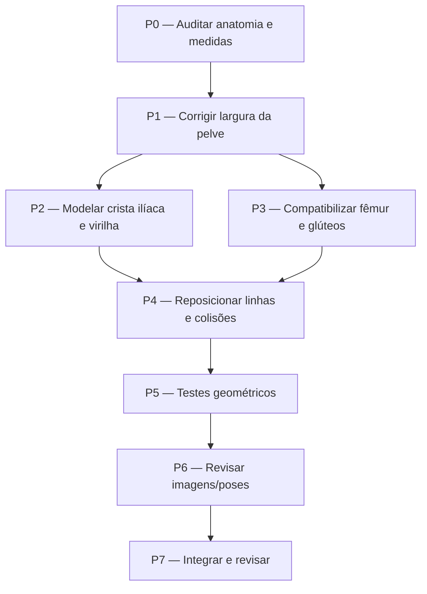

# Task graph — adequação da bacia e pelve

**Escopo:** alinhar o corpo do GeoMannequin à transição anatômica entre costelas inferiores, cintura, crista ilíaca, pelve, articulações coxofemorais, glúteos e coxas. O parâmetro `hips` continua configurável; os demais modos e o editor de quadros compartilham a geometria corrigida.

## Dependências



## Tarefas e critérios de aceite

| ID | Alteração | Arquivo(s) | Critério | Status |
| --- | --- | --- | --- | --- |
| P0 | Mapear perfil, medidas efetivas, ilíacos, articulações, glúteos, colisões e testes | `src/engine/` | Identificar origem do estrangulamento e dependências | Concluído |
| P1 | Aumentar largura efetiva da pelve proporcional ao tipo corporal | `src/engine/corpo.js` | Padrão com pelve mais larga que cintura e tórax preservado | Concluído |
| P2 | Abrir a crista ilíaca e suavizar o fechamento para virilha, incluindo profundidade 3D | `src/engine/corpo.js` | Perfil contínuo em várias alturas | Concluído |
| P3 | Acompanhar o posicionamento do fêmur e o volume glúteo, sem escalar espessura das coxas | `src/engine/pernas.js` | Quadris simétricos, juntas e glúteos coerentes com `hips` | Concluído |
| P4 | Adaptar traços inguinais e cápsula de colisão ao volume | `src/engine/tronco.js`, `src/engine/colisao-cena.js` | Traços e colisão seguem a nova pelve | Concluído |
| P5 | Garantir regressão de cintura, pelve, simetria e parâmetros | `testes/cintura.mjs`, `testes/pelve.mjs`, `package.json` | Testes geométricos passam | Concluído em validação V8 |
| P6 | Conferir vistas frontal, 3/4, perfil, costas, sentado, agachado e torção | `testes/corpo.mjs` | Gerar recortes PNG e revisar artefatos | Preparado; renderização e inspeção visual pendentes |
| P7 | Publicar a alteração para avaliação no GitHub Pages | branch / PR | Merge após revisão de código e regressão geométrica | A integrar |

## Verificações executadas

- **Manequim padrão:** largura da bacia no nível dos quadris aumentou aproximadamente **14,2%**; largura da crista ilíaca, aproximadamente **16,0%**.
- **Manequim padrão:** largura da cintura acompanha a mudança em aproximadamente **3,7%**, preservando a diferenciação das regiões.
- Perfis geométricos revisados em diversas alturas, tipos corporais e ângulos.
- Ambos os testes geométricos `testes/cintura.mjs` e `testes/pelve.mjs` executados em V8 com o código real dos módulos: **passaram**.
- A **suíte Node completa e a inspeção visual dos PNGs** dependem de execução em um ambiente com o projeto e suas dependências e não devem ser dadas como concluídas apenas por essas verificações.

## Execução local

No diretório `geomannequin/`:

```bash
npm ci
npm run testar
node testes/corpo.mjs 'bacia-'
node testes/vistas.mjs ecorche atletico
```

Compare as imagens da pasta `testes/saida/` com as referências, especialmente o fechamento lateral da pelve, encaixe das coxas e deformação ao agachar/sentar. Se encontrar um degrau na pele ou interferência com glúteos, ajuste o perfil e repita os testes antes de considerar P6 validado.
