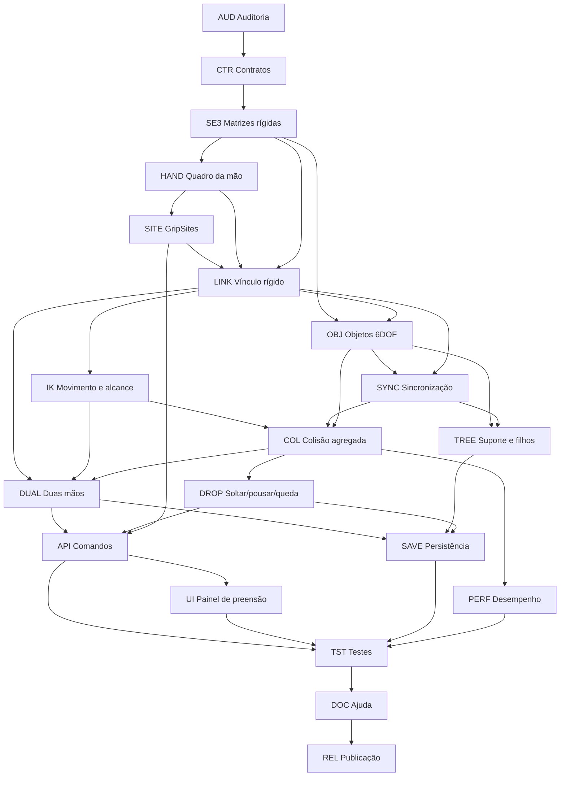

# GeoMannequin — Task Graph: preensão rígida V3, cadeiras e objetos que acompanham a mão

**Auditoria estática do `main` em 10/11/2026.**  
**Escopo:** transformar o vínculo cinemático parcial de Contact V2 em attachment rígido tridimensional, dirigido por braço/punho/palma, com pontos reais de pega, colisão, objetos móveis 6DOF, duas mãos, liberação, persistência e controle completo pelo editor.

**Estado do projeto desta entrega:** somente **análise, especificação e task graph**, NÃO implementação do Grip V3. Todas as tarefas abaixo começam `planejadas`. O código V2 existente permanece intacto.

**Volume:** 239 tarefas com IDs únicos, em 20 fases.

## 1. Resultado da auditoria: o que já existe

| Funcionalidade | Situação confirmada em código | Arquivo e motivo |
|---|---|---|
| Segurar objeto pelo editor e pela UI | **Existente, cinemático** | `scene/comandos.js` (`m.segurar`, `cena.segurarObjeto`); `ui/colisoes.js` |
| Seguir movimento da mão ao alterar o braço | **Parcial** | `scene/preensao-v2.js:updateGrip` calcula nova âncora; `scene/modelo.js:atualizarApoios` atualiza durante render e estado |
| Rotação da cadeira conforme punho | **Não existe corretamente** | `updateGrip` usa apenas `it.params.wRot + yawOffset`; não recebe matriz da palma |
| Agarrar encosto/borda do assento | **Ausente** | `beginGrip` testa distância ao centro do objeto; a cadeira já tem peças em `engine/objetos.js:partesLocais`, mas não GripSites |
| Cadeira livre em pitch e roll | **Ausente** | Objetos atuais têm `x`, `z`, `giro`, `base`; `partesDoObjeto` usa giro só horizontal |
| Soltar preservando altura/queda | **Ausente** | `releaseGrip` exclui o vínculo; `atualizarApoios` volta a posicionar a base segundo o apoio/chão |
| Colisão com cadeira enquanto é carregada | **Parcial experimental** | `scene/contato-v2.js` usa cápsulas×sólidos; atualmente ignora a mão proprietária e suas falanges inteiras no par segurado |
| Filhos sobre a cadeira seguem elevação/rotação | **Parcial em translado no chão; não 6DOF** | `cenario.js` move filhos no x/z durante `editarObjeto`; `modelo.js` atualiza altura de apoio |
| Preensão com duas mãos | **Ausente** | Um único `o.grip={mannequinId,side,offset,yawOffset}` |
| Salvamento do vínculo simples | **Existente para V2** | `scene/estado.js` serializa `grip` por `mannequinIndex` e remapeia ID ao carregar |
| Contato de dedos | **Parcial experimental** | `fecharDedos` avança cinco controles de flexão, mas não garante que cinco dedos permaneçam tocando o objeto |

### Limitações mensuradas no código

```js
// Estado atual: translação segue getHandAnchor(), mas rotação usa somente a raiz.
o.x = ancoraDaMao.x + deslocamentoRelativoARotacaoDoCorpo.x;
o.z = ancoraDaMao.z + deslocamentoRelativoARotacaoDoCorpo.z;
o.giro = it.params.wRot + o.grip.yawOffset;
```

A consequência é que **levantar ou mover o braço pode transportar a cadeira parcialmente**, porém torcer o punho ou inclinar o encosto em 3D não gira o objeto corretamente. A validação inicial também usa distância até o **centro da cadeira** (padrão `reach=2.5 R`, com 1 R ≈ 11,4 cm); isso pode impedir uma pega realista na borda do encosto, embora a mão esteja junto dele.

### Teste de código já disponível hoje — V2, não V3

```js
// Funciona apenas quando a mão estiver suficientemente perto do CENTRO.
// Não garante orientação da cadeira pelo punho.
const ana = cena.ativo.renomear("Ana");
const cadeira = cena.objeto("cadeira",{nome:"Cadeira de teste",x:4,z:0});
const r = cena.segurarObjeto("Cadeira de teste",{
  manequim:"Ana",mao:"direita",reach:2.5
});
log(r);
ana.pose({armFlexR:40});
```

**Aviso:** esse exemplo não assegura que a cadeira esteja alcançável, já que depende da pose e da posição inicial. É ilustrativo da API existente e não é um caso de sucesso validado visualmente.

## 2. Como deve funcionar: uma única transformada rígida completa

**Comportamento pretendido:** a mão funciona como um osso pai temporário do objeto. O objeto conserva a sua pose local em relação à palma enquanto ela se move, gira, levanta ou abaixa.

Se `T_WH` é a transformação da mão no mundo e `T_WO` é a transformação do objeto no mundo:

```text
Ao agarrar sem mover nada:
  G = inverse(T_WH) × T_WO

A cada atualização da pose do manequim:
  T_WO_novo = T_WH_atual × G
```

Para **agarrar um ponto nomeado** no objeto (ex.: `encostoTopo`), com `T_OS` representando a transformação local daquele ponto e `T_HS` o deslocamento desejado desse ponto em relação à mão:

```text
T_WO = T_WH × T_HS × inverse(T_OS)
```

O objeto **não precisa estar colado pelo centro de massa à mão**: apenas o ponto de pega precisa coincidir com a palma. A distância entre o encosto e o assento continua normal.

É essencial separar duas ações: **preservar** — agarrar sem teleporte, guardando a posição relativa atual; e **encaixar** — usar IK para colocar a palma no GripSite antes de criar o vínculo. Uma cadeira grande deve ter múltiplos GripSites geométricos (topo do encosto, lados, borda do assento etc.).

### Contrato proposto para Grip V3 (ainda não existe)

```js
// NOVA API PLANEJADA — NÃO disponível na versão atual:
const ana = cena.ativo;
const cadeira = cena.objeto("cadeira",{nome:"Cadeira 1",x:4,z:2});

// Identificar pontos geométricos reais da cadeira.
log(cadeira.pontosDeAgarre());

// 1) Aproximar mão ao topo do encosto, sem mover a cadeira.
ana.maoEmSite("Cadeira 1","encostoTopo",{lado:"direita"});

// 2) Capturar vínculo completo da mão com a cadeira.
ana.segurar("Cadeira 1",{
  mao:"direita",
  ponto:"encostoTopo",
  modo:"encaixar"
});

// 3) Mover braço, ombro ou punho: a cadeira acompanha posição + rotação.
ana.parametro("armFlexR",40);
ana.parametro("elbowR",85);
ana.parametro("handTwistR",30); // nome exato a definir no mapeamento do rig

// 4) Soltar no ar SEM salto imediato ao chão.
ana.soltar("Cadeira 1",{modo:"manter"});

// Opcional: pousar no chão de forma controlada.
cadeira.pousar({superficie:"chao"});
```

A API final deverá registrar os nomes reais dos parâmetros de punho disponíveis no rig, em vez de introduzir aliases que não existem. **A preensão inicial é cinemática**; gravidade, atrito e soltura realista serão modos adicionais e não requisitos para manter a cadeira presa à mão.

## 3. DAG de dependências



Há uma **dependência iterativa controlada entre LINK e OBJ**: a interface SE(3) e a transformação de cena devem ser definidas primeiro; a integração de ambos os módulos pode ser desenvolvida em paralelo após o contrato compartilhado, evitando uma dependência circular de imports.

## 4. Gráfico completo de tarefas — 239 tarefas

**Convenção:** todas as tarefas têm estado inicial `planejada`. Dependências intra-fase seguem a tarefa anterior; a primeira tarefa de cada fase depende da última tarefa das fases predecessoras, salvo quando implementações paralelas são explicitamente compatíveis. IDs estáveis permitem uso em GitHub Issues, Linear ou agentes de programação.


### AUD — Auditoria do legado (12 tarefas)

**Predecessores:** nenhum. **Entrega:** auditoria do legado com critérios verificáveis.

| ID | Depende de | Tarefa | Critério de aceite |
|---|---|---|---|
| **AUD-01** | — | Mapear cena.segurarObjeto, m.segurar, obj.grip e UI | Assinaturas verificadas com código |
| **AUD-02** | AUD-01 | Traçar beginGrip→getHandAnchor→updateGrip→atualizarApoios | Fluxo real com pontos de sincronização |
| **AUD-03** | AUD-02 | Reproduzir giro do punho com cadeira agarrada | Evidência de que o yaw segue só a raiz |
| **AUD-04** | AUD-03 | Reproduzir alcance pelo centro da cadeira | Falha de pega pelo encosto registrada |
| **AUD-05** | AUD-04 | Reproduzir soltar objeto suspenso | Confirmar snap atual de base/chão |
| **AUD-06** | AUD-05 | Auditar cadeira em partesLocais e partesDoObjeto | Geometria de pernas, tampo e encosto mapeada |
| **AUD-07** | AUD-06 | Auditar pares mão-objeto filtrados em contato-v2 | Listar colisões hoje ignoradas |
| **AUD-08** | AUD-07 | Auditar pose do braço em sliders/IK/arrastar/roteiro | Todos os pontos de mutação listados |
| **AUD-09** | AUD-08 | Auditar objeto.sobre, apoioEm e filhos | Casos de dependência documentados |
| **AUD-10** | AUD-09 | Auditar serialização dos grips por ID/índice | Roundtrip legado caracterizado |
| **AUD-11** | AUD-10 | Auditar custo de colisores e cache | Baseline de tempo medido |
| **AUD-12** | AUD-11 | Produzir atlas de defeitos com cadeira | Referência visual antes/depois comparável |

### CTR — Contrato de estados e comportamento (10 tarefas)

**Predecessores:** `AUD`. **Entrega:** contrato de estados e comportamento com critérios verificáveis.

| ID | Depende de | Tarefa | Critério de aceite |
|---|---|---|---|
| **CTR-01** | AUD-12 | Definir livre, aproximando, agarrado, duas_mãos, soltando, apoiado | Transições sem estado impossível |
| **CTR-02** | CTR-01 | Separar agarrar sem deslocar de encaixar a mão no ponto | Modos distintos no contrato |
| **CTR-03** | CTR-02 | Definir que mover o braço governa posição e orientação do objeto | Invariante matemática explícita |
| **CTR-04** | CTR-03 | Distinguir seguir cinemático de simulação de força | Sem falsa promessa de peso/atrito |
| **CTR-05** | CTR-04 | Definir um dono e uma ou duas mãos por objeto | Conflitos de posse tipados |
| **CTR-06** | CTR-05 | Definir alcance em R e centímetros | Sem constantes mágicas |
| **CTR-07** | CTR-06 | Definir comportamentos para objeto grande fora do alcance | Não teleporta cadeira por padrão |
| **CTR-08** | CTR-07 | Definir cancelamento e rollback de tentativa fracassada | Estado anterior recuperado |
| **CTR-09** | CTR-08 | Definir escala e eixo canônicos do objeto | Coordenadas locais versus mundo inequívocas |
| **CTR-10** | CTR-09 | Definir modos soltar, manter, pousar e queda | Estado final determinístico |

### SE3 — Matemática de transformadas rígidas (12 tarefas)

**Predecessores:** `CTR`. **Entrega:** matemática de transformadas rígidas com critérios verificáveis.

| ID | Depende de | Tarefa | Critério de aceite |
|---|---|---|---|
| **SE3-01** | CTR-10 | Definir T={M,T} ou posição+quaternion como representação interna | Um formato canônico |
| **SE3-02** | SE3-01 | Criar rigidCompose(A,B) | Composição preserva orientação e posição |
| **SE3-03** | SE3-02 | Criar rigidInverse(A) | Produto com inversa≈identidade |
| **SE3-04** | SE3-03 | Criar transformação ponto/direção/normal | Pontos transladam, direções não |
| **SE3-05** | SE3-04 | Normalizar quaternion e detectar degeneração | Nenhum NaN |
| **SE3-06** | SE3-05 | Migrar yaw antigo para pose 6DOF | Arquivos antigos idênticos |
| **SE3-07** | SE3-06 | Definir pivô local independente da base no chão | Rotação ao redor de âncora |
| **SE3-08** | SE3-07 | Calcular G=inverse(T_WH)×T_WO no instante de agarrar | Captura sem teleporte |
| **SE3-09** | SE3-08 | Calcular T_WO=T_WH×G em cada atualização | Erro de rigidez menor que 0.01 R |
| **SE3-10** | SE3-09 | Definir T_WO=T_WH×T_HS×inverse(T_OS) no encaixe | Grip-site coincide com palma |
| **SE3-11** | SE3-10 | Criar SLERP para transições opcionais | Sem giro longo em ±180° |
| **SE3-12** | SE3-11 | Testar espelhamento das mãos e handedness | Sem inversão/reflexão do objeto |

### HAND — Referencial 3D da palma (10 tarefas)

**Predecessores:** `SE3`. **Entrega:** referencial 3d da palma com critérios verificáveis.

| ID | Depende de | Tarefa | Critério de aceite |
|---|---|---|---|
| **HAND-01** | SE3-12 | Criar getHandFrame(it,side) com orientação e posição | Devolve SE3 mundial |
| **HAND-02** | HAND-01 | Combinar chainSetup.A2, armPose.hand e transform do mundo | Frame confere com malha visível |
| **HAND-03** | HAND-02 | Aplicar rotação da cintura e do corpo deitado | Referencial preservado invertido |
| **HAND-04** | HAND-03 | Identificar grau de liberdade de punho/palma | Twist/flex alteram orientação do frame |
| **HAND-05** | HAND-04 | Definir frame de superfície palmar e dorso | Normal de agarre previsível |
| **HAND-06** | HAND-05 | Distinguir âncora em punho e na palma | Offsets anatômicos nomeados |
| **HAND-07** | HAND-06 | Preservar wrapper getHandAnchor V2 | Sem regressão da API legada |
| **HAND-08** | HAND-07 | Atualizar frame após IK do cotovelo e arraste | Mesmo resultado por edição |
| **HAND-09** | HAND-08 | Testar mão direita e esquerda com objetos idênticos | Espelhamento correto |
| **HAND-10** | HAND-09 | Validar compatibilidade com cabeças V1-V4 | Frame independe da face |

### SITE — Pontos de agarre em objetos (12 tarefas)

**Predecessores:** `HAND`. **Entrega:** pontos de agarre em objetos com critérios verificáveis.

| ID | Depende de | Tarefa | Critério de aceite |
|---|---|---|---|
| **SITE-01** | HAND-10 | Criar schema GripSite{id,frameLocal,normal,capacidade,tipo} | Serializável e testado |
| **SITE-02** | SITE-01 | Gerar topo do encosto da cadeira | Coordenada usa altura, largura e profundidade |
| **SITE-03** | SITE-02 | Gerar canto esquerdo do encosto | Site acessível a mão esquerda |
| **SITE-04** | SITE-03 | Gerar canto direito do encosto | Site acessível a mão direita |
| **SITE-05** | SITE-04 | Gerar borda anterior do assento | Pega possível sem alcançar centro |
| **SITE-06** | SITE-05 | Gerar bordas laterais do assento | Sites continuam na superfície |
| **SITE-07** | SITE-06 | Gerar sites de caixa e cubo | Faces e arestas nomeadas |
| **SITE-08** | SITE-07 | Gerar sites de banco, mesa e cama | Superfícies ligadas à geometria |
| **SITE-09** | SITE-08 | Gerar sites de copo e cilindro | Superfície circular coerente |
| **SITE-10** | SITE-09 | Calcular ponto mais próximo na superfície | Seleciona site pelo alcance da mão, não centro |
| **SITE-11** | SITE-10 | Recalcular sites após alterar dimensões | Ponto segue a peça correta |
| **SITE-12** | SITE-11 | Permitir site customizado e gizmos de inspeção | Mesmo ID na interface e no código |

### LINK — Vínculo rígido V3 (14 tarefas)

**Predecessores:** `SE3`, `HAND`, `SITE`. **Entrega:** vínculo rígido v3 com critérios verificáveis.

| ID | Depende de | Tarefa | Critério de aceite |
|---|---|---|---|
| **LINK-01** | SE3-12, HAND-10, SITE-12 | Criar grip-v3.js separado do V2 | Flag experimental reversível |
| **LINK-02** | LINK-01 | Implementar beginRigidGrip com validação transacional | Sem mutação parcial em erro |
| **LINK-03** | LINK-02 | Implementar modo preservar transformação inicial | Cadeira não salta ao agarrar |
| **LINK-04** | LINK-03 | Implementar modo encaixarSite com IK primeiro | Palma chega à superfície |
| **LINK-05** | LINK-04 | Guardar transformada relativa 6DOF | Rotação de punho herdada |
| **LINK-06** | LINK-05 | Propagar transform de mão para objeto em toda edição | Sem frame atrasado |
| **LINK-07** | LINK-06 | Aplicar mudanças por script de pose | Mesma rigidez que via mouse |
| **LINK-08** | LINK-07 | Aplicar mudanças por sliders e arraste | Sem caminho de código esquecido |
| **LINK-09** | LINK-08 | Aplicar movimento e rotação da raiz do manequim | Cadeira acompanha corpo inteiro |
| **LINK-10** | LINK-09 | Proteger transform contra movimento de câmera | World pose não muda com câmera |
| **LINK-11** | LINK-10 | Permitir transferência de mão proprietária | Sem salto ao trocar |
| **LINK-12** | LINK-11 | Incluir objetos com centro deslocado da pega | Pegar pelo encosto sem mover centro à mão |
| **LINK-13** | LINK-12 | Notificar grip ativo, owner e resíduos | Estado introspectável |
| **LINK-14** | LINK-13 | Não duplicar vínculo ao repetir segurar | Operação idempotente ou erro claro |

### OBJ — Pose 6DOF de todos os objetos (12 tarefas)

**Predecessores:** `SE3`, `LINK`. **Entrega:** pose 6dof de todos os objetos com critérios verificáveis.

| ID | Depende de | Tarefa | Critério de aceite |
|---|---|---|---|
| **OBJ-01** | SE3-12, LINK-14 | Adicionar pose completa a objetos sem romper x/z/giro | Compatibilidade V2 |
| **OBJ-02** | OBJ-01 | Separar altura real, apoio e pivô de render | Objeto suspenso não perde y |
| **OBJ-03** | OBJ-02 | Atualizar partesDoObjeto por matriz 3D | Todas as peças da cadeira giram juntas |
| **OBJ-04** | OBJ-03 | Transformar caixas orientadas para colisão | Contatos no encosto inclinado |
| **OBJ-05** | OBJ-04 | Transformar cilindros e suas normais | Contato robusto ao inclinar copo |
| **OBJ-06** | OBJ-05 | Atualizar projeção e bounding boxes | Picking e câmera reconhecem objeto suspenso |
| **OBJ-07** | OBJ-06 | Atualizar sombra e profundidade | Cadeira inclinada desenhada corretamente |
| **OBJ-08** | OBJ-07 | Rotacionar marcadores de grip com o objeto | Sites não ficam no ar |
| **OBJ-09** | OBJ-08 | Atualizar câmera.orientacaoDoAlvo do objeto | Frente/costas seguem 6DOF |
| **OBJ-10** | OBJ-09 | Testar yaw/pitch/roll extremos e body inverted | Sem singularidades |
| **OBJ-11** | OBJ-10 | Evitar rebuild de malha se só pose muda | Performance estável |
| **OBJ-12** | OBJ-11 | Permitir aliases antigos base/giro na importação | Sem alteração visual em cenas antigas |

### SYNC — Ordem de atualização da cena (10 tarefas)

**Predecessores:** `LINK`, `OBJ`. **Entrega:** ordem de atualização da cena com critérios verificáveis.

| ID | Depende de | Tarefa | Critério de aceite |
|---|---|---|---|
| **SYNC-01** | LINK-14, OBJ-12 | Definir updatePose→propagar grip→colidir→renderizar | Pipeline único |
| **SYNC-02** | SYNC-01 | Criar scene.updateTransforms() idempotente | Duas atualizações iguais não alteram estado |
| **SYNC-03** | SYNC-02 | Executar atualização em arraste de braço | Cadeira segue em tempo real |
| **SYNC-04** | SYNC-03 | Executar atualização em sliders/parametro/pose | Cadeira acompanha código e controles |
| **SYNC-05** | SYNC-04 | Executar atualização antes de salvar e exportar | Sem estado de frame antigo |
| **SYNC-06** | SYNC-05 | Atualizar cache sujo somente do ator/objeto | Sem rebuild global |
| **SYNC-07** | SYNC-06 | Invalidar picking após transformação | Seleção acompanha cadeira levantada |
| **SYNC-08** | SYNC-07 | Evitar ciclos entre atualizarApoios e grip | Grafo sem recursão infinita |
| **SYNC-09** | SYNC-08 | Versionar estados usados pelo worker de render | Frames antigos não sobrescrevem novos |
| **SYNC-10** | SYNC-09 | Revalidar quando biotipo altera comprimento do braço | Transform preservada ou erro explícito |

### IK — Controle por braço e movimento reverso (12 tarefas)

**Predecessores:** `HAND`, `LINK`. **Entrega:** controle por braço e movimento reverso com critérios verificáveis.

| ID | Depende de | Tarefa | Critério de aceite |
|---|---|---|---|
| **IK-01** | HAND-10, LINK-14 | Aproximar mão a site com ikArm | Sem teleporte de cadeira |
| **IK-02** | IK-01 | Validar limites de ombro/cotovelo e punho | Pose plausível |
| **IK-03** | IK-02 | Oferecer apenas aproximar sem prender | Prévia separada |
| **IK-04** | IK-03 | Agarrar após convergência de IK | Distância/normal dentro da tolerância |
| **IK-05** | IK-04 | Mover braço por pose e atualizar cadeira | Objeto segue 6DOF |
| **IK-06** | IK-05 | Mover mão via drag e atualizar cadeira | Sem jitter |
| **IK-07** | IK-06 | Mover corpo e girar 360° com cadeira | Sem deslizamento |
| **IK-08** | IK-07 | Arrastar cadeira com IK inversa opcional | Mão acompanha objeto |
| **IK-09** | IK-08 | Resolver alvos fora do alcance sem esticar ossos | Rollback ou limitação |
| **IK-10** | IK-09 | Evitar movimento indevido do braço oposto | Sem acoplamento acidental |
| **IK-11** | IK-10 | Integrar com gestos e dedos | Abertura da mão não destrói grip sem soltar |
| **IK-12** | IK-11 | Integrar com roteiros e keyframes | Transições determinísticas |

### COL — Colisões mão+objeto carregado (14 tarefas)

**Predecessores:** `OBJ`, `SYNC`, `IK`. **Entrega:** colisões mão+objeto carregado com critérios verificáveis.

| ID | Depende de | Tarefa | Critério de aceite |
|---|---|---|---|
| **COL-01** | OBJ-12, SYNC-10, IK-12 | Tratar cadeira segurada como parte de agregado para bloqueio | Cadeira não atravessa outro manequim |
| **COL-02** | COL-01 | Filtrar somente superfícies efetivas dedo-site | Não ignorar mão inteira |
| **COL-03** | COL-02 | Preservar contato tangencial sem penetração | Grip sólido |
| **COL-04** | COL-03 | Checar cadeira contra antebraço/cabeça/torso/pernas | Não afunda no próprio corpo |
| **COL-05** | COL-04 | Checar cadeira contra chão e móveis vizinhos | Sem atravessamento |
| **COL-06** | COL-05 | Atualizar contexto de objeto em movimento | Não usar colisor da pose antiga |
| **COL-07** | COL-06 | Ampliar CCD aproximada para arco de mão+cadeira | Sem túnel entre amostras |
| **COL-08** | COL-07 | Fazer rollback atômico de pose+objeto se bloqueada | Não separa objeto do braço |
| **COL-09** | COL-08 | Adicionar tolerâncias de contato por site | Sem vibração contínua |
| **COL-10** | COL-09 | Desconsiderar autocolisão interna da cadeira rígida | Não bloquear por peças próprias |
| **COL-11** | COL-10 | Inspecionar contato por parte (encosto/assento/perna) | Diagnóstico útil |
| **COL-12** | COL-11 | Detectar obstáculos finos por swept proxy | Cobertura de cantos e paredes |
| **COL-13** | COL-12 | Testar transporte por passagem estreita | Sem atravessamento dentro da precisão proxy |
| **COL-14** | COL-13 | Explicitar limite de cápsulas/OBB vs malha exata | Sem promessa de colisão perfeita |

### DUAL — Segurar com duas mãos (10 tarefas)

**Predecessores:** `LINK`, `IK`, `COL`. **Entrega:** segurar com duas mãos com critérios verificáveis.

| ID | Depende de | Tarefa | Critério de aceite |
|---|---|---|---|
| **DUAL-01** | LINK-14, IK-12, COL-14 | Armazenar duas mãos e dois GripSites | Vínculos independentes |
| **DUAL-02** | DUAL-01 | Declarar mão primária | Transform do objeto sem ambiguidade |
| **DUAL-03** | DUAL-02 | Solucionar IK da secundária para acompanhar objeto | Segunda palma toca site |
| **DUAL-04** | DUAL-03 | Verificar resíduo simultâneo de ambos os contatos | Desvio mensurado |
| **DUAL-05** | DUAL-04 | Bloquear metas incompatíveis com limite anatômico | Erro claro |
| **DUAL-06** | DUAL-05 | Transferir mão primária sem salto | Continuidade |
| **DUAL-07** | DUAL-06 | Soltar uma mão mantendo outra | Cadeira continua presa |
| **DUAL-08** | DUAL-07 | Soltar última mão seguindo modo de liberação | Estado livre |
| **DUAL-09** | DUAL-08 | Impedir donos de dois atores sem constraint explícita | Conflito tipado |
| **DUAL-10** | DUAL-09 | Prever evolução para dois atores carregando móvel | API preparada, física futura |

### TREE — Objetos sobre cadeira e pessoa sentada (10 tarefas)

**Predecessores:** `OBJ`, `SYNC`. **Entrega:** objetos sobre cadeira e pessoa sentada com critérios verificáveis.

| ID | Depende de | Tarefa | Critério de aceite |
|---|---|---|---|
| **TREE-01** | OBJ-12, SYNC-10 | Converter suporte objeto.sobre em transform relativo quando necessário | Filhos movem com pai |
| **TREE-02** | TREE-01 | Distinguir apoiado por gravidade de rigidamente preso | Inclinação define política |
| **TREE-03** | TREE-02 | Mover copo sobre cadeira com cadeira transladada | Sem x/z antigo |
| **TREE-04** | TREE-03 | Inclinar cadeira e escolher escorregar/reter copo | Regra explícita |
| **TREE-05** | TREE-04 | Evitar cadeias cíclicas de parent/grip | DAG validado |
| **TREE-06** | TREE-05 | Tratar cadeira enquanto pessoa está sentada | Erro ou modo transportar sentado explícito |
| **TREE-07** | TREE-06 | Resolver excluir suporte carregado | Descendentes sem referências órfãs |
| **TREE-08** | TREE-07 | Propagar o giro e a translação a acessórios | Local transform constante |
| **TREE-09** | TREE-08 | Salvar e restaurar hierarquia objeto→objeto | Roundtrip correto |
| **TREE-10** | TREE-09 | Testar cadeira carregada com objetos no assento | Integridade visual e de colisão |

### DROP — Soltar, pousar ou derrubar (12 tarefas)

**Predecessores:** `LINK`, `OBJ`, `COL`. **Entrega:** soltar, pousar ou derrubar com critérios verificáveis.

| ID | Depende de | Tarefa | Critério de aceite |
|---|---|---|---|
| **DROP-01** | LINK-14, OBJ-12, COL-14 | Soltar mantendo transform da cadeira no instante da liberação | Zero snap para chão |
| **DROP-02** | DROP-01 | Pousar em superfície alvo quando houver contato | Posição final plausível |
| **DROP-03** | DROP-02 | Distinguir repouso no ar versus apoio real | Estado explícito |
| **DROP-04** | DROP-03 | Criar queda animada sob gravidade opcional | Sem teleporte |
| **DROP-05** | DROP-04 | Usar colisão com piso durante queda | Não atravessar chão |
| **DROP-06** | DROP-05 | Definir velocidades herdadas do braço | Largada coerente |
| **DROP-07** | DROP-06 | Definir atrito/restituição em modo dinâmico | Objeto estabiliza |
| **DROP-08** | DROP-07 | Não forçar cadeira a ficar vertical ao pousar | Orientação preservada |
| **DROP-09** | DROP-08 | Manter modo cinemático sem forças para keyframe | Usuário decide destino |
| **DROP-10** | DROP-09 | Soltar uma mão sem ativar queda se outra segura | Dupla preensão respeitada |
| **DROP-11** | DROP-10 | Remover objeto/ator com limpeza segura de grip | Sem IDs órfãos |
| **DROP-12** | DROP-11 | Testar salvar no exato frame da soltura | Sem base redefinida |

### API — API de preensão completa (15 tarefas)

**Predecessores:** `SITE`, `LINK`, `DUAL`, `DROP`. **Entrega:** api de preensão completa com critérios verificáveis.

| ID | Depende de | Tarefa | Critério de aceite |
|---|---|---|---|
| **API-01** | SITE-12, LINK-14, DUAL-10, DROP-12 | m.segurar(obj,{mao,ponto,modo,alcance}) | Assinatura pública validada |
| **API-02** | API-01 | cena.segurarObjeto(obj,{manequim,mao,ponto,modo}) | Mesma lógica que m.segurar |
| **API-03** | API-02 | obj.segurarPor(m,{mao,ponto}) | Operação equivalente |
| **API-04** | API-03 | m.soltar(obj,{modo}) | Soltura configurável |
| **API-05** | API-04 | cena.soltarObjeto(obj,{modo}) | Soltura configurável |
| **API-06** | API-05 | obj.pontosDeAgarre() | IDs e frames consultáveis |
| **API-07** | API-06 | obj.pontoDeAgarre(id) | Ponto local+mundial |
| **API-08** | API-07 | m.maoEmSite(obj,ponto,{lado}) | IK sem segurar |
| **API-09** | API-08 | obj.emPosseDe() | Donos e mãos em JSON |
| **API-10** | API-09 | m.objetosSegurados() | Lista por mão |
| **API-11** | API-10 | cena.vinculos() | Todos grips ativos |
| **API-12** | API-11 | cena.inspecionarPreensao() | Resíduo e colisões |
| **API-13** | API-12 | obj.criarSite(id,frame,opts) | Sites de objetos personalizados |
| **API-14** | API-13 | cena.preensao({motor:'v3'}) | Ativação experimental |
| **API-15** | API-14 | Definir erros ReachError/CollisionError/OccupiedHand | Erros tratáveis no editor |

### UI — Painel de preensão (12 tarefas)

**Predecessores:** `API`. **Entrega:** painel de preensão com critérios verificáveis.

| ID | Depende de | Tarefa | Critério de aceite |
|---|---|---|---|
| **UI-01** | API-15 | Adicionar seção Preensão visível | Localização clara no menu |
| **UI-02** | UI-01 | Selecionar ator e mão | Sem ambiguidade |
| **UI-03** | UI-02 | Selecionar objeto | Suporta cadeira e outros |
| **UI-04** | UI-03 | Escolher encosto/assento/lateral por gizmo | Ponto correto |
| **UI-05** | UI-04 | Exibir distância à mão e orientação | Diagnóstico ao vivo |
| **UI-06** | UI-05 | Botão Aproximar mão | IK antes do vínculo |
| **UI-07** | UI-06 | Botão Segurar sem mover | Preserva estado inicial |
| **UI-08** | UI-07 | Botão Encaixar e segurar | Converge para site |
| **UI-09** | UI-08 | Controlar mão primária/secundária | Dupla preensão |
| **UI-10** | UI-09 | Exibir vínculo e tolerância de contato no palco | Feedback visível |
| **UI-11** | UI-10 | Botões Soltar/Pousar/Deixar cair distintos | Modos sem ambiguidade |
| **UI-12** | UI-11 | Testar acessibilidade e responsive | Funciona desktop/celular |

### SAVE — Schema e compatibilidade (12 tarefas)

**Predecessores:** `OBJ`, `DUAL`, `TREE`, `DROP`, `API`. **Entrega:** schema e compatibilidade com critérios verificáveis.

| ID | Depende de | Tarefa | Critério de aceite |
|---|---|---|---|
| **SAVE-01** | OBJ-12, DUAL-10, TREE-10, DROP-12, API-15 | Definir grip.version=3 com ownerIndex, mãos e SE3 | Schema formal |
| **SAVE-02** | SAVE-01 | Persistir pose 6DOF e pivô do objeto | Sem rotação perdida |
| **SAVE-03** | SAVE-02 | Persistir sites padrões e personalizados | Mesma localização após importar |
| **SAVE-04** | SAVE-03 | Reindexar IDs de manequins e objetos na carga | Sem referência equivocada |
| **SAVE-05** | SAVE-04 | Persistir vínculos objeto.sobre relativos | Conjunto rígido recuperável |
| **SAVE-06** | SAVE-05 | Migrar grip V2 para V3 sem mudança de pose | Sem salto |
| **SAVE-07** | SAVE-06 | Validar campos numéricos e sites ao importar | Não aceitar NaN/infinito |
| **SAVE-08** | SAVE-07 | Restaurar frame de mão depois da pose do ator | Sem ordem de carga incorreta |
| **SAVE-09** | SAVE-08 | Integrar undo/redo de cena completa | Desfazer e refazer agarramento |
| **SAVE-10** | SAVE-09 | Integrar JSON, link, roteiro e exportação | Mesmo vínculo em todos os formatos |
| **SAVE-11** | SAVE-10 | Rejeitar e limpar vínculo órfão após exclusão | Sem crash |
| **SAVE-12** | SAVE-11 | Criar regressão de arquivos antigos | Cadeiras antigas no mesmo lugar |

### PERF — Desempenho e robustez (10 tarefas)

**Predecessores:** `SYNC`, `COL`, `DUAL`. **Entrega:** desempenho e robustez com critérios verificáveis.

| ID | Depende de | Tarefa | Critério de aceite |
|---|---|---|---|
| **PERF-01** | SYNC-10, COL-14, DUAL-10 | Medir custo de getHandFrame e sites | p50/p95 de baseline |
| **PERF-02** | PERF-01 | Cache dos quadros de mão por revisão de pose | Sem cálculos redundantes |
| **PERF-03** | PERF-02 | Dirty flags para objetos anexados | Atualizar só o necessário |
| **PERF-04** | PERF-03 | Broadphase incremental com cadeira móvel | Evitar O(N²) desnecessário |
| **PERF-05** | PERF-04 | Versionar renderização assíncrona | Sem frame velho |
| **PERF-06** | PERF-05 | Testar 12 manequins + 40 objetos | Sem travamentos severos |
| **PERF-07** | PERF-06 | Medir erro após 10000 movimentos | Sem drift acumulado |
| **PERF-08** | PERF-07 | Testar body roll ±180 e extremos de escala | Sem não finitos |
| **PERF-09** | PERF-08 | Log de contato/IK/grip opt-in | Diagnósticos auditáveis |
| **PERF-10** | PERF-09 | Fallback de refinamento em máquinas lentas | Vínculo básico mantém rigidez |

### TST — Testes e atlas de aprovação (24 tarefas)

**Predecessores:** `API`, `UI`, `SAVE`, `PERF`. **Entrega:** testes e atlas de aprovação com critérios verificáveis.

| ID | Depende de | Tarefa | Critério de aceite |
|---|---|---|---|
| **TST-01** | API-15, UI-12, SAVE-12, PERF-10 | Teste SE3 inverse/compose | Erro ≤1e-6 R |
| **TST-02** | TST-01 | Teste prender sem teleporte | Transform inicial igual |
| **TST-03** | TST-02 | Teste agarrar topo do encosto com centro distante | Site acessível |
| **TST-04** | TST-03 | Teste mudar somente cotovelo | Cadeira segue mão |
| **TST-05** | TST-04 | Teste torcer punho mantendo tronco imóvel | Cadeira gira junto |
| **TST-06** | TST-05 | Teste raiz x/z e yaw completo | Grip não desliza |
| **TST-07** | TST-06 | Teste manequim deitado/invertido | Direções corretas |
| **TST-08** | TST-07 | Teste mão esquerda/direita | Espelho correto |
| **TST-09** | TST-08 | Teste levantar pelo encosto | Assento e pernas seguem |
| **TST-10** | TST-09 | Teste cadeira pitch/roll ±90 | Todas peças rotacionam |
| **TST-11** | TST-10 | Teste colisão encosto/cabeça | Movimento limitado |
| **TST-12** | TST-11 | Teste cadeira contra parede fina | CCD bloqueia |
| **TST-13** | TST-12 | Teste contatos dos dedos no grip | Sem penetração no suporte |
| **TST-14** | TST-13 | Teste duas mãos segurando | Dois sites consistentes |
| **TST-15** | TST-14 | Teste soltar uma das mãos | Não cai |
| **TST-16** | TST-15 | Teste cadeira com copo apoiado | Filho segue política |
| **TST-17** | TST-16 | Teste ator sentado em cadeira levantada | Política explícita |
| **TST-18** | TST-17 | Teste soltar no ar | Não teleporta |
| **TST-19** | TST-18 | Teste pousar no chão | Sem penetração |
| **TST-20** | TST-19 | Teste salvar/carregar JSON com cadeira presa | Mesma pose final |
| **TST-21** | TST-20 | Teste UI↔código em quatro caminhos | Mesma transformação |
| **TST-22** | TST-21 | Teste storyboard de cinco quadros | Movimento temporal consistente |
| **TST-23** | TST-22 | Atlas 8 vistas × 6 poses | Inspeção visual documentada |
| **TST-24** | TST-23 | Benchmark 12 atores/40 objetos/três grips | p50/p95 registrados |

### DOC — Documentação e exemplos (8 tarefas)

**Predecessores:** `TST`. **Entrega:** documentação e exemplos com critérios verificáveis.

| ID | Depende de | Tarefa | Critério de aceite |
|---|---|---|---|
| **DOC-01** | TST-24 | Documentar novos métodos no editor | Exemplos copiáveis |
| **DOC-02** | DOC-01 | Exemplo cadeira pelo encosto | Resultado previsto |
| **DOC-03** | DOC-02 | Exemplo mover e torcer braço com cadeira | SE3 comprovado |
| **DOC-04** | DOC-03 | Exemplo cadeira com duas mãos | Ambos sites corretos |
| **DOC-05** | DOC-04 | Exemplo soltar e pousar | Sem snap |
| **DOC-06** | DOC-05 | Manual de mensagens de erro | Ação corretiva clara |
| **DOC-07** | DOC-06 | Explicar limites físicos e de colisão | Sem falsa equivalência a física real |
| **DOC-08** | DOC-07 | Atualizar mapa de tarefas com evidências | Status auditável |

### REL — Entrega, CI e publicação (8 tarefas)

**Predecessores:** `DOC`. **Entrega:** entrega, ci e publicação com critérios verificáveis.

| ID | Depende de | Tarefa | Critério de aceite |
|---|---|---|---|
| **REL-01** | DOC-08 | Implementar em branch isolada Grip V3 | PR específica |
| **REL-02** | REL-01 | Executar testes Node de preensão V3 | Logs verdes |
| **REL-03** | REL-02 | Rodar regressão da colisão V2 e câmeras | Sem regressões |
| **REL-04** | REL-03 | Produzir atlas e revisar manualmente | Screenshots por vista |
| **REL-05** | REL-04 | Verificar CLI, editor, sliders e arraste no navegador | Todos funcionam |
| **REL-06** | REL-05 | Publicar no GitHub Pages após revisão | Mesmo código em produção |
| **REL-07** | REL-06 | Testar restauro e downgrade de cena V2 | Sem perda de dados |
| **REL-08** | REL-07 | Marcar tarefas somente após gates concluídos | Documento reflete estado real |

## 5. Critérios quantitativos de aprovação

| Aspecto | Critério mínimo |
|---|---|
| Rigidez da pega | `max|T_WH × G − T_WO|` em posições equivalentes ≤ **0,01 R** (~1,14 mm) após atualização |
| Alinhamento angular | Desvio entre o frame objeto previsto e o renderizado ≤ **0,2°** |
| Pega sem teleporte | Mudança da posição do objeto no frame de captura, modo `preservar`, ≤ **0,001 R** |
| Agarre pelo encosto | Com mão a ≤ tolerância do **site** mas longe do centro da cadeira, a operação pode ser iniciada |
| Orientação livre | Cadeira pode receber pitch/roll ±90° e yaw ±180° mantendo todas as peças e colisores |
| Movimentos com raiz | Rotação, caminhada e movimento do corpo não fazem a cadeira deslizar em relação à palma |
| Duas mãos | Uma mão pode soltar sem derrubar objeto que ainda esteja preso à outra |
| Queda/soltura | No primeiro frame após `soltar({modo:'manter'})`, a cadeira conserva a mesma pose mundial |
| Colisão | Bloqueio em proxies sem novas penetrações além da tolerância V2 configurada; nunca afirmar precisão exata de malha antes de CCD completa |
| Roundtrip | JSON salva/carrega vínculo e pose mundial dentro das tolerâncias acima |
| UI/código | Segurar, mover e soltar por mouse, slider, editor e roteiro geram a mesma transformação |
| Desempenho | p50/p95 medidos com cenário de 12 manequins + 40 objetos; metas fixadas após baseline real |
| Evidência visual | Atlas de no mínimo 8 vistas × 6 poses de cadeira, incluindo encosto, assento, duas mãos e soltar |
| Compatibilidade | Testes legados do Contact V2, câmeras, objetos e cenas antigas sem regressão |

## 6. Gates de implementação recomendados

**M0 — Levantamento (AUD/CTR).** Demonstrar e registrar limitações de Grip V2 para cadeira; aprovar modo de agarrar e soltar.  
**M1 — Núcleo 6DOF (SE3/HAND/OBJ).** Objeto acompanha a **rotação da mão**, não só a rotação do corpo.  
**M2 — Ponto real (SITE/LINK/IK).** Pegar cadeira pelo encosto sem testar distância até seu centro.  
**M3 — Transporte sem atravessar (SYNC/COL).** Colisão do objeto carregado com corpo, pessoas, móveis e piso.  
**M4 — Duas mãos e hierarquias (DUAL/TREE).** Segurar a mesma cadeira por dois pontos e preservar objetos apoiados.  
**M5 — Soltura (DROP).** Manter a pose no ar, pousar sobre uma superfície ou cair por física opcional.  
**M6 — Controle completo (API/UI/SAVE).** Todos os comportamentos por código, painel e JSON.  
**M7 — Qualidade (PERF/TST/DOC/REL).** Suítes verdes, atlas aprovado, publicação real confirmada.

### Ordem crítica para o objetivo central

```text
AUD → CTR → SE3 → HAND → SITE → LINK → OBJ → SYNC → IK → COL → API → SAVE → TST → REL
```

As trilhas DUAL, TREE, DROP, UI e PERF podem prosseguir em paralelo após suas dependências, mas nenhuma tarefa é aceita sem testes específicos.

## 7. Arquivos existentes e módulos a criar

| Arquivo | Intervenção planejada |
|---|---|
| `src/scene/preensao-v2.js` | Preservar V2 e migrar comportamento a partir da nova implementação |
| `src/scene/grip-v3.js` **novo** | Contrato Grip, captura do vínculo, follow e liberação |
| `src/engine/rigid-transform.js` **novo** | SE3, inversas, quaternions e cálculo de frame local |
| `src/engine/grip-sites.js` **novo** | Sites paramétricos por cadeira, mesa, caixa, copo etc. |
| `src/engine/objetos.js` | Render/colisão 6DOF da cadeira e demais objetos |
| `src/engine/cadeia.js`, `bracos.js` | Frames de palma/punho realmente orientados |
| `src/scene/modelo.js` | Atualização de vínculo e objetos dependentes antes do render |
| `src/scene/cenario.js` | Parenting, movimentos reversos e IK ao pegar |
| `src/scene/contato-v2.js` | Manifold e bloqueio de objeto carregado, filtro mão-site |
| `src/scene/comandos.js` | APIs públicas para selecionar GripSites, segurar, acompanhar e soltar |
| `src/scene/estado.js` | Persistência/migração Grip V3 e relações pai/filho |
| `src/ui/colisoes.js` e painel Preensão | Controles visuais e mensagens de erro |
| `src/ui/arrastar.js` | Arraste da mão dirigindo o objeto e arraste reverso opcional |
| `src/scene/quadros.js` | Continuidade de vínculo ao renderizar roteiro |
| `testes/preensao-v3-*.mjs` **novos** | Testes por módulos, cenas e regressões |
| `.github/workflows/geomannequin-grip-v3.yml` **novo** | Gates de CI da preensão |

## 8. Distinção fundamental

**Pegar e carregar algo como parte do braço é um problema de vínculo rígido (attachment / parent constraint).** Ele não exige motor de dinâmica completo para funcionar. Uma vez capturado `G`, toda mudança no punho deve transportar o objeto com a transformação 3D correta.

**Mas segurar com os dedos sem atravessar a peça, carregar a cadeira através de obstáculos, usar duas mãos, equilibrar peso e fazer queda realista** são problemas adicionais de colisão, IK, otimização multirrestrição e dinâmica.

A implementação deve entregar primeiro a solução simples e robusta — attachment 6DOF — e acrescentar as demais camadas sem comprometer a aderência básica.

**Status final do documento:** task graph construído e auditoria do código atual realizada; **Grip V3 ainda não implementado**. Não marcar tarefas nem testes como aprovados nesta etapa.

---

## Implementação incremental Grip V3 — 10/11/2026

**Status real:** núcleo cinemático 6DOF e primeiros controles foram implementados na branch de desenvolvimento. O task graph integral de 239 tarefas **não foi concluído**.

### Implementado em código (execução integrada ainda exige gate de CI/browser)

| Área | Evidência | O que já funciona em código |
|---|---|---|
| SE3 | `src/engine/rigid-transform.js` | Matrizes rígidas, composição/inversa, pose mundial de objeto |
| HAND | `src/scene/grip-v3.js` | `handFrameV3` usa palma/punho e cadeia do braço para obter quadro de mundo 3D |
| SITE | `src/engine/grip-sites.js` | Cadeira: encostoTopo, encostoEsquerdo, encostoDireito, assentoFrente e laterais; outros objetos têm sites |
| LINK | `src/scene/grip-v3.js` | Captura de transformação relativa mão→objeto, movimento sem salto, rotação do objeto ao torcer braço |
| OBJ | `src/engine/objetos.js` | Caixas, assento, pernas, encosto e cilindros usam a matriz 3D na projeção, colisores e sombras |
| COL | `src/scene/contato-v2.js`, `engine/objetos.js` | Cadeira carregada é incluída na colisão por pose candidata e SAT 3D aproximada |
| TREE | `src/scene/grip-v3.js`, `modelo.js` | Filhos apoiados armazenam transformação relativa e acompanham o objeto transportado |
| DUAL | `src/scene/grip-v3.js` | Segunda mão registrável e troca sem salto, **sem solver simultâneo de ambas mãos** |
| DROP | `src/scene/grip-v3.js` | Soltura `manter` sem snap no chão; modo `chao` reposiciona sem física |
| API | `src/scene/comandos.js` | `m.segurar`, `m.soltar`, `m.maoEmSite`, `cena.segurarObjeto`, `cena.vinculos`, `obj.pontosDeAgarre` |
| UI | `index.html`, `src/ui/colisoes.js` | Pontos de agarrar e opção de soltar visíveis na seção Colisões |
| SAVE | `src/scene/estado.js` | `rot3`, `emAr`, `sobreRel`, `gripV3` por índice de manequim |
| TST | `testes/grip-v3-se3.mjs`, `testes/grip-v3-cadeira.mjs` | Cenários automatizados escritos; execução integrada aguardando CI verde |
| REL | `.github/workflows/geomannequin-grip-v3.yml` | Workflow integrado para novo motor e regressão Contact V2 |

**Validação independente realizada:** SE3 com 20 rotações e erros máximos de ordem `2.2×10^-16`, sete locais de agarre da cadeira, cenário isolado de mudança de braço e corpo seguido de atualização rígida exata (`erro 0`). **Isso não equivale a aprovação do navegador nem dos testes completos Node.**

### Exemplo novo — pegar a cadeira pelo encosto

```js
const m = cena.ativo.renomear("Ana");
const cadeira = cena.objeto("cadeira", {nome:"Cadeira",x:2,z:0});
log(cadeira.pontosDeAgarre().map(p=>p.id));
cena.segurarObjeto("Cadeira",{
  manequim:"Ana", mao:"direita",
  ponto:"encostoTopo", reach:10, modo:"preservar"
});
m.parametro("armFlexR",45);
m.parametro("elbowR",80);
log(cena.vinculos(),cena.inspecionarPreensao());
m.soltar("Cadeira",{modo:"manter"}); // sem snap ao chão
```

### Limites ainda abertos

- Não há simulação de peso, torque, gravidade, arremesso e atrito real; soltar em modo `chao` apenas aproxima o apoio de maneira discreta.
- A segunda mão pode ser registrada, mas ainda falta solucionador bilateral IK + restrição rígida simultânea; a primária conduz o objeto.
- CCD é aproximada por amostragem, contatos usam cápsulas e OBB; não é garantia de zero interpenetração para todas as superfícies.
- A projeção de objetos inclinados usa ordenação por profundidade aproximada; melhorar oclusão interpeças em todas as vistas exige QA visual.
- Exige testes reais em Node e navegador antes de aprovação de produção. Não prometer 100% das 239 tarefas como finalizadas.
