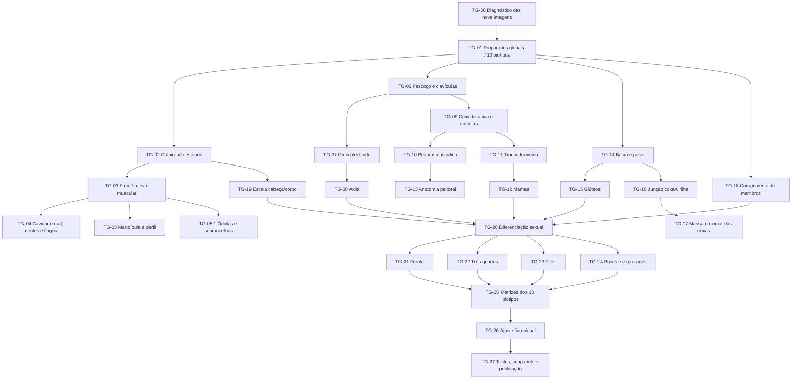

# GeoMannequin — task graph de reconstrução anatômica (09/11/2026)

**Escopo:** 9 imagens de referência de defeitos em crânio/mandíbula/boca,
olhos e sobrancelhas, clavícula/pescoço, ombro/deltoide/axila,
peitoral/mama, dorso/escápula, pelve/glúteo/coxa; masculino e feminino,
cinco biotipos cada. Esta rodada implementa mudanças no motor do
manequim **sem substituir o sistema procedural existente**.

## Grafo de dependências



## Diagnóstico dos prints

| Print | Região indicada | Falha / hipótese de causa |
| --- | --- | --- |
| 1, 5 e 6 | Ombro e axila | Descontinuidade na seção do deltoide (v=0), acoplamento da axila e marcações musculares excessivas |
| 2 | Glúteo, virilha, coxa | Linha glútea angular e fechamento abrupto no topo da coxa |
| 3 e 4 | Peitoral/seios, axila | Projeções mamárias quase esféricas, peitoral masculino sobreposto ao feminino |
| 7 | Clavícula e pescoço | Traçados duros, comprimento cervical dependente do preset de rosto |
| 8 | Crânio | Secção demasiado esférica no vértex e planos temporais |
| 9 | Boca/mandíbula | Fenda oral fixa, mandíbula lateral pouco identificável, ausência de dentes e língua |

As imagens demonstram os problemas visuais; causas geométricas foram conferidas
nos arquivos do motor. Os traçados continuam **representações esquemáticas para
artistas**, não anatomia médica certificada.

## Progresso tarefa a tarefa

| ID | Solução aplicada | Principal arquivo | Estado |
| --- | --- | --- | --- |
| TG-00 | Identificar regiões e causas no motor | Prints + auditoria de `engine/` | Concluído |
| TG-01 | Proporções de cabeça, pescoço, braços e pernas por sexo/biotipo | `scene/biotipos.js` | Implementado |
| TG-02 | Parietal, temporal, testa e occipital com perfil não esférico | `engine/cabeca.js` | Implementado |
| TG-03 | Zigomático, masseter, pálpebras e outros relevos funcionais | `engine/cabeca.js`, `atlas/rosto.js` | Implementado (esquemático) |
| TG-04 | Abertura oral gradual, cavidade escura, incisivos/caninos e língua | `engine/desenho.js` | Implementado como projeções; malhas internas 3D pendentes |
| TG-05 | Traçado contínuo do ângulo mandibular ao queixo | `engine/desenho.js` | Implementado |
| TG-05.1 | Orbicular dos olhos, pregas por expressão, músculos do supercílio | `cabeca.js`, `atlas/rosto.js`, `desenho.js` | Implementado |
| TG-06 | Pescoço por perfil; clavícula em arco mais suave; preservar comprimento após troca de rosto | `biotipos.js`, `poses.js`, `ui/controles.js`, `desenho.js` | Implementado |
| TG-07 | Remover salto no raio do deltoide e recalibrar distância acromial | `engine/bracos.js`, `corpo.js` | Implementado |
| TG-08 | Afinar/suavizar bandas entre peitoral/dorsal e braço | `engine/desenho.js` | Implementado |
| TG-09 | Suavizar intensidade de costelas, coluna e linhas musculares segundo gordura/massa | `desenho.js`, `atlas/tronco.js` | Implementado |
| TG-10 | Preservar peitoral masculino com relevo da musculatura | `musculos.js` | Implementado |
| TG-11 | Abertura progressiva da silhueta feminina no quadril e no tórax | `corpo.js`, `tronco.js` | Implementado |
| TG-12 | Mamas aderidas ao tórax, prolongamento axilar e sulco inframamário suave | `tronco.js`, `atlas/tronco.js` | Implementado (simplificado) |
| TG-13 | Não sobrepor o peitoral masculino às mamas femininas | `musculos.js`, `atlas/tronco.js` | Implementado |
| TG-14 | Curva contínua cintura–crista ilíaca–pelve, por sexo e massa | `corpo.js` | Implementado |
| TG-15 | Glúteo médio, glúteo máximo e linhas de contorno lateral mais arredondadas | `tronco.js`, `desenho.js` | Implementado |
| TG-16 | Integrar virilha, bacia e cabeça femoral sem degraus grosseiros | `corpo.js`, `pernas.js` | Implementado |
| TG-17 | Alargar levemente a parte proximal da coxa e suavizar conexão com a pelve | `pernas.js` | Implementado |
| TG-18 | Braços e pernas com comprimentos/espessuras próprios por biotipo | `biotipos.js`, `bracos.js`, `pernas.js` | Implementado |
| TG-19 | Escala suave da cabeça (aprox. 0,95–1,02×), ancorada na região cervical | `biotipos.js`, `cabeca.js` | Implementado |
| TG-20 | Diferenciação masculina/feminina, inclusive músculos faciais e maxilar | `biotipos.js`, `cabeca.js`, `corpo.js` | Implementado |
| TG-21 | Testes de frente (10 perfis) | Renderizador original | Execução amostral concluída |
| TG-22 | Testes em 3/4 com pose e expressão | Renderizador original | Execução amostral concluída |
| TG-23 | Testes em perfil com mandíbula aberta | Renderizador original | Execução amostral concluída |
| TG-24 | Pose de braço erguido, flexão e expressões | Renderizador original | Execução amostral concluída |
| TG-25 | Matriz corporal 900 + matriz facial 300 SVG | `testes/matriz-anatomica.mjs`, `testes/matriz-facial.mjs` | Preparadas; não executadas integralmente |
| TG-26 | Revisão estética humana das imagens renderizadas | Relatórios / SVG | Pendente |
| TG-27 | Testes de geometria + exportação + atualização deliberada de snapshots | `testes/anatomia-integral.mjs`, `package.json` | Geometria passou; suíte completa/snapshots pendentes |

## Validação efetivamente executada nesta rodada

- **10/10 biotipos:** malha craniana, mandíbula, musculatura esquemática,
  simetria geométrica do ombro/quadril, coxa superior, mama e invalidação de cache
  passaram nos testes V8 usando as funções reais (demais construtores de peças
  substituídos por objetos simples exclusivamente na auditoria do cache).
- **14 renders SVG do motor original**: 10 frontais (5 masculinos + 5 femininos)
  com sorriso e boca aberta, 2 de três quartos no écorché com pose, 2 de
  perfil no écorché. Não ocorreram NaN, Infinity, undefined nem falhas.
- Estão prontas as matrizes de **900 cenários corporais** e **300 cenários
  faciais** (incluindo sorriso, boca aberta, surpresa e olhos contraídos).
- Não foi possível executar as 1.200 renderizações nem inspecionar todas
  visualmente: o GitHub Actions não forneceu runner na tentativa anterior
  (0 ms de processamento). O workflow permanece manual.
- **Não regravar `testes/referencia.json` sem comparar visualmente** os
  resultados com as referências antigas. O arquivo único `dist/` precisa
  ser reconstruído separadamente; GitHub Pages importa os módulos `src/`.

## Próximas validações necessárias para aceite visual integral

1. Inspecionar fisicamente no navegador os prints novos dos dez corpos e as
   regiões marcadas, no modo manequim, construção e écorché.
2. Rodar `npm run testar:anatomia` com Node e `npm run testar:face`
   (300 SVGs) junto de `npm run testar:matriz` (900 SVGs).
3. Verificar se a simetria observada na pose neutra persiste após rotações,
   contrações faciais, braços cruzados, agachamentos e sentados.
4. Desenvolver cavidade oral real com malhas internas e articulação dentária,
   se exigida fidelidade 3D para radiografia/close de perfil.
5. Regravar snapshots somente após revisão, executar a suíte Node completa,
   reconstruir `dist/geomannequin.html` e testar o pacote MCP.

## Comandos para executar localmente

```bash
cd geomannequin
npm ci
npm ci --prefix mcp
npm run testar:anatomia
npm run testar:face:rapida
npm run testar:face
npm run testar:matriz
# Rever os SVGs em testes/saida/face e testes/saida/biotipos
node testes/cenas.mjs --gravar  # APENAS após a revisão estética
npm run testar
npm run construir
npm run build --prefix mcp
```
