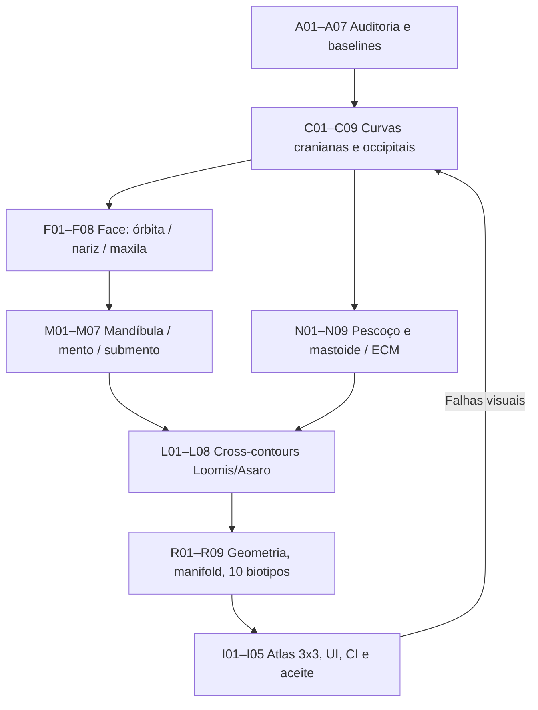

# TASK GRAPH EXECUTÁVEL — RECONSTRUÇÃO ANATÔMICA CABEÇA V3
**Data:** 10/11/2026  
**Projeto:** GeoMannequin (`geomannequin/`)  
**Versão-alvo:** `headModel="v3_microgeometry"` (V1/V2 intocadas)  
**Referências:** oito imagens do usuário mostrando testa abaulada, constrição temporal, linha reta occipital/cervical, nariz/olhos afundados, boca protuberante e pescoço largo.  
**Objetivo:** reconstruir a cabeça a partir de microformas 2D sobrepostas, fundidas na malha 3D. Loomis e Asaro são marcos de orientação de desenho, não sólidos adicionais no modelo final.

## Definição de pronto

A única malha da cabeça deve possuir:
- topo craniano oval/achatado nas laterais, sem balão ou concavidade artificial acima das orelhas;
- testa relativamente reta em perfil e temporal ridge projetada na sua transição lateral;
- brow ridge, glabela, órbita rasa e prisma nasal proporcionais, sem buraco no perfil;
- zigomas e maxila de curvatura convexa moderada; boca sem bico;
- gônio, corpo da mandíbula, mento plano e submento legíveis;
- occipital posterior curvando-se para dentro até a região mastoide; inserção do pescoço **dentro** da caixa craniana, não uma tampa reta na superfície;
- pescoço mais estreito que mandíbula e bochechas; inclinação cervical com ECM bilaterais e trapézios coerentes;
- paralelos, meridianos e curvas Loomis/Asaro projetados em pontos da superfície 3D;
- vistas frontal, ambos perfis, 3/4, costas, superior e inferior consistentes;
- V1/V2 e exportação OBJ continuam operacionais.

## DAG de execução



## Inventário de tarefas com dependências, arquivos e testes

**Legenda:** ✅ implementação codificada; ◐ parcial / precisa revisão; ☐ pendente de validação objetiva.

### A — Auditoria, referências e condições iniciais

| ID | Estado | Depende | Execução / arquivo | Evidência exigida |
|---|---|---|---|---|
| A01 | ✅ | — | Inspecionar `src/engine/head-v3/anatomy.js` e fotos | Localizar afunilamento e balão |
| A02 | ✅ | A01 | Verificar `head-v3/microfields.js` | Detectar excesso de órbita/nariz |
| A03 | ✅ | A01 | Inspecionar `src/engine/corpo.js` e `tronco.js` | Detectar topo cervical posterior exposto |
| A04 | ✅ | A02 | Inspecionar `head-v3/index.js` | Seções, malha e microformas separadas |
| A05 | ✅ | A03 | Inspecionar `src/engine/desenho.js` | Rotas de curva, `L.rings`, `L.anat` |
| A06 | ◐ | A01–A05 | Criar baselines de frente/perfil/3/4/trás | Imagens pareadas antes/depois |
| A07 | ◐ | A06 | Medições de referência e landmarks | Faixas proporcionais orientativas, não métricas antropométricas universais |

### C — Calota craniana, plano lateral e occipital

| ID | Estado | Depende | Execução / arquivo | Critério |
|---|---|---|---|---|
| C01 | ✅ | A04 | Definir `WIDTH_V3` independente da profundidade | Crânio não depende de esfera única |
| C02 | ✅ | C01 | Interpolação cúbica monotônica `spline()` | Sem overshoot ou espinhos |
| C03 | ✅ | C02 | Alargar temporal progressivamente | `W(.60)/W(.33) > 0.91` |
| C04 | ✅ | C02 | `FRONT_V3` ajustado à testa reta | `|F(.33)-F(.46)| < 0.055` |
| C05 | ✅ | C02 | `BACK_V3` com occipital contínuo | `B(.40)<B(.67)<B(.83)` |
| C06 | ✅ | C03 | Plano temporal bilateral com tampa Hermite suave | Tangência lateral sem faces flutuantes |
| C07 | ✅ | C05 | Forma inferior em progressão posterior/anterior | Não há corte abrupto na seção sagital |
| C08 | ◐ | C04–C07 | Ajustar crânio com referência visual direta | Não parecer balão nos 8 ângulos |
| C09 | ◐ | C08 | Refinar variantes de biotipo e largura craniana | Respeitar dimorfismo e parâmetros sem deformar |

### F — Testa, órbitas, zigoma, nariz e maxila

| ID | Estado | Depende | Execução / arquivo | Critério |
|---|---|---|---|---|
| F01 | ✅ | C04 | Reduzir microrelevo da testa | Sem saliência frontal esférica |
| F02 | ✅ | F01 | Reduzir profundidade negativa orbital | Depressão orbital localizada |
| F03 | ✅ | F02 | Moderar arco superciliar | Brow à frente do centro da órbita |
| F04 | ✅ | F02 | Reequilibrar glabela, raiz e dorso do nariz | Nariz conectado ao plano frontal |
| F05 | ✅ | F04 | Limitar ponta nasal / asa nasal | Projeção não cônica exagerada |
| F06 | ✅ | F03 | Redistribuir planos zigomáticos e masseter | Zona malar não cria bico lateral |
| F07 | ✅ | F05–F06 | Construir cilindro bucal suave e maxila | Perfil maxilar convexo sem protusão |
| F08 | ◐ | F02–F07 | Comparar perfil e ângulos de nariz/órbita/maçã | Revisão estética usando atlas SVG |

### M — Mandíbula, gônio, mento e submento

| ID | Estado | Depende | Execução / arquivo | Critério |
|---|---|---|---|---|
| M01 | ✅ | F07 | Redistribuir larguras mandibulares de `.70..1` | Sem mandíbula em funil |
| M02 | ✅ | M01 | Controlar mento inferior achatado | Largura `W(1)>0` (não ponta aguda) |
| M03 | ✅ | M02 | Ajustar volume do queixo e lábios | Boca não avança muito além do mento |
| M04 | ✅ | M03 | Adicionar `submento` na fusão de campos | Transição queixo/garganta menos convexa |
| M05 | ✅ | M01 | Reprojetar linha óssea gônio → mento | Landmark acompanha a malha |
| M06 | ◐ | M05 | Refinar ramo mandibular real sob a orelha | Perfil/3/4 mostram ângulo mandibular |
| M07 | ◐ | M03–M06 | Reavaliar mandíbula aberta e expressões | Occipital permanece imóvel e sem cortes |

### N — Pescoço, mastoide, ECM e trapézio

| ID | Estado | Depende | Execução / arquivo | Critério |
|---|---|---|---|---|
| N01 | ✅ | C05 | Reduzir largura efetiva `bodyEff().neck` só na V3 | Pescoço < mandíbula |
| N02 | ✅ | N01 | Limitar o pescoço pela largura mandibular editável | `neckHalf < jawHalf*.90` |
| N03 | ✅ | N02 | Deslocar centro cervical superior para anterior | `bustZc(F.yTop)>0` na V3 |
| N04 | ✅ | N03 | Enterrar topo cervical sob a calota | `neckBack > headBack+.08` |
| N05 | ✅ | N04 | Mantê-lo inclinado à frente em perfil | Centro superior mais anterior que base |
| N06 | ✅ | N05 | Ancorar ECM no mastoide derivado da orelha V3 | Linha move-se com o rig da cabeça |
| N07 | ◐ | N06 | Refinar trapézio nos dois lados do busto | Convergência no ombro, sem poste |
| N08 | ◐ | N04–N07 | Inspecionar seam occipital/pescoço em rotação | Nenhuma tampa reta exposta |
| N09 | ◐ | N08 | Rodar poses extremas do pescoço e corpo deitado | Sem desencaixe visual |

### L — Cross-contours e landmarks Loomis / Asaro

| ID | Estado | Depende | Execução / arquivo | Critério |
|---|---|---|---|---|
| L01 | ✅ | C06 | Criar `head-v3/landmarks.js` | 17 landmarks iniciais 3D finitos |
| L02 | ✅ | L01 | Linha temporal bilateral | `temporal-ridge` na superfície |
| L03 | ✅ | L01 | Linha supraorbital bilateral | `brow-ridge` na superfície |
| L04 | ✅ | L03 | Linha zigomática bilateral | `zygomatic` na superfície |
| L05 | ✅ | M05 | Gônio e corpo da mandíbula | `mandibular-angle` na superfície |
| L06 | ✅ | C07,N06 | Mastoide e linha nucal posterior | `mastoid`, `nuchal-ridge` |
| L07 | ✅ | L02–L06 | Reprojeção no SVG `src/engine/desenho.js` | Guias acompanham malha real |
| L08 | ◐ | L07 | Revisar oclusão e densidade gráfica | Nada cruzando áreas invisíveis sem estilo correto |

### R — Provas geométricas e regressão

| ID | Estado | Depende | Execução / arquivo | Critério |
|---|---|---|---|---|
| R01 | ✅ | C02 | Teste de seções com interpolação monótona | Derivadas sem espinhos |
| R02 | ✅ | C03–C05 | Teste de testa, temporal e occipital | Limites numéricos explícitos |
| R03 | ✅ | F02–F07 | Teste de brow/orbita/nariz/maxila | Relações de profundidade |
| R04 | ✅ | N01–N04 | Teste de encaixe da nuca nos 10 biotipos | Pescoço interno ao crânio na junção |
| R05 | ✅ | L01–L07 | Teste de guias 3D e simetria | Sem `NaN`, lados espelhados |
| R06 | ✅ | M07 | Teste de occipital estável com boca aberta | Posterior sem deslocamento |
| R07 | ✅ | C09 | Teste de três LOD × 10 biotipos | 30 malhas sem degeneração |
| R08 | ✅ | R07 | Teste OBJ `meshTopologyV3` | 0 bordas abertas/arestas não-manifold |
| R09 | ☐ | R01–R08 | Executar Node real e regressão V1/V2 | Suíte verde verificada pelo CI |

### I — Qualidade visual, integração e entrega

| ID | Estado | Depende | Execução / arquivo | Critério |
|---|---|---|---|---|
| I01 | ✅ | L07 | Script atlas 3×3 com cabeça **e pescoço** | 9 SVGs no mesmo modelo/pose |
| I02 | ◐ | I01,R09 | Gerar masculino/feminino e revisar pares | 18 vistas com silhuetas coerentes |
| I03 | ☐ | I02 | Comparação direta com oito anexos do usuário | Aprovação humana de frente/perfil/3/4/trás |
| I04 | ☐ | R09,I03 | Build modular + bundle HTML único | Página e `dist` atualizados |
| I05 | ☐ | I04 | Publicar e verificar versão real no GitHub Pages | Site renderizado e aprovado |

## Matemática de reconstrução

Use `v=(1-y)/(1-chinY)`, de 0 (vértice) até 1 (mento). A seção independente é:

```text
W(v) = PCHIP(WIDTH_V3, v) * skullScale * jawScale(v)
F(v) = PCHIP(FRONT_V3, v) * headScale + relevoFrontal
B(v) = PCHIP(BACK_V3, v) * cranialDepth + relevoOccipital

x = W(v) * lateralHermite(sin θ)
z = (F+B)/2 + (F-B)/2 * sign(cos θ) * |cos θ|^0.77
    + wFront(θ) * clamp(microFront,-0.085,0.23)
    + wBack(θ) * microBack
```

- **Lateral Hermite:** em `|sin θ| > 0.87`, move suavemente para seção de até 96,2% da meia-largura, simulando corte temporal sem aresta abrupta.
- **Microcampos:** pequenas elipses 2D normalizadas e fundidas por convolução gaussiana no atlas UV; nunca desenhadas como sólidos obrigatórios.
- **Encaixe cervical:** em `y=F.yTop`, exigir `zNeckRear > zHeadRear + 0.08 R`; assim a extremidade superior do pescoço fica coberta pela cabeça.
- **Relação transversal:** `neckHalf < 0.90*jawHalf` na seção mandibular de referência.
- **Linha Asaro:** cada amostra é `pointV3(yAt(v), θ, p, S)`, com transformações do rig da cabeça. É linha construtiva, não borda de uma peça independente.

## Dependências principais

```text
src/engine/head-v3/anatomy.js        # Largura/calota/testa/occipital
src/engine/head-v3/microfields.js     # Órbita/nariz/zigoma/boca/mento/submento
src/engine/head-v3/index.js          # Fusão final, achatamento Hermite, landmarks
src/engine/head-v3/landmarks.js       # Temporal, brow, zigoma, gônio e nuca
src/engine/corpo.js                  # Pescoço mais estreito e topo oculto
src/engine/desenho.js                # Loomis/Asaro e mastoide-ECM no renderer
testes/cabeca-v3-correcao-anatomica.mjs
testes/atlas-cabeca-v3-reconstrucao.mjs
```

## Comandos de aceite

```bash
cd geomannequin
npm run testar:cabeca-v3-anatomia
npm run testar:cabeca-v3
npm run testar:cabeca-v2
npm run construir
node testes/atlas-cabeca-v3-reconstrucao.mjs masculino medio
node testes/atlas-cabeca-v3-reconstrucao.mjs feminino medio
```

Os arquivos de comparação ficam em `testes/saida/cabeca-v3-reconstrucao/`. Para visualizar, abrir o SVG gerado e comparar lado a lado às imagens anexadas.

**Limitações expressas:** geometria sólida fechada + guias posicionadas não comprovam fidelidade anatômica profissional, precisão clínica nem topologia facial adequada a animação. O pescoço é uma malha de tronco sobreposta sob o crânio, não uma fusão manifold cabeça+pescoço; a correção atual esconde o bordo superior mediante interpenetração intencional e limita proporções. O nó I03 precisa de inspeção visual antes de aprovação final.
